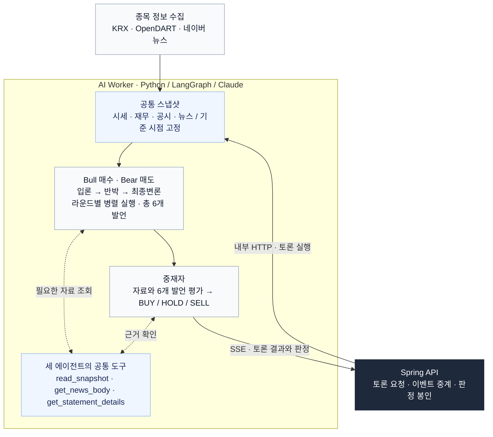

# 불앤베어 (가칭)

매수·매도 AI 에이전트의 토론을 보고 사용자가 먼저 판정하고, AI 중재자 판정과 실제 주가로
채점받으며 투자 근거 읽는 법을 배우는 모의투자 교육 서비스. 졸업 전시 팀 프로젝트 (2026-10-19 ~ 11-30).

> AI가 정답을 알려 주는 서비스가 아니라, **AI 토론을 심판하면서 투자 근거를 읽는 눈을 기르는 서비스.**
> 뒤에는 "AI 여럿이 토론하면 AI 하나보다 판단이 나은가?"를 실제 데이터로 재는 실험이 있다 (`docs/experiment.md`).
> AI 적중률을 자랑하지 않는다. 단기 주가는 원래 맞히기 어렵고, 우리가 보여주는 건 근거를 따지는 경험과 정직한 측정이다.

## 구조

```
브라우저 (web/, React)
  │ HTTP + SSE
  ▼
Spring API 서버 (api/) ── PostgreSQL (사용자·판정 봉인·채점·이벤트)
  │ 내부 HTTP + SSE
  ▼
Python AI 워커 (ai-worker/) ── KRX OpenAPI, OpenDART, 네이버 뉴스, Claude API
  └─ 영속 데이터: HTTP SQLite·스냅샷·감사·선택적 비용 장부
```

| 폴더 | 내용 | 담당 |
|---|---|---|
| `api/` | Spring Boot: 사용자, 판정 봉인·공개, 채점, 전향 운용, SSE 중계 | ricky00-dev |
| `web/` | React + Vite + TypeScript, Tailwind, TanStack Query, SSE 수신 | ricky00-dev |
| `ai-worker/` | 고정 스냅샷, 3라운드 토론·중재자 판정, 단일 분석, HTTP/SSE | jangwonii |
| `docs/worker-api.md` | Spring ↔ 워커 API 계약 | 공동 |

각 폴더의 README에 실행 방법이 있다. 브라우저는 Spring만 호출하며, AI 판정은 사용자가 판정을 제출한 뒤 공개한다.

### AI Worker 아키텍처

**같은 자료, 다른 관점.** 기준 시점이 고정된 스냅샷으로 매수·매도가 토론하고, 중재자가 근거를 평가합니다.



- **공통 입력:** 양측은 같은 스냅샷을 사용하고, 반박·최종변론에서는 이전 라운드의 양쪽 발언을 읽습니다.
- **도구 호출:** 필요한 자료를 조회한 뒤 결과를 반영해 발언하거나 판정합니다. 뉴스 외부 본문 조회는 설정과 실행 조건에 따라 제한됩니다.
- **판정 공개:** 워커는 Spring에 판정을 반환합니다. Spring은 사용자 판정 제출 전까지 이를 브라우저에 공개하지 않습니다.

라운드별 실행 흐름과 도구별 조회 범위는 [워커 아키텍처](ai-worker/README.md#ai-worker-아키텍처)를 참고하세요.

## 문서

- [문서 안내](docs/README.md): 실행·계약·운영·실험·평가 기록의 읽는 순서
- [워커 README](ai-worker/README.md): 현재 기능·실행 방법·운영 시 주의사항
- [워커 운영 안내](docs/WORKER-OPERATIONS.md): 인증, 동시 실행, 영속 비용 장부, 복구 범위
- [로드맵](docs/ROADMAP.md), [작업 로그](docs/WORKLOG.md): 팀 일정·결정과 작업 이력

## 협업 규칙

브랜치

- `main`: 최종 제출·전시 버전. 마감 시점에 `develop`에서만 합친다.
- `develop`: 통합 브랜치 (기본 브랜치). 모든 PR은 여기로.
- 작업 브랜치: `develop`에서 따서 `feat/…`, `fix/…`, `docs/…`, `chore/…` 로 이름 짓는다. 예: `feat/api-debate-relay`.

흐름

1. `git switch develop && git pull` 후 작업 브랜치 생성
2. 작업, 커밋, 푸시
3. `develop`으로 PR → 리뷰 1명 승인 → 머지 (squash 권장)
4. 머지된 작업 브랜치는 삭제

기타

- 워커 API를 바꿀 때는 `docs/worker-api.md`를 먼저 고치는 PR을 올리고 양쪽 담당자가 승인한다.
- `.env`, 데이터 파일은 커밋하지 않는다. 키는 레포 밖에서 공유한다.
