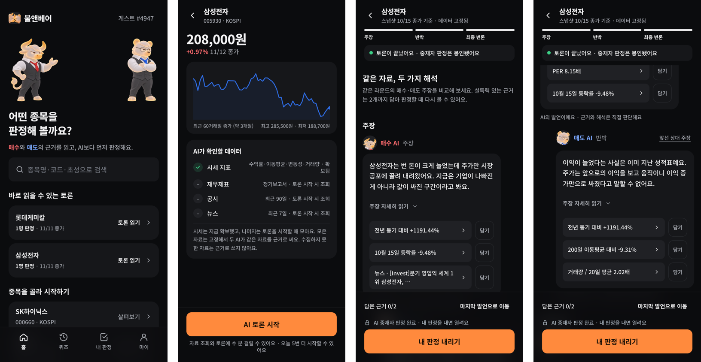
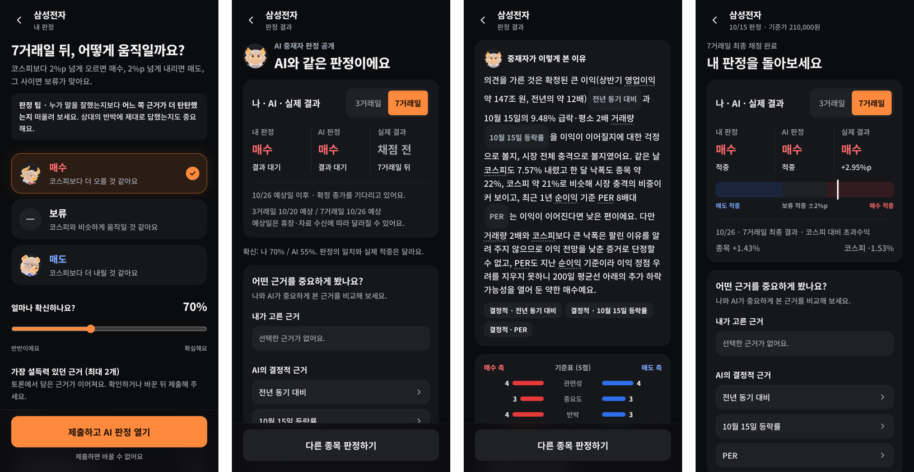
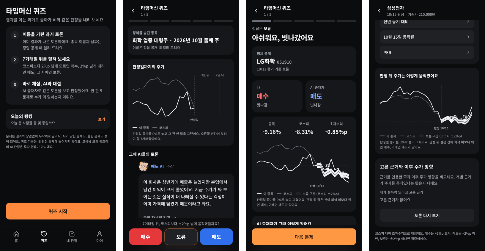
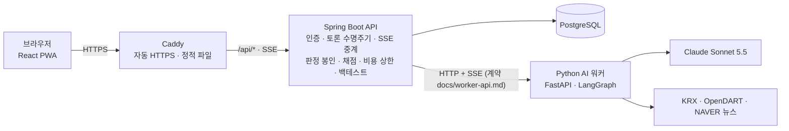
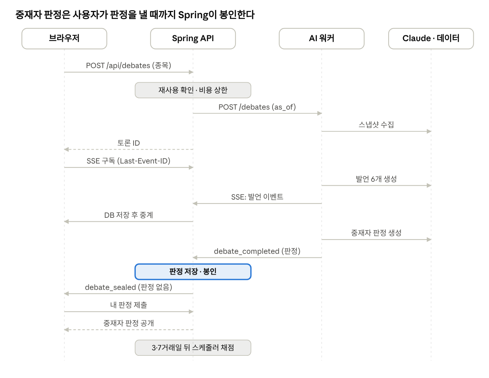
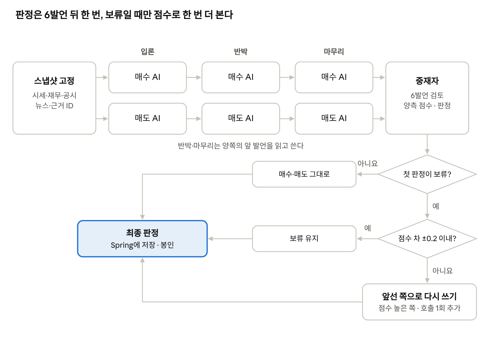

# 불앤베어 (Bull & Bear)

**AI가 토론하고, 당신이 판정합니다.**

같은 종목·같은 데이터를 두고 매수 AI와 매도 AI가 3라운드 토론을 합니다. 사용자는 AI 중재자의 판정을 보기 전에 먼저 매수·보류·매도를 고르고(판정 봉인), 3·7거래일 뒤 실제 주가로 사용자와 AI가 같은 규칙으로 채점됩니다.
AI가 정답을 알려 주는 서비스가 아니라, **양쪽 근거를 읽고 스스로 판단하는 눈을 기르는 모의투자 교육 서비스**입니다.

단국대학교 SW융합대학 졸업작품 (2026) · 팀 불앤베어

| | |
|---|---|
| 서비스 | https://54-253-242-203.sslip.io |
| 시연 영상 | (업로드 후 추가) |
| 결과보고서 | (제출본 추가 예정) |




## 핵심 흐름

1. **종목 검색**: 코스피 보통주를 이름·코드·초성으로 찾습니다.
2. **AI 토론 시청**: 매수·매도 AI가 같은 스냅샷(시세·재무·공시·뉴스)을 근거로 입론·반박·마무리 6발언을 합니다. 발언은 SSE로 실시간 도착하고, 숫자마다 근거 칩을 눌러 원자료를 볼 수 있습니다.
3. **내 판정 (봉인)**: 매수·보류·매도와 확신도, 설득된 근거 2개를 고릅니다. 그 전까지 AI 중재자 판정은 서버가 봉인합니다.
4. **AI 판정 공개**: 제출하는 순간 중재자 판정과 이유, 다른 사용자 분포가 열립니다.
5. **채점**: 3·7거래일 뒤 종가의 코스피 대비 초과수익률로 채점합니다. +2%p 초과면 매수, −2%p 미만이면 매도, 그 사이면 보류가 정답입니다.

전시용으로 **타임머신 퀴즈**(결과가 이미 나온 과거 토론 5문제), 랭킹, 전시장 화면(QR), AI 성적표, 관리자 화면이 있습니다.



## 아키텍처



- 브라우저는 Spring만 호출합니다. Spring이 워커 이벤트를 모두 저장한 뒤 중계하고, 중재자 판정이 담긴 이벤트는 저장만 하고 봉인합니다.
- 같은 종목·같은 데이터 기준일의 토론은 재사용해 비용이 0입니다. 사용자당 하루 5회, 출처별 하루 비용 상한을 둡니다.
- AWS EC2 한 대에 Docker Compose(web·api·postgres·worker)로 배포합니다.



### 토론 엔진



- 스냅샷의 모든 수치는 `PX.CLOSE`, `FIN.2026H1.REVENUE_YOY`, `VAL.PER_TTM` 같은 근거 ID를 가집니다.
- 토론자 6회 요청은 공통 규칙·도구·스냅샷을 앞에 똑같이 두어 프롬프트 캐시를 함께 씁니다. 토론 1건 평균 **$0.28, 약 2분**.
- 중재자의 첫 판정이 보류면 양측 점수 차로 다시 봅니다(±0.2 안이면 보류 유지).

## 실험: 토론 AI는 혼자 판단한 AI보다 나은가

모델 지식 기준일 이후의 과거 날짜(2026-09 ~ 11)로 토론을 재구성하는 백테스트를 했습니다. 대형주 10종목 × 8주 + 시범 5건 = **토론 85건**, 같은 스냅샷의 단일 AI 판정 73건.

| 조건 | 7거래일 적중률 | 3거래일 적중률 |
|---|---:|---:|
| 토론 + 중재자 (최종) | 47.1% | 30.6% |
| 중재자 첫 판정 (보류 재판정 전) | 15.3% | 31.8% |
| 단일 AI | 16.4% | 35.6% |
| 기준선: 항상 매도 | 44.7% | 31.8% |
| 기준선: 항상 보류 | 16.5% | 32.9% |

- 두 AI 모두 거의 항상 보류를 골랐습니다(중재자 첫 판정 96%, 단일 AI 99%).
- 7거래일의 차이는 토론 내용보다 **토론 점수로 방향을 정하는 규칙**에서 나왔고, "항상 매도" 기준선과는 오차(±11%p) 안입니다.
- 결론: 이 표본으로는 토론형 AI가 더 잘 맞힌다고 말할 수 없습니다. AI 판정을 그대로 믿지 말고 근거를 직접 판단하자는 서비스 방향과 맞는 결과입니다. 자세한 설계와 한계는 [docs/experiment.md](docs/experiment.md)와 결과보고서에 있습니다.

## 기술 스택

| 영역 | 사용 |
|---|---|
| 웹 | React 19, Vite, TypeScript, Tailwind CSS 4, TanStack Query, PWA |
| API 서버 | Java 17, Spring Boot 4.1, Spring Data JPA, Flyway, PostgreSQL 16, SSE |
| AI 워커 | Python 3.12, FastAPI, LangGraph, Anthropic SDK (Claude Sonnet 5.5) |
| 데이터 | KRX OPEN API, OpenDART, NAVER 검색 API |
| 인프라 | AWS EC2, Docker Compose, Caddy (Let's Encrypt), GitHub Actions |

## 폴더

| 폴더 | 내용 |
|---|---|
| [`web/`](web) | React 웹앱 |
| [`api/`](api) | Spring Boot API 서버 (사용자, 판정 봉인·공개, 채점, 비용 상한, 백테스트, 관리자) |
| [`ai-worker/`](ai-worker) | AI 워커 (스냅샷, 토론·단일 판정, 중재자, HTTP/SSE) |
| [`deploy/`](deploy) | 운영 배포 (Compose, 백업, 백테스트 스크립트) |
| [`docs/`](docs) | 워커 계약, 아키텍처, 배포·운영, 실험 설계, 작업 로그 |

## 로컬 실행

필요한 것: JDK 17, Node 22, Python 3.12 + [uv](https://docs.astral.sh/uv/), Docker

```bash
docker compose up -d                 # PostgreSQL (포트 5433)
cd api && ./gradlew bootRun          # API :8080. 기본은 가짜 워커라 키 없이 전체 흐름을 볼 수 있음
cd web && npm ci && npm run dev      # 웹 :5173
```

실제 AI 토론까지 돌리려면 `ai-worker/.env`에 Anthropic·KRX·OpenDART·NAVER 키를 넣고 워커를 띄운 뒤, API를 `worker` 프로필로 실행합니다. 자세한 방법은 [ai-worker/README.md](ai-worker/README.md)에 있습니다.

```bash
cd ai-worker && uv sync && uv run uvicorn bullbear.server:app --port 8000 --workers 1
```

테스트: `cd api && ./gradlew test` (Docker 필요) · `cd ai-worker && uv run pytest` · `cd web && npm run lint`

운영 배포는 [docs/DEPLOY.md](docs/DEPLOY.md)를 참고하세요.

## 팀

| 이름 | 역할 |
|---|---|
| 조성빈 | 웹·API 서버·배포 |
| 이장원 | AI 워커 (토론 엔진·데이터) |
| 이용찬 | UI/UX |
| 송준서 | 디자인 |

> 교육용 모의 서비스입니다. AI 판정은 투자 권유가 아니며 실제 주문을 실행하지 않습니다.
