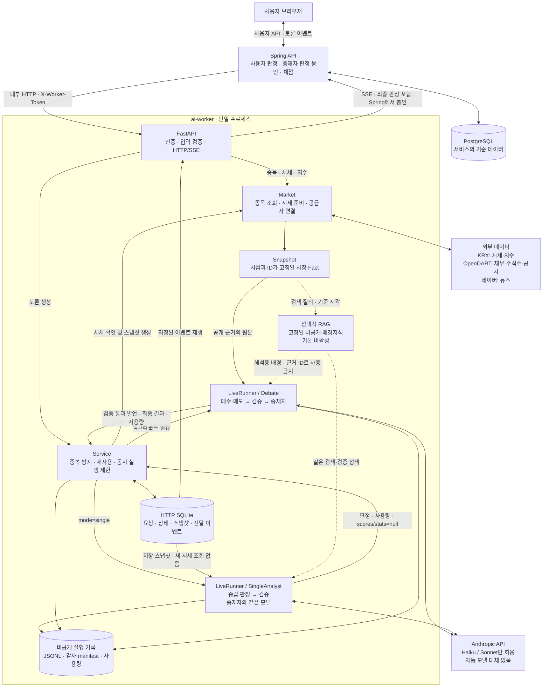
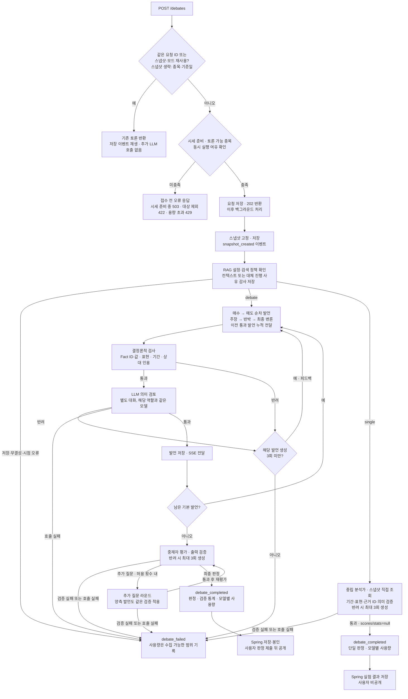
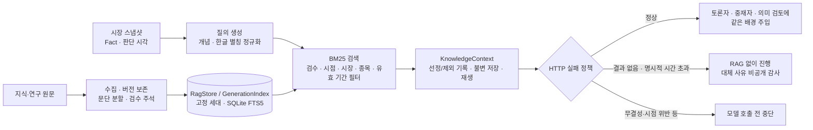

# 불앤베어 AI 워커

Spring API 서버가 호출하는 Python 서비스. API 계약은 [`../docs/worker-api.md`](../docs/worker-api.md).

매수 에이전트와 매도 에이전트가 실제 시장 데이터를 근거로 토론하고, 사용자가 먼저 판정한 뒤
AI 중재자의 판정과 실제 주가로 채점받으며 투자 근거 읽는 법을 배우는 모의투자 교육 서비스.

현재 단계: **CLI + HTTP/SSE 서버**. Spring·웹과 연결해 검색 → 토론 → 판정 봉인·공개 → 채점 예약을 실행한다.
HTTP는 계약 v0.6의 토론·단일 모드와 v0.5의 비동기 스냅샷 응답을 지원한다.

구조부터 보려면 [기능 아키텍처](#기능-아키텍처)의 전체 구성·토론 처리·RAG 다이어그램을 참고한다.

## 시작하기

```bash
brew install uv            # 또는 https://docs.astral.sh/uv/
cd ai-worker
uv sync                    # Python 3.12 + 의존성 설치
# 아래 데이터 소스 설정을 참고해 .env 생성 (기존 .env는 덮어쓰지 않음)

uv run bullbear universe           # 대상 30종목
uv run bullbear snapshot 삼성전자   # 데이터만 확인 (LLM 호출 없음)
uv run bullbear debate 005930      # 토론 → 내 판정 → 중재자 판정 공개
uv run bullbear replay <debate_id> # 기록 재생
uv run pytest                      # 테스트 (네트워크·API 키 불필요)
```

## Spring과 실제 워커 연결

`.env`에 API 키와 `WORKER_TOKEN`을 설정하고, 워커 폴더에서 실행한다. `.env`는 서버 시작 시 읽는다.

```bash
uv run uvicorn bullbear.server:app --host 127.0.0.1 --port 8000 --workers 1
```

별도 터미널에서 루트의 `docker compose up -d`로 PostgreSQL을 띄우고 Spring을 시작한다 (Java 17 이상).
PowerShell 예시:

```powershell
cd api
$env:WORKER_TOKEN = 'dev-worker-token' # 워커 .env와 동일한 값
./gradlew.bat bootRun --args='--spring.profiles.active=worker'
```

Linux/macOS: `WORKER_TOKEN=dev-worker-token ./gradlew bootRun --args='--spring.profiles.active=worker'`.
워커가 다른 호스트라면 `WORKER_BASE_URL`도 설정한다. 기존 `BULLBEAR_WORKER_MODE=http`,
`BULLBEAR_WORKER_BASE_URL`, `BULLBEAR_WORKER_TOKEN` 방식도 지원한다. 기본 프로필은 가짜 워커다.
운영 compose에서는 `WORKER_MODE=http`와 키를 지정하고 `--profile worker`로 기동한다.

- 인증: `/health`를 제외한 모든 엔드포인트에 `X-Worker-Token`이 필요하다. 운영에서는 임의의 긴 토큰을 쓴다.
- 토론: 시세를 확인한 뒤 `202`를 반환하고 스냅샷·LLM 작업은 별도 스레드에서 실행한다.
  처음 응답의 `snapshot_id`는 `null`일 수 있으며 `snapshot_created`에서 확정된다.
- 최초 시세 조회: 400일 이력은 백그라운드에서 준비하며, 같은 종목·기준일의 동시 요청은 수집 하나를 공유한다.
  시세 준비 완료를 최대 1초만 기다리고 아직 준비 중이면 `503 DATA_UNAVAILABLE`을 반환한다. 수집은 계속 진행하므로
  잠시 뒤 재시도한다. 이때 토론은 접수되지 않고 LLM도 호출하지 않는다. 시세 일부나 이전 기준일을 대신 쓰지 않는다.
- 재사용: 종목·확정 종가 날짜마다 처음 생성한 스냅샷과 토론을 고정해 재사용한다. 같은 날짜에 추가된 뉴스로
  재생성하지 않는 Spring 정책과 같다. 같은 `request_id`는 재시작 후에도 같은 토론을 반환한다.
  다른 본문으로 키를 재사용하면 409다. 실패한 토론을 새로 실행하려면 새 키를 쓴다.
- SSE: `Last-Event-ID` 이후 이벤트 재생, 10초 하트비트, 완료·실패 시 연결 종료.
  검증 실패 발언·원시 토큰·중간 중재자 평가를 내보내지 않는다. 검증 재시도가 소진되면 토론을 실패 처리한다.
- 저장: `BULLBEAR_DATA_DIR/http/worker.sqlite3`에 요청·스냅샷·공개 이벤트를 저장한다.
  기존 JSONL은 감사용으로 유지하며 SSE로 그대로 노출하지 않는다. 중재자 최종 판정은 Spring이 봉인한다.
- 재시작: 완료 이벤트는 그대로 재생하고, 중단된 토론에는 `debate_failed`를 기록한다. 유료 호출을 자동 재실행하지 않는다.
  재시작으로 중단된 호출의 정확한 사용량은 복구할 수 없으므로 Spring 추정 비용이 적용된다.
- 동시 실행: `WORKER_MAX_CONCURRENT` 기본 2. 용량 초과는 429 + `Retry-After: 5`.
  데이터 디렉터리당 **프로세스 하나**만 허용한다. 다중 Uvicorn worker/replica는 시작 시 차단한다.
  시세 준비는 별도 스레드 2개·실행 및 대기 작업 합계 최대 32개로 제한하며 종료 시 남은 KRX 날짜 수집을 중단한다.

HTTP·CLI 시세는 KRX 공식 OPEN API, 재무·발행주식수·공시는 OpenDART를 사용한다.
KST 15:40 이전 당일 값과 미래 날짜는 제외한다. 종목 화면·스냅샷은 같은 확정 일봉을 공유한다.
코스피·코스닥 지수도 KRX에서 가져온다. 네이버는 뉴스 검색 API만 사용하며, 시세 실패 시 네이버 차트로 대체하지 않는다.
검색은 기본 30종목 + 예시 우선주·ETF, DART 키가 있으면 상장회사 목록을 추가한다.
DART에 시장 구분이 없는 추가 종목은 `market: null`이며, 전체 ETF·우선주 목록은 제공하지 않는다.
현재 토론 허용 기준은 `UNIVERSE`의 대형주 30종목이다. 시장 전체의 시총·거래대금 필터는 아직 구현하지 않았다.

운영 HTTP와 Claude CLI는 **Haiku·Sonnet만 허용**한다. 기본 역할은 토론자
`claude-haiku-5-5`, 중재자 `claude-sonnet-5-5`로 기존 운영 compose와 일치한다.
`BULLBEAR_MODEL`은 공통 재정의, `BULLBEAR_DEBATER_MODEL`·`BULLBEAR_MODERATOR_MODEL`은
역할별 재정의다. 기존 Opus 설정은 호출 전에 거부한다. 서버 측 자동 모델 대체는 사용하지 않는다.
모델 ID가 계정에서 실제 사용 가능한지는 별도 확인해야 하며, 위 기본값만으로 접근을 보장하지 않는다.
실제 응답 모델별 입력·출력·캐시 읽기/생성 토큰을 합산한다.

유료 호출 없이 설정을 점검하려면 워커 폴더에서 실행한다:

```bash
uv run python -m bullbear.preflight --env-file /absolute/path/to/.env
```

키 값은 출력하지 않고 존재 여부만 표시한다. 필수 설정 누락·Opus 등 비허용 모델·개발 기본 토큰은
종료 코드 2로 알린다. 선택한 환경 파일은 해당 프로세스에서만 기존 환경값보다 우선한다.
이 점검은 네트워크를 사용하지 않으며 키 인증·모델 접근·RAG 원문 무결성·운영 준비 완료를 보증하지 않는다.
이전 OpenAI 비교 도구와 기록은 과거 실험 재현용으로 보존하며 운영 워커가 사용하지 않는다.

RAG는 기본 비활성이다. 활성화 시 명시적 세대가 필요하며 검색 결과 없음과 명시적 시간 초과만
배경 없이 진행한다. 무결성·시점·감사 저장 오류는 모델 호출 전에 중단한다. 대체 진행 사유는
비공개 감사에 저장하고 공개 HTTP/SSE 계약에는 추가하지 않는다.

## HTTP 통합 검증

`POST /debates`는 `mode`를 생략하면 기존 토론을 실행한다. `mode: "single"`은 저장된
`snapshot_id`가 필수이며, 현재 시장 데이터를 새로 조회하지 않는다.

```json
{"ticker":"005930","request_id":"single-example","mode":"single","snapshot_id":"저장된 스냅샷 ID"}
```

단일 분석가는 `BULLBEAR_MODERATOR_MODEL`과 같은 모델로 스냅샷을 직접 조회해 판정한다.
토론 내역·양측 점수는 입력하지 않으며, 같은 7거래일·코스피 대비 ±2%p 기준과 표현·근거·의미 검증을 적용한다.
SSE는 `snapshot_created → moderator_started → debate_completed` 또는 `debate_failed`다.
완료 응답의 `verdict.scores`·`stats`는 `null`, 발언 목록은 비어 있고 모델별 `usage`는 유지된다.

- 같은 스냅샷·같은 모드의 실행 중/완료 결과만 재사용한다. 실패 후 새 요청 ID는 다시 실행한다.
- 같은 요청 ID에 모드·스냅샷 등 다른 본문을 보내면 409, 없는 스냅샷은 404, 종목 불일치는 400이다.
- 토론 모드도 명시적 `snapshot_id`를 지원한다. 생략 시 기존 종목·기준일 재사용을 유지한다.
- 기존 SQLite는 시작 시 `mode=debate`로 이관되며 과거 요청 멱등 키도 유지한다.
- Spring의 단일 모드 운용 스위치는 별도다. 워커 구현만으로 운영 스위치를 활성화하지 않는다.

[단일 모드 검증 기록](docs/single-http-validation.md): 자동 테스트는 통과했다. 실제 Sonnet 실험 2건은
판정 검증에서 반려되어 실패 이벤트·사용량 기록까지 확인했으며, 실제 완료 판정과 Spring #23 연결은 미확인이다.

기본 `uv run pytest`는 외부 데이터·유료 LLM 호출 없이 서버와 토론 엔진을 검증한다.
실제 Spring/PostgreSQL까지 확인하려면 다음 테스트 전용 워커를 실행한다 (운영 진입점에는 테스트 모드가 없다).

```bash
uv run python -m tests.http_fixture --port 18000 --data data/integration-test
```

Spring을 별도 테스트 DB와 `WORKER_BASE_URL=http://127.0.0.1:18000`,
`WORKER_TOKEN=integration-test-token`, `worker` 프로필로 실행한 뒤:

```powershell
$env:BULLBEAR_TEST_API_URL = 'http://127.0.0.1:8080'
uv run pytest tests/test_spring_integration.py -q
```

실제 HTTP/SSE·DB 저장·판정 봉인·공개·채점 예약을 확인한다. 이 테스트는 게스트와 판정을 생성하므로 테스트 DB에서 실행한다.
외부 API 키와 실제 모델 응답 품질은 별도로 확인해야 한다.

## 기능 아키텍처

아래는 현재 코드의 **운영 HTTP 경로**다. 데이터 수집 → 고정 스냅샷 → 토론 또는 단일 판정·검증 →
이벤트 저장·전달을 워커가 맡는다. 사용자 계정·판정 저장·중재자 판정 봉인·3/7거래일 채점은 Spring의 책임이다.
그림은 구현 구조이며 실제 Claude 호출·운영 검증 완료를 뜻하지 않는다.

Mermaid가 표시되지 않는 뷰어에서는 렌더링된 PNG를 열 수 있다:
[전체 구성](docs/images/architecture-overview.png) ·
[토론 처리 흐름](docs/images/architecture-debate-flow.png) ·
[RAG 흐름](docs/images/architecture-rag-flow.png).
PNG는 현재 Mermaid 원본의 스냅샷이므로 다이어그램 수정 시 함께 다시 렌더링한다.

### 전체 구성과 책임 경계



- 브라우저는 워커에 직접 연결하지 않는다. 워커의 완료 응답에는 중재자 판정이 있으므로
  **Spring이 사용자 판정 전까지 이를 숨겨야 한다.** 워커 SQLite는 Spring PostgreSQL을 대체하지 않는다.
- 토론 작업 풀은 기본 2개, 시세 준비 작업 풀도 별도 2개다. 실행 중 토론 수와 시세 준비 대기열을 각각 제한한다.
- LLM의 도구는 `SnapshotTools`로 고정된 Fact를 조회한다. 토론 중 도구가 외부 시세·뉴스를 새로 수집하지 않는다.
- SSE는 검증을 통과한 발언을 전달한다. LLM 원시 토큰, 반려된 후보 본문, 비공개 RAG 원문은 전달하지 않는다.
  진행 상태와 반려 알림은 별도 이벤트이며, 최종 중재자 판정은 Spring까지만 전달한다.

### 토론 한 건의 처리 흐름



위 그림의 접수 단계는 개념적으로 묶었다. 실제로는 요청 ID를 먼저 확인하고 시세를 조회한 뒤,
명시적 스냅샷이면 시세 조회를 건너뛴다. DB 트랜잭션에서 요청 ID·스냅샷/모드 재사용과 실행 한도를 다시 확인한다. 같은 요청 ID에 다른 본문을
보내면 409다. 시세 준비 중 503이 나면 토론·LLM 작업은 시작되지 않지만 시세 수집은 계속된다.
추가 질문은 기본 최대 1회이며 요청의 `max_extra_rounds`로 제한한다. 발언 생성·파싱·도구 호출 중 오류도
성공으로 처리하지 않고 실패 경로로 보낸다. 의미 검토 통과는 사실·추론·투자 성과의 정확성 보장이 아니다.

### RAG: 공개 시장 근거와 비공개 배경지식 분리



RAG는 **기본 꺼짐**이며 활성화하려면 명시적인 검색 세대가 필요하다. 검색·감사 저장 실패도 모델 호출 전에 중단한다.
지식은 개념·조건·한계를 해석하는 배경이고, 공개 `evidence.source_id`는 스냅샷 Fact만 가리킨다.
HTTP의 대체 진행 정책과 달리 실험 benchmark는 RAG 조건 실패를 RAG 없는 조건으로 바꾸지 않는다.

### 코드와 저장소 대응

| 기능 | 주요 모듈 | 역할 |
|---|---|---|
| HTTP 진입점 | `server/app.py` | 인증, 엔드포인트, SSE 재생·하트비트 |
| HTTP 단일 판정 | `single.py` | 스냅샷 직접 조회, 중립 판정, 근거·표현·의미 검증 |
| 실행 관리 | `server/service.py` | 중복/재사용, 백그라운드 실행, 이벤트 선별, `LiveRunner` |
| 시장 데이터 | `server/market.py`, `data/` | 공급자·캐시 연결, 종목/시세/지수, 시세 준비 작업 풀 |
| 고정 근거 | `snapshot.py`, `tools.py` | Fact·파생 지표 고정, 스냅샷 조회 도구 |
| 토론·모델 | `debate.py`, `agents.py`, `prompts.py`, `llm.py` | 순차 토론, 누적 기록, 중재자, Claude 호출 |
| 검증 | `verifier.py`, `presentation.py`, `semantic.py` | 수치/ID·표현·인용 규칙, LLM 의미 검토 |
| RAG | `rag/ingest.py`, `store.py`, `index.py`, `retrieval.py`, `context.py`, `replay.py` | 수집·검수 이력, 검색, 배경 저장·재생 (`rag/` 하위 파일) |
| 전달 상태 | `server/store.py` | `data/http/worker.sqlite3`: 요청·토론 상태·스냅샷·SSE 이벤트 |
| 비공개 기록 | `events.py`, `audit.py` | `data/debates/*.jsonl`, `data/audits/<run_id>/manifest.json`: 시도·검증·사용량·실행 출처 |
| 별도 실행·평가 도구 | `cli.py`, `experiment.py`, `benchmark.py`, `budget.py` | CLI, 선공 비교, 단일/토론·RAG 비교, benchmark 예산 원장 |
| 비용 없는 점검 | `preflight.py`, `diagnostics.py` | 설정 검사, 저장된 benchmark 결과의 오프라인 진단·검수 목록 |

표의 `data/`는 기본 `BULLBEAR_DATA_DIR` 기준이다. RAG 저장은 `data/rag/` 아래 별도 원문·색인·컨텍스트로 관리한다.
실험/진단 도구는 운영 HTTP 요청에서 자동 실행되지 않는다. `budget.py`의 benchmark 예산 원장을
운영 HTTP의 강제 비용 상한으로 해석하면 안 된다. 운영 비용 제한은 현재 Spring 정책과 구분해야 한다.
CLI는 토론 엔진을 직접 호출하며 HTTP 요청 관리·SSE 경로를 거치지 않는다.

## 데이터 소스 메모

- 시세·지수는 KRX 공식 OPEN API. 기존 pykrx/네이버 차트 어댑터는 남겨 두지만 HTTP·CLI 기본 경로에서 사용하지 않는다.
  밸류에이션은 `snapshot.py`에서 시세 × DART 발행주식수, DART 재무로 계산하고 계산 입력을 `inputs`에 남긴다.
- KRX 원시 일봉은 기업행사 수정주가가 아니다. 액면분할·병합 등이 있으면 지표·수익률이 왜곡될 수 있으며
  현재는 스냅샷 경고로 알린다. 해당 종목을 정식 성과평가에 쓰기 전 기업행사 보정이 필요하다.
- PER은 당기순이익(연결, 비지배지분 포함) 기준이라 증권사 PER(지배주주 순이익)과 다를 수 있다.
- 시가총액은 보통주만 센다.
- 뉴스는 `NewsSource`로 따로 둔다. 네이버 검색 API로 최근 7일 기사 중 제목에 종목명이 있는 것만, 재전송 기사는 하나로 합쳐 최대 30건.
  스냅샷 생성 시각 이후 기사는 넣지 않는다. 본문은 가져오지 않는다 (저작권·약관).
- LG, SK처럼 이름이 짧은 종목은 관련 없는 기사가 섞인다. `naver_news.QUERY_OVERRIDES`로 보정한다.
- 새 공급자는 `MarketDataSource`를 구현하고 공통 진입점 `server/market.py`에서 연결한다.

### 데이터 소스 설정

`ai-worker/.env`에 다음 값을 설정한다. 비밀값은 커밋하지 않는다.

```dotenv
KRX_API_KEY=
OPENDART_API_KEY=
NAVER_CLIENT_ID=
NAVER_CLIENT_SECRET=
# OpenAI 실험용. 기존 HTTP 워커는 ANTHROPIC_API_KEY 사용.
OPENAI_API_KEY=
```

- 네이버 키는 **NAVER API HUB**에서 `NAVER 검색 > 뉴스`를 선택한 Application의 인증 정보다.
  기존 개발자센터 신규 발급은 종료됐다. 현재 코드는 HUB 주소와 `X-NCP-APIGW-API-KEY-ID/KEY` 헤더를 사용한다.
  [뉴스 API 공식 문서](https://api.ncloud-docs.com/docs/naver-api-hub-search-news).
- KRX 인증키와 별도로 유가증권/코스닥 일별매매정보, KOSPI/KOSDAQ 시리즈 일별시세정보 활용 승인이 필요하다.
  [공식 이용 절차](https://openapi.krx.co.kr/contents/OPP/INFO/OPPINFO003.jsp).
- KRX는 하루치 시장 전체를 반환한다. 날짜별 압축 캐시를 공유하며, 최근 7일과 빈 응답은 1시간 뒤 갱신한다.
  최초 400일 수집은 여러 분 걸릴 수 있다. **시연 전에 `uv run bullbear snapshot 삼성전자`로
  과거 시세 캐시를 준비하는 것을 권장한다.** HTTP 요청이 먼저 오면 백그라운드에서 준비하고 완료 전에는
  빠르게 503을 반환한다. 이는 수집 시간을 줄이는 기능이 아니므로 준비가 끝난 뒤 시연한다.
- 조회 간격은 최소 0.25초, 단일 조회 구간은 최대 800일로 제한한다. 오류 응답을 휴장일로 처리하지 않는다.
- KRX 키가 없으면 시세 조회가 실패한다. DART·뉴스 키가 없으면 해당 자료를 제외하고 스냅샷 경고를 남긴다.
- DART·뉴스의 HTTP/타임아웃·JSON 오류도 해당 자료를 제외하고 스냅샷 경고로 기록한다.
  OpenDART의 자료 없음(013) 응답은 저장하지 않으며, 이전 버전의 013 캐시도 무시해 새 보고서를 다시 확인한다.
- 기존 셸 환경변수가 `.env`보다 우선이다. 실험에서 파일을 명시적으로 우선하려면
  `uv run python -m bullbear.experiment --env-file .env --provider openai --model gpt-5-mini`를 사용한다.
- 2026-10-29: 사용자 인증키로 유가증권 일봉·KOSPI 지수 조회와 삼성전자 265거래일 수집을 확인했다.
  실제 키의 코스닥 시세·지수 권한은 별도 확인이 필요하다.

## 판단 기간과 개념·논리 검토

- `7d-concise-v4`: 판정 질문을 그대로 공유한다. HOLD는 자료 부족/애매함이 아니라
  7거래일 뒤 코스피와 비슷하게 움직여 상대수익이 −2%p~+2%p 안일 것이라는 예측이다.
- 주장 한 줄·한 문장, 본문 최대 3문장, 서로 다른 근거 최대 3개. 반박·마무리는
  양측의 이전 전체 토론에 없던 source_id를 최소 1개 인용하며 7거래일 안의 계기가 될
  뉴스·공시를 우선 조회한다. 새 근거가 전혀 없으면 발언을 지어내지 않고 중단한다.
- 1조 원 이상 금액은 사용자 글에서 조 원으로 표현한다. 도구의 display는 표현용이며
  evidence.value는 원 단위 그대로다. 중재자 글에서는 내부 ID·검증 통계·투자자별 권고를 제외한다.
- 중재자 [E1]은 decisive_evidence[0]에 대응한다(토론자 번호와 별도). 이유 최대 3문장,
  양측 평가 각 1문장. 표현 규칙 위반도 재작성 피드백으로 처리한다.
- 반박은 상대 발언에서 짧은 원문을 인용하고, 코드가 실제 반대편 주장·본문의 문구인지 확인한다.
  의미 검토에는 발언자·라운드·각 발언의 독립적인 근거 번호 대응표를 전달한다.

- `prompts.JUDGMENT_POLICY`를 양측·중재자·검토 역할이 공유한다. 주가 기준일 이후
  7거래일 코스피 대비 초과수익률 기준: BUY > +2%p, SELL < -2%p, HOLD는 경계 포함 사이 구간.
  서비스의 3거래일 채점은 보조 지표다. 장기 지표를 쓸 경우 이 기간과의 연결 및 한계를 설명한다.
- 기존 수치/ID 대조 → 판단 기간 명시·알려진 PER 역전 규칙 검사 → 별도 대화의 LLM 의미 검토 순서다.
  의미 검토는 개념 오류, 근거 없는 인과 단정, 기간 이탈, 모순을 원문 인용과 함께 반려한다.
- 발언과 중재자 판정은 최대 3회 생성한다. 끝까지 실패하거나 검토 호출이 실패하면
  미검증 발언/판정을 성공 처리하지 않고 토론을 중단한다. 기존 API 응답 형식은 바꾸지 않는다.
- 실험 보고서의 `policy_version`, `judgment_policy`, `semantic_reviews`에 기준과 검토 대상/결과를 저장한다.
  검토 호출 토큰도 해당 토론자/중재자 사용량에 포함된다. 별도 대화지만 같은 모델이므로
  독립적인 사실 확인이나 논리적 정확성 증명이 아니며 오탐·누락 가능성이 있다.
- 현재 명시적 개념 규칙은 알려진 PER 역전 표현을 좁게 다룬다. 모든 표현을 정규식으로 판별하지 않는다.
- 인용 정확도를 원천 사실의 무오류로 확대하는 관측 사례도 규칙으로 반려한다.
  evidence.ref는 E1 형식만 허용하며 본문의 [E1]과 구분한다.

## 테스트

- 파이프라인 동작을 바꾸면 `tests/fakes.py`의 가짜 소스·에이전트로 테스트를 추가한다.
