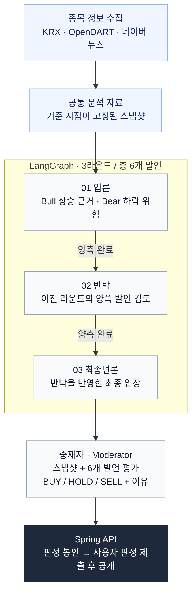
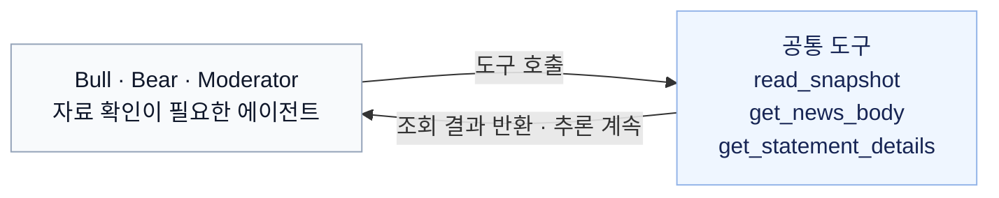

# 불앤베어 AI 워커

국내 주식 데이터를 바탕으로 매수·매도 에이전트가 토론하고, 중재자가 최종 의견을 내는 Python 서비스입니다.
Claude로 발언을 생성하고 LangGraph로 토론 순서를 관리합니다. CLI에서 단독 실행하거나 Spring에 HTTP/SSE로 연결할 수 있습니다.

[API 명세](../docs/worker-api.md) · [운영 가이드](../docs/WORKER-OPERATIONS.md) · [배포](../docs/DEPLOY.md)

## 설치

Python 3.12 이상과 [uv](https://github.com/astral-sh/uv)가 필요합니다.

```bash
cd ai-worker
uv sync
```

`ai-worker/.env`에 키를 설정합니다.

```dotenv
ANTHROPIC_API_KEY=
KRX_API_KEY=
WORKER_TOKEN=

# 재무·공시와 뉴스를 사용하려면 설정
OPENDART_API_KEY=
NAVER_CLIENT_ID=
NAVER_CLIENT_SECRET=
```

`WORKER_TOKEN`은 Spring과 공유하는 인증 토큰입니다. 임의의 긴 값을 사용합니다.
KRX 키는 사용할 시세·지수 API의 활용 승인이 필요하고, 네이버 키는 NAVER API HUB에서 발급받은 값을 사용합니다.
`.env`는 커밋하지 않습니다.

## 사용법

아래 명령은 모두 `ai-worker/`에서 실행합니다.

```bash
# 시장 데이터 확인 — LLM 호출 없음
uv run bullbear snapshot 삼성전자

# 토론 실행 — Claude API 비용 발생
uv run bullbear debate 005930
```

토론이 끝나면 터미널에서 매수·보유·매도 중 하나를 선택합니다. 사용자 판정 이후 중재자의 의견과 양측 평가를 보여줍니다.
첫 데이터 수집은 과거 520일 시세를 조회하므로 여러 분 걸릴 수 있습니다.

```bash
# CLI 기본 종목 목록
uv run bullbear universe

# 과거 날짜 기준으로 실행
uv run bullbear debate 삼성전자 --as-of 2026-09-01

# 저장된 스냅샷으로 다시 실행
uv run bullbear debate 삼성전자 --snapshot <snapshot_id>

# 토론 기록 재생
uv run bullbear replay <debate_id>
```

`--as-of`와 `--snapshot`은 함께 사용할 수 없습니다. 과거 날짜의 뉴스는 현재 검색되는 기사 중 당시 발행된 자료를 사용하므로, 당시 검색 결과를 완전히 재현하지는 못합니다.

### HTTP 서버

```bash
uv run uvicorn bullbear.server:app --host 127.0.0.1 --port 8000 --workers 1
```

`/health`를 제외한 요청에는 `X-Worker-Token` 헤더가 필요합니다. 데이터 디렉터리 하나당 서버 프로세스 하나만 실행합니다.

Spring 연결은 별도 터미널에서 진행합니다. 저장소 루트 기준 PowerShell 예시입니다.

```powershell
docker compose up -d
cd api
$env:WORKER_TOKEN = '워커 .env와 같은 토큰'
./gradlew.bat bootRun --args='--spring.profiles.active=worker'
```

Linux/macOS에서는 같은 환경변수를 설정하고 `./gradlew`를 사용합니다. 워커 주소가 다르면 `WORKER_BASE_URL`을 설정합니다.
Spring은 기본적으로 가짜 워커를 사용하므로 실제 연결에는 `worker` 프로필이 필요합니다.

워커는 중재자 판정을 그대로 반환합니다. 브라우저에는 Spring을 통해 전달하며, 사용자 판정 전까지 숨기는 처리는 Spring에서 맡습니다.

## AI Worker 아키텍처

**수집 → 스냅샷 고정 → 3라운드 토론 → 중재자 판정** 순서로 실행합니다.
LangGraph는 각 라운드의 매수·매도 발언을 병렬로 실행하고, 두 발언이 모두 완료되면 다음 라운드로 넘어갑니다.



### 에이전트 역할

| 에이전트 | 역할 | 입력 |
|---|---|---|
| 매수 (Bull) | 매수 논거를 제시하고 매도 측 반박에 답변 | 공통 스냅샷, 이전 라운드 발언 |
| 매도 (Bear) | 매도 논거를 제시하고 매수 측 반박에 답변 | 공통 스냅샷, 이전 라운드 발언 |
| 중재자 (Moderator) | 양측 논거를 평가하고 BUY/HOLD/SELL 판정 | 스냅샷 수치 자료, 6개 발언과 상세 분석 |
| 단일 분석가 (SingleAnalyst) | 토론 없이 중립적으로 판정하는 비교 모드 | 저장된 스냅샷, 토론 이력 없음 |

일반 토론에는 매수·매도·중재자 세 역할이 참여합니다. 단일 분석가는 `mode: "single"`에서 별도로 실행합니다.

양측은 같은 스냅샷을 읽고 세 번씩 발언합니다. 반박과 최종변론에서는 앞선 양측 발언을 함께 읽습니다.
필요한 수치, 뉴스 요약, 이전 발언의 상세 분석은 도구로 조회합니다.
매수·매도는 각각 독립된 LLM 클라이언트를 사용하며, LangGraph가 양측 라운드 완료를 기다린 뒤 다음 단계로 진행합니다.

중재자는 6개 발언을 평가해 BUY/HOLD/SELL 의견을 냅니다. 최초 의견이 HOLD이면 양측의 관련성·중요도·반박·위험 인식 점수를 단순 평균해 보정합니다.
매수 평균에서 매도 평균을 뺀 값이 +0.2를 넘으면 BUY, −0.2 미만이면 SELL, 나머지는 HOLD입니다.
판정이 바뀌면 점수와 평가 문구는 유지하고 해설을 다시 생성합니다. 최초 BUY/SELL은 보정하지 않습니다.

공개 전 리뷰어는 없습니다. 토론 응답은 JSON·필수 필드 형식을 처리하지만 내용의 정확성을 코드로 검증하지 않습니다.
중재자 평가와 점수 보정의 예측 성능은 [실험 기록](../docs/evaluations/README.md)에서 별도로 다룹니다.

토론 없이 한 모델의 의견만 받으려면 `POST /debates`에 `mode: "single"`과 저장된 `snapshot_id`를 전달합니다.
단일 분석은 중재자와 같은 모델을 쓰며 별도의 근거·표현·의미 검증을 거칩니다. 요청 예시는 [API 명세](../docs/worker-api.md)를 참고하세요.

### 도구

매수·매도·중재자는 같은 세 도구를 사용합니다.



| 도구 | 조회 내용 |
|---|---|
| `read_snapshot(kind, args)` | 고정 스냅샷의 수치·뉴스·차트 |
| `get_news_body(source_id)` | 스냅샷에 등록된 기사의 본문 또는 저장 요약 |
| `get_statement_details(statement_id)` | 현재 토론의 확정 발언에 담긴 해석·가정·한계·반박·입장 변경 조건 |

`read_snapshot`은 `kind`에 따라 조회 범위를 지정합니다.

| kind | args 예시 | 반환 내용 |
|---|---|---|
| `facts` | `["근거 ID"]` | 지정한 근거의 값·단위·출처·요약, 최대 8개 |
| `catalog` | `["financials", "0"]` | 분류별 근거 목록, 페이지당 20개 |
| `news` | `["company", "0"]` | 종목(`company`) 또는 시황(`market`) 뉴스, 페이지당 5개 |
| `chart` | `["2026-09-01", "2026-09-10"]` | 일봉·이동평균·코스피 종가 CSV, 최대 14달력일 |

뉴스는 저장 요약을 먼저 읽고 필요한 정보가 없을 때 본문을 요청합니다.
외부 본문 조회는 `BULLBEAR_NEWS_WEB_FETCH_ENABLED=true`인 신규 실시간 토론에서만 사용하며, 조회할 수 없으면 저장 요약이나 자료 없음 상태를 반환합니다.
모델이 임의의 URL을 열거나 다른 스냅샷으로 바꾸는 도구는 없습니다.

단일 분석가는 별도의 도구 목록을 사용합니다.

| 도구 | 조회 내용 |
|---|---|
| `get_price_metrics()` | 종가·수익률·이동평균·변동성·거래량 지표 |
| `get_financials()` | DART 재무제표 |
| `get_valuation()` | PER·PBR·ROE 등 계산 지표와 계산식 |
| `get_disclosures()` | 최근 90일 공시 제목 |
| `get_new_url(source_id)` | 저장된 뉴스 원문 URL. 링크를 직접 열지는 않음 |

도구 정의는 [tools.py](src/bullbear/tools.py), 기사 조회는 [news_lookup.py](src/bullbear/news_lookup.py), 발언 조회는 [history_lookup.py](src/bullbear/history_lookup.py)에 있습니다.

## 설정

기본 모델은 토론자·중재자 모두 `claude-sonnet-5-5`입니다. 사용할 모델은 계정에서 접근 가능해야 합니다.
셸 환경변수가 `.env`보다 우선합니다.

| 환경변수 | 기본값 | 설명 |
|---|---|---|
| `BULLBEAR_MODEL` | `claude-sonnet-5-5` | 공통 모델 |
| `BULLBEAR_DEBATER_MODEL` | 공통 모델 | 토론자 모델 |
| `BULLBEAR_MODERATOR_MODEL` | 공통 모델 | 중재자·단일 분석 모델 |
| `BULLBEAR_DATA_DIR` | `data` | 데이터 저장 경로 |
| `WORKER_MAX_CONCURRENT` | `2` | HTTP 동시 실행 수 |
| `BULLBEAR_NEWS_WEB_FETCH_ENABLED` | `false` | 실시간 토론의 기사 본문 조회 |

모델 허용 여부와 필수 설정은 외부 호출 없이 점검할 수 있습니다.

```bash
uv run python -m bullbear.preflight --env-file .env
```

HTTP 상태와 이벤트는 `data/http/worker.sqlite3`, 토론 기록은 `data/debates/`, 감사 기록은 `data/audits/`에 저장됩니다.
서버 재시작으로 중단된 토론은 실패로 기록하며 자동 재실행하지 않습니다. 비용 제한과 복구 절차는 [운영 가이드](../docs/WORKER-OPERATIONS.md)에 있습니다.

## 개발

```bash
uv run pytest
```

기본 테스트는 외부 API와 유료 LLM 호출 없이 실행됩니다. Spring/PostgreSQL 통합 테스트는 별도 실행 환경이 필요합니다.

코드는 `src/bullbear/`에 있습니다. 토론 흐름은 `graph.py`·`graph_runtime.py`, 프롬프트는 `prompts.py`, 데이터 수집은 `data/`, HTTP 처리는 `server/`에서 관리합니다.

현재 알려진 제약:

- 종목의 과거 시세를 준비하는 동안 HTTP 요청은 `503 DATA_UNAVAILABLE`을 반환할 수 있습니다. 수집이 끝난 뒤 재시도합니다.
- DART 회사 목록 다운로드가 공용 잠금을 잡아 다른 조회를 지연시키는 문제(#79)가 남아 있습니다.
- KRX 일봉은 기업행사 미보정 값이므로 액면분할 등이 있으면 지표와 수익률이 왜곡될 수 있습니다.

최근 변경과 검증 결과는 [작업 로그](../docs/WORKLOG.md)에 기록합니다.
