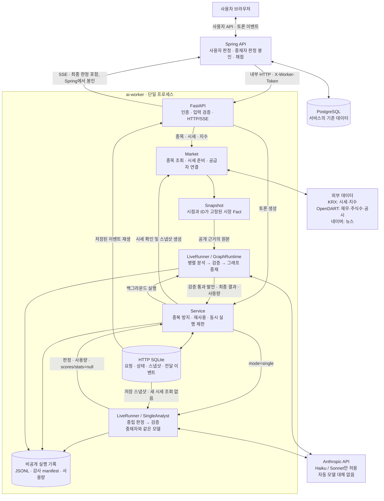
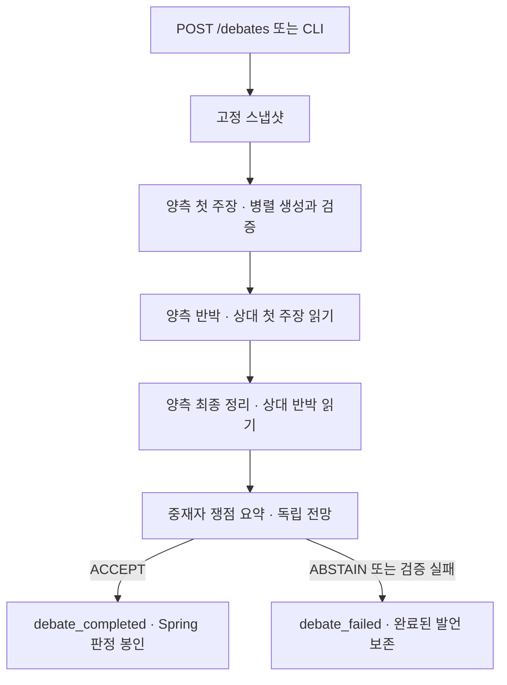

# 불앤베어 AI 워커

Spring API 서버가 호출하는 Python 서비스. API 계약은 [`../docs/worker-api.md`](../docs/worker-api.md).

매수 에이전트와 매도 에이전트가 실제 시장 데이터를 근거로 토론하고, 사용자가 먼저 판정한 뒤
AI 중재자의 판정과 실제 주가로 채점받으며 투자 근거 읽는 법을 배우는 모의투자 교육 서비스.

채택 원본은 `feat/worker-text-quality`의 `adda79f`다. 웹은 현재의 두 문장 `claim` 기본 표시 + 자세히 보기/접기로 `argument`를 펼치는 방식을 유지한다. 실험 브랜치의 웹 개편은 가져오지 않았다.

현재 단계: **CLI + HTTP/SSE 서버**. Spring·웹과 연결해 검색 → 토론 → 판정 봉인·공개 → 채점 예약을 실행한다.
HTTP는 계약 v0.6의 토론·단일 모드와 v0.5의 비동기 스냅샷 응답을 지원한다.

HTTP·CLI 토론은 `LiveRunner → GraphRuntime → build_debate_graph`를 실행한다.
양측 첫 주장 → 양측 상호 반박 → 양측 최종 정리 → 중재자 순서다. 각 단계의 양측은 독립 클라이언트로 병렬 실행한다.
해석 ID·관측 Fact 사본·가정/한계·반박 연결·중재자 쟁점 분석을 유지한다. 새 근거는 필수가 아니다.
기존 순차 엔진(`agents.py`, `debate.py`)과 전용 선공/paired benchmark·OpenAI 비교 어댑터·오프라인
실험 진단 도구는 삭제했다. 단일 분석 모드와 감사·비용 제한, 공용 검증기는 유지한다.

구현 완료와 실제 운용 준비는 구분한다. [최신 현황·실측·남은 순서](../docs/evaluations/worker-goal-readiness-20261102.md)에서
실모델 검증, fixture 통합, 배포 상태를 확인한다.

구조부터 보려면 [기능 아키텍처](#기능-아키텍처)의 전체 구성과 토론 처리 다이어그램을 참고한다.

### LangGraph 실행 엔진

`bullbear.graph.build_debate_graph(bull=..., bear=..., mediate=...)`에 역할별 LLM과
중재 함수를 전달한 뒤, 반환된 그래프에 `invoke({"snapshot": snapshot})`을 호출한다.
HTTP·CLI는 `fixed_rounds=True`와 검증 콜백을 사용한다. 각 단계의 양측 완료를 기다려
다음 단계가 같은 이전 발언 전체를 읽도록 한다. `opening`, `rebuttal`, `closing` 각 2개,
총 6개 발언 이후 중재한다. 매수는 BUY, 매도는 SELL을 유지하되 논거의 약화·반론 인정은 허용한다.
자료가 약하면 한계로 표시하며 사실을 만들거나 무조건 확신하지 않는다. 새 근거는 필수가 아니다.

`max_extra_rounds`는 기존 요청 호환을 위해 0~3을 받지만 운영 고정 흐름에서 추가 실행하지 않는다.
중재자는 ACCEPT/ABSTAIN만 반환하며 독립 전망과 쟁점 요약을 작성한다. HOLD는 중재자에게 허용된다.
중재자 검증 탈락은 비공개 JSONL의 `moderator_rejected`에 저장하고 공개 오류에는
`moderator_validation_failed` 코드만 제공한다. 실패해도 이미 저장된 6개 발언은 유지한다.
`turn_started.debate_flow=fixed_three_rounds`로 신규 완료 기준과 기존 2발언 기록을 구분한다.

독립 그래프의 기본 adaptive 모드는 이전 라이브러리 호출 호환용으로 남아 있으며 운영 경로는 사용하지 않는다.
무과금 검증: `uv run pytest tests/test_graph.py tests/test_graph_runtime.py -q`.
Spring 판정 봉인은 유지하며 사용자 판정 허용 정책·프론트는 이번 변경 범위 밖이다.

### 검증 책임

HTTP·CLI는 발언 공개 전 LLM 근거 검토를 기본 활성화한다. `BULLBEAR_REVIEW_STATEMENTS=false`로 끌 수 있으며 검토 호출도 비용 장부에 포함된다.
코드가 자료 ID·원본 값·구조화 반박 연결·역할 등 기본 계약을 검사한 뒤 리뷰어가 발언을 검토한다.
문제가 없으면 원문을 그대로 공개하고, 문제가 있으면 리뷰어가 같은 응답에 완전한 수정 발언을 작성한다.
수정본에도 같은 코드 검증을 적용하며, 통과한 수정본만 공개하고 이후 토론·중재 이력에 넣는다. 토론자에게 재작성을 요청하지 않는다.
리뷰어 응답의 형식·인용·수정본 검증에 실패하면 리뷰어에게 한 번만 복구를 요청하고, 다시 실패하면 공개하지 않고 토론을 실패 처리한다.
원문과 검토 사유·수정본은 비공개 감사 기록에 남긴다. 6개 발언 후 중재자가 전체 고정 자료와 발언의 논리·가정·반론을 검토한다.
`first_try_pass_rate`와 `rejected_attempts`에는 수정 전 초안의 검토 실패를 포함한다. 공개 이벤트의 `attempts`는 토론자 생성 횟수이므로 리뷰어 편집만으로 증가하지 않는다.
본문에 따옴표로 상대 문구를 반복할 의무는 없으며 analysis.rebuttal의 원문 연결은 유지한다.
중재자는 verdict.analysis.statement_reviews에 각 발언의 문제 미발견/우려/불확실과 이유를 기록한다.
이는 정오 채점이나 인과 증명이 아니다. 공개 전 검토와 중재자 판단도 오류가 가능하며, 발언 내용 전체의 정확성을 보증한 것으로
간주하지 않는다. verified=true는 verification_scope=source_values_and_structure 범위다.
프론트·Spring은 수정하지 않았으며 새 리뷰는 기존 판정 봉인 경로에 포함된다.

## 시작하기

```bash
brew install uv            # 또는 https://docs.astral.sh/uv/
cd ai-worker
uv sync                    # Python 3.12 + 의존성 설치
# 아래 데이터 소스 설정을 참고해 .env 생성 (기존 .env는 덮어쓰지 않음)

uv run bullbear universe           # 대형주 30종목 목록 (CLI 기본)
uv run bullbear snapshot 삼성전자   # 데이터만 확인 (LLM 호출 없음)
uv run bullbear debate 005930      # 토론 → 내 판정 → 중재자 판정 공개
uv run bullbear replay <debate_id> # 기록 재생
uv run pytest                      # 테스트 (네트워크·API 키 불필요)
```

## Spring과 실제 워커 연결

`.env`에 API 키와 `WORKER_TOKEN`을 설정하고, 워커 폴더에서 실행한다. `.env`는 서버 시작 시 읽는다.

```bash
uv run uvicorn bullbear.server:app --host 127.0.0.1 --port 8000 --workers 1
```

별도 터미널에서 루트의 `docker compose up -d`로 PostgreSQL을 띄우고 Spring을 시작한다 (Java 17 이상).
PowerShell 예시:

```powershell
cd api
$env:WORKER_TOKEN = 'dev-worker-token' # 워커 .env와 동일한 값
./gradlew.bat bootRun --args='--spring.profiles.active=worker'
```

Linux/macOS: `WORKER_TOKEN=dev-worker-token ./gradlew bootRun --args='--spring.profiles.active=worker'`.
워커가 다른 호스트라면 `WORKER_BASE_URL`도 설정한다. 기존 `BULLBEAR_WORKER_MODE=http`,
`BULLBEAR_WORKER_BASE_URL`, `BULLBEAR_WORKER_TOKEN` 방식도 지원한다. 기본 프로필은 가짜 워커다.
운영 compose에서는 `WORKER_MODE=http`와 키를 지정하고 `--profile worker`로 기동한다.

- 인증: `/health`를 제외한 모든 엔드포인트에 `X-Worker-Token`이 필요하다. 운영에서는 임의의 긴 토큰을 쓴다.
- 토론: 시세를 확인한 뒤 `202`를 반환하고 스냅샷·LLM 작업은 별도 스레드에서 실행한다.
  처음 응답의 `snapshot_id`는 `null`일 수 있으며 `snapshot_created`에서 확정된다.
- 최초 시세 조회: 520일 이력은 백그라운드에서 준비하며, 같은 종목·기준일의 동시 요청은 수집 하나를 공유한다.
  시세 준비 완료를 최대 1초만 기다리고 아직 준비 중이면 `503 DATA_UNAVAILABLE`을 반환한다. 수집은 계속 진행하므로
  잠시 뒤 재시도한다. 이때 토론은 접수되지 않고 LLM도 호출하지 않는다. 시세 일부나 이전 기준일을 대신 쓰지 않는다.
- 재사용: 종목·확정 종가 날짜마다 처음 생성한 스냅샷과 토론을 고정해 재사용한다. 같은 날짜에 추가된 뉴스로
  재생성하지 않는 Spring 정책과 같다. 같은 `request_id`는 재시작 후에도 같은 토론을 반환한다.
  다른 본문으로 키를 재사용하면 409다. 실패한 토론을 새로 실행하려면 새 키를 쓴다.
- SSE: `Last-Event-ID` 이후 이벤트 재생, 10초 하트비트, 완료·실패 시 연결 종료.
  검증 실패 발언·원시 토큰·중간 중재자 평가를 내보내지 않는다. 검증 재시도가 소진되면 토론을 실패 처리한다.
- 저장: `BULLBEAR_DATA_DIR/http/worker.sqlite3`에 요청·스냅샷·공개 이벤트를 저장한다.
  기존 JSONL은 감사용으로 유지하며 SSE로 그대로 노출하지 않는다. 중재자 최종 판정은 Spring이 봉인한다.
- 재시작: 완료 이벤트는 그대로 재생하고, 중단된 토론에는 `debate_failed`를 기록한다. 유료 호출을 자동 재실행하지 않는다.
  재시작으로 중단된 호출의 정확한 사용량은 복구할 수 없으므로 Spring 추정 비용이 적용된다.
- 동시 실행: `WORKER_MAX_CONCURRENT` 기본 2. 용량 초과는 429 + `Retry-After: 5`.
  데이터 디렉터리당 **프로세스 하나**만 허용한다. 다중 Uvicorn worker/replica는 시작 시 차단한다.
  시세 준비는 별도 스레드 2개·실행 및 대기 작업 합계 최대 32개로 제한하며 종료 시 남은 KRX 날짜 수집을 중단한다.

HTTP·CLI 시세는 KRX 공식 OPEN API, 재무·발행주식수·공시는 OpenDART를 사용한다.
KST 15:40 이전 당일 값과 미래 날짜는 제외한다. 종목 화면·스냅샷은 같은 확정 일봉을 공유한다.
코스피·코스닥 지수도 KRX에서 가져온다. 네이버는 뉴스 검색 API만 사용하며, 시세 실패 시 네이버 차트로 대체하지 않는다.
검색은 기본 30종목 + 예시 우선주·ETF, DART 키가 있으면 상장회사 목록을 추가한다.
DART에 시장 구분이 없는 추가 종목은 `market: null`이며, 전체 ETF·우선주 목록은 제공하지 않는다.
토론 허용 기준은 develop의 국내 보통주 전체 정책을 유지한다. 우선주·ETF·스팩은 제외하며 `UNIVERSE` 30종목은 검색 정렬과 CLI 기본 목록이다.

운영 HTTP와 Claude CLI는 **Haiku·Sonnet만 허용**한다. 기본 역할은 토론자
`claude-sonnet-5-5`, 중재자 `claude-sonnet-5-5`로 기존 운영 compose와 일치한다.
`BULLBEAR_MODEL`은 공통 재정의, `BULLBEAR_DEBATER_MODEL`·`BULLBEAR_MODERATOR_MODEL`은
역할별 재정의다. 기존 Opus 설정은 호출 전에 거부한다. 서버 측 자동 모델 대체는 사용하지 않는다.
모델 ID가 계정에서 실제 사용 가능한지는 별도 확인해야 하며, 위 기본값만으로 접근을 보장하지 않는다.
실제 응답 모델별 입력·출력·캐시 읽기/생성 토큰을 합산한다.

운영 프롬프트는 `고정 스냅샷(user, 5분 캐시) → 라운드·이력·출력 요청(user) → 역할·페르소나(system)` 순서다.
토론자는 양측·각 라운드에 같은 스냅샷 JSON을 보내고, 도구 결과와 검증 재시도는 기존 메시지 뒤에 덧붙인다.
역할 지시를 뒤에 놓는 기능은 현재 지원을 확인한 Haiku 5.5/Sonnet 5.5와 날짜 고정 ID만 허용한다.
다른 버전은 preflight와 실제 호출 전에 거부하며 기존 순서로 자동 대체하지 않는다.
최초 병렬 호출은 캐시 생성 전 시작할 수 있고, 입론에만 있는 이미지 때문에 후속 라운드 캐시가 새로 만들어질 수 있다.
중재자·검토자는 출력 스키마·effort·입력 범위가 달라 같은 캐시를 공유한다고 가정하지 않는다.
실제 적중 여부는 `cache_creation_input_tokens`와 `cache_read_input_tokens`로 확인한다.

유료 호출 없이 설정을 점검하려면 워커 폴더에서 실행한다:

```bash
uv run python -m bullbear.preflight --env-file /absolute/path/to/.env
```

키 값은 출력하지 않고 존재 여부만 표시한다. 필수 설정 누락·Opus 등 비허용 모델·개발 기본 토큰은
종료 코드 2로 알린다. 선택한 환경 파일은 해당 프로세스에서만 기존 환경값보다 우선한다.
이 점검은 네트워크를 사용하지 않으며 키 인증·모델 접근·운영 준비 완료를 보증하지 않는다.
이전 OpenAI 비교 실행 도구는 삭제했다. 과거 실험 문서·기록은 당시 구현의 이력이며 현재 실행 명령으로 사용할 수 없다.

## HTTP 통합 검증

`POST /debates`는 `mode`를 생략하면 LangGraph 토론을 실행한다. `mode: "single"`은 저장된
`snapshot_id`가 필수이며, 현재 시장 데이터를 새로 조회하지 않는다.

```json
{"ticker":"005930","request_id":"single-example","mode":"single","snapshot_id":"저장된 스냅샷 ID"}
```

단일 분석가는 `BULLBEAR_MODERATOR_MODEL`과 같은 모델로 스냅샷을 직접 조회해 판정한다.
토론 내역·양측 점수는 입력하지 않으며, 같은 7거래일·코스피 대비 ±2%p 기준과 표현·근거·의미 검증을 적용한다.
SSE는 `snapshot_created → moderator_started → debate_completed` 또는 `debate_failed`다.
완료 응답의 `verdict.scores`·`stats`는 `null`, 발언 목록은 비어 있고 모델별 `usage`는 유지된다.

- 같은 스냅샷·같은 모드의 실행 중/완료 결과만 재사용한다. 실패 후 새 요청 ID는 다시 실행한다.
- 같은 요청 ID에 모드·스냅샷 등 다른 본문을 보내면 409, 없는 스냅샷은 404, 종목 불일치는 400이다.
- 토론 모드도 명시적 `snapshot_id`를 지원한다. 생략 시 기존 종목·기준일 재사용을 유지한다.
- 기존 SQLite는 시작 시 `mode=debate`로 이관되며 과거 요청 멱등 키도 유지한다.
- Spring의 단일 모드 운용 스위치는 별도다. 워커 구현만으로 운영 스위치를 활성화하지 않는다.

[단일 모드 검증 기록](docs/single-http-validation.md): 자동 테스트는 통과했다. 실제 Sonnet 실험 2건은
판정 검증에서 반려되어 실패 이벤트·사용량 기록까지 확인했으며, 실제 완료 판정과 Spring #23 연결은 미확인이다.

기본 `uv run pytest`는 외부 데이터·유료 LLM 호출 없이 서버와 토론 엔진을 검증한다.
실제 Spring/PostgreSQL까지 확인하려면 다음 테스트 전용 워커를 실행한다 (운영 진입점에는 테스트 모드가 없다).

```bash
uv run python -m tests.http_fixture --port 18000 --data data/integration-test
```

Spring을 별도 테스트 DB와 `WORKER_BASE_URL=http://127.0.0.1:18000`,
`WORKER_TOKEN=integration-test-token`, `worker` 프로필로 실행한 뒤:

```powershell
$env:BULLBEAR_TEST_API_URL = 'http://127.0.0.1:8080'
uv run pytest tests/test_spring_integration.py -q
```

실제 HTTP/SSE·DB 저장·판정 봉인·공개·채점 예약을 확인한다. 이 테스트는 게스트와 판정을 생성하므로 테스트 DB에서 실행한다.
외부 API 키와 실제 모델 응답 품질은 별도로 확인해야 한다.

## 기능 아키텍처

아래는 현재 코드의 **운영 HTTP 경로**다. 데이터 수집 → 고정 스냅샷 → 토론 또는 단일 판정·검증 →
이벤트 저장·전달을 워커가 맡는다. 사용자 계정·판정 저장·중재자 판정 봉인·3/7거래일 채점은 Spring의 책임이다.
그림은 구현 구조이며 실제 Claude 호출·운영 검증 완료를 뜻하지 않는다.

### 전체 구성과 책임 경계



- 브라우저는 워커에 직접 연결하지 않는다. 워커의 완료 응답에는 중재자 판정이 있으므로
  **Spring이 사용자 판정 전까지 이를 숨겨야 한다.** 워커 SQLite는 Spring PostgreSQL을 대체하지 않는다.
- 토론 작업 풀은 기본 2개, 시세 준비 작업 풀도 별도 2개다. 실행 중 토론 수와 시세 준비 대기열을 각각 제한한다.
- LLM의 도구는 `SnapshotTools`로 고정된 Fact를 조회한다. 토론 중 도구가 외부 시세·뉴스를 새로 수집하지 않는다.
- SSE는 검증을 통과한 발언을 전달한다. LLM 원시 토큰, 반려된 후보 본문은 전달하지 않는다.
  진행 상태와 반려 알림은 별도 이벤트이며, 최종 중재자 판정은 Spring까지만 전달한다.

### 토론 한 건의 처리 흐름



양측은 처음에 서로의 미완료 결과를 읽지 않는다. 다음 라운드는 공개가 확정된 양측 발언을 읽으며 리뷰어가 수정한 경우 수정본을 사용한다.
토론자의 코드 검증 재시도와 중재자 판정 생성은 각각 최초 포함 최대 3회다. 공개 전 리뷰어는 검토·수정을 한 응답에 반환하며, 잘못된 응답의 복구를 포함해 최대 2회 호출한다.
단일 분석(`mode=single`)은 기존 중립 분석 경로를 유지한다.

### 코드와 저장소 대응

| 기능 | 주요 모듈 | 역할 |
|---|---|---|
| HTTP 진입점 | `server/app.py` | 인증, 엔드포인트, SSE 재생·하트비트 |
| HTTP 단일 판정 | `single.py` | 스냅샷 직접 조회, 중립 판정, 근거·표현·의미 검증 |
| 실행 관리 | `server/service.py` | 중복/재사용, 백그라운드 실행, 이벤트 선별, `LiveRunner` |
| 시장 데이터 | `server/market.py`, `data/` | 공급자·캐시 연결, 종목/시세/지수, 시세 준비 작업 풀 |
| 고정 근거 | `snapshot.py`, `tools.py` | Fact·파생 지표 고정, 스냅샷 조회 도구 |
| 토론·모델 | `graph.py`, `graph_runtime.py`, `prompts.py`, `llm.py` | 병렬 분석, 선택 재검토, 그래프 중재, Claude 호출 |
| 검증 | `verifier.py`, `presentation.py`, `semantic.py` | 수치/ID·표현·인용 규칙, LLM 의미 검토 |
| 전달 상태 | `server/store.py` | `data/http/worker.sqlite3`: 요청·토론 상태·스냅샷·SSE 이벤트 |
| HTTP 비용 장부 | `anthropic_budget.py` | 선택적 `data/http/provider-budget.sqlite3`: 요청별 최대 비용 예약·정산·미확정 보존 |
| 비공개 기록 | `events.py`, `audit.py` | `data/debates/*.jsonl`, `data/audits/<run_id>/manifest.json`: 시도·검증·사용량·실행 출처 |
| CLI | `cli.py` | 종목·스냅샷 조회, 토론 실행, 이벤트 재생 |
| 비용 없는 점검 | `preflight.py` | 운영 설정 검사 |

표의 `data/`는 기본 `BULLBEAR_DATA_DIR` 기준이다.
HTTP의 선택적 `anthropic_budget.py` 장부와 Spring의 추정 입장 제한은
[운영 안내](../docs/WORKER-OPERATIONS.md)에서 적용 범위를 구분한다.
CLI는 토론 엔진을 직접 호출하며 HTTP 요청 관리·SSE 경로를 거치지 않는다.

## 데이터 소스 메모

- 시세·지수는 KRX 공식 OPEN API. 기존 pykrx/네이버 차트 어댑터는 남겨 두지만 HTTP·CLI 기본 경로에서 사용하지 않는다.
  밸류에이션은 `snapshot.py`에서 시세 × DART 발행주식수, DART 재무로 계산하고 계산 입력을 `inputs`에 남긴다.
- KRX 원시 일봉은 기업행사 수정주가가 아니다. 액면분할·병합 등이 있으면 지표·수익률이 왜곡될 수 있으며
  현재는 스냅샷 경고로 알린다. 해당 종목을 정식 성과평가에 쓰기 전 기업행사 보정이 필요하다.
- PER은 당기순이익(연결, 비지배지분 포함) 기준이라 증권사 PER(지배주주 순이익)과 다를 수 있다.
- 시가총액은 보통주만 센다.
- 뉴스는 `NewsSource`로 따로 둔다. 네이버 검색 API로 최근 7일 기사 중 제목에 종목명이 있는 것만, 재전송 기사는 하나로 합쳐 최대 30건.
  스냅샷 생성 시각 이후 기사는 넣지 않는다. 본문은 가져오지 않는다 (저작권·약관).
- LG, SK처럼 이름이 짧은 종목은 관련 없는 기사가 섞인다. `naver_news.QUERY_OVERRIDES`로 보정한다.
- 새 공급자는 `MarketDataSource`를 구현하고 공통 진입점 `server/market.py`에서 연결한다.

### 데이터 소스 설정

`ai-worker/.env`에 다음 값을 설정한다. 비밀값은 커밋하지 않는다.

```dotenv
KRX_API_KEY=
OPENDART_API_KEY=
NAVER_CLIENT_ID=
NAVER_CLIENT_SECRET=
```

- 네이버 키는 **NAVER API HUB**에서 `NAVER 검색 > 뉴스`를 선택한 Application의 인증 정보다.
  기존 개발자센터 신규 발급은 종료됐다. 현재 코드는 HUB 주소와 `X-NCP-APIGW-API-KEY-ID/KEY` 헤더를 사용한다.
  [뉴스 API 공식 문서](https://api.ncloud-docs.com/docs/naver-api-hub-search-news).
- KRX 인증키와 별도로 유가증권/코스닥 일별매매정보, KOSPI/KOSDAQ 시리즈 일별시세정보 활용 승인이 필요하다.
  [공식 이용 절차](https://openapi.krx.co.kr/contents/OPP/INFO/OPPINFO003.jsp).
- KRX는 하루치 시장 전체를 반환한다. 날짜별 압축 캐시를 공유하며, 최근 7일과 빈 응답은 1시간 뒤 갱신한다.
  최초 520일 수집은 여러 분 걸릴 수 있다. **시연 전에 `uv run bullbear snapshot 삼성전자`로
  과거 시세 캐시를 준비하는 것을 권장한다.** HTTP 요청이 먼저 오면 백그라운드에서 준비하고 완료 전에는
  빠르게 503을 반환한다. 이는 수집 시간을 줄이는 기능이 아니므로 준비가 끝난 뒤 시연한다.
- 조회 간격은 최소 0.25초, 단일 조회 구간은 최대 800일로 제한한다. 오류 응답을 휴장일로 처리하지 않는다.
- KRX 키가 없으면 시세 조회가 실패한다. DART·뉴스 키가 없으면 해당 자료를 제외하고 스냅샷 경고를 남긴다.
- DART·뉴스의 HTTP/타임아웃·JSON 오류도 해당 자료를 제외하고 스냅샷 경고로 기록한다.
  OpenDART의 자료 없음(013) 응답은 저장하지 않으며, 이전 버전의 013 캐시도 무시해 새 보고서를 다시 확인한다.
- 기존 셸 환경변수가 `.env`보다 우선이다. 설정 검사에는 `bullbear.preflight --env-file`을 사용할 수 있다.
- 2026-10-29: 사용자 인증키로 유가증권 일봉·KOSPI 지수 조회와 삼성전자 265거래일 수집을 확인했다.
  실제 키의 코스닥 시세·지수 권한은 별도 확인이 필요하다.

## 공통 시장 입력

새 스냅샷은 `schema_version: 2`와 `series`, `time_context`, `data_status`를 저장한다. 기존 `facts`와
근거 ID는 그대로 사용한다. `series`에는 최근 126거래일 종목 일봉 OHLCV·날짜별 MA7/11/24/25/200,
최근 10주 코스피 종가와 `price_basis`가 들어간다. 126개 날짜에 MA200을 모두 그리려면 종가 325개가
필요하다. 520일 수집 범위에서 이력이 부족한 날짜의 이동평균은 null이다.
KRX 종가는 기업행사 미보정이며, 연속 종가의 30% 초과 단절은 경고로 표시한다.

`as_of`는 마지막 일봉 날짜이고 `created_at`은 실제 스냅샷 생성 시각이다. `decision_at`과
`information_cutoff`는 현재 정책상 마지막 일봉 정규장 마감(15:30 KST)이다. OpenDART 접수일만
확인되는 당일 재무·공시·발행주식 수는 제외한다. 이전 형식은 v1로 읽고, 시계열이 비어 있으며 과거
`created_at`을 판단 시각으로 사용한다. SQLite 스키마 변경 없이 기존 ID를 조회·재사용할 수 있다.

매수·매도 모델은 같은 `shared_push`를 받는다. 차트에는 월요일 기준 최근 10주의 주봉 OHLCV를 CSV로
전달하고 요약 지표는 Fact로 보낸다. 가장 최근 주는 스냅샷 기준일까지 집계한다. `get_daily_chart`는
같은 스냅샷의 일봉·MA7/11/25/200·코스피 종가를 CSV로 반환한다. 날짜는 YYYY-MM-DD, 조회는 최대
14달력일이며 확인할 수 없는 값은 빈 셀이다. 이전 스냅샷은 보관한 일봉 범위에서만 집계하거나 조회한다.
두 입론 요청에는 같은 최근 126거래일 일봉·거래량·이평 PNG를 이미지 블록으로 첨부한다. HTTP 워커 비용
장부가 활성화된 경우에는 기존 텍스트 제한에 따라 CSV와 Fact만 보낸다. 뉴스 제목 목록에는 기사 ID·제목·언론사·발행 시각·URL만 포함한다. NAVER가 언론사 이름을 주지 않는 경우 원문 호스트를 사용하고 확인할 수 없으면 null이다.
국내 시황은 증시·통화정책·환율·경제산업 키워드로 검색해 관련 주제 수와 최신성으로 정렬한다.
같은 링크, 정규화 제목, 발행 시각이 가깝고 제목이 매우 유사한 기사는 대표 기사만 남긴다.
기존 `get_news` 도구는 스냅샷에서 요약을 조회한다. OpenDART 영업활동현금흐름은 전체 재무제표
응답에 동일 접수번호·보고 기준의 원화 계정이 있을 때만 추가한다.

| 환경변수 | 동작 |
|---|---|
| `FRED_API_KEY` | WTI 현물가 및 연준 목표금리 하한·상한 조회. 키 생략 시 FRED 비활성 |
| `BULLBEAR_VIX_ENABLED` | 기본 false. Cboe VIX 사용권과 서비스 노출 범위를 확인한 뒤 true로 설정 |
| `ECOS_API_KEY` | 한국은행 기준금리 `722Y001 / 0101000 / D` 조회. 키 생략 시 ECOS 비활성 |
| `BULLBEAR_MARKET_NEWS_LIMIT`, `BULLBEAR_STOCK_NEWS_LIMIT` | 기본 8건·30건. 각 0~30, 0이면 해당 검색 비활성 |

FRED는 한국 마감 시각보다 앞서 끝난 미국 중부 달력일을 vintage로 지정한다. `vintage_date`는 그날에
조회 가능했던 자료라는 근거이며 정확한 공개 시각은 아니다. ECOS는 공개 시각이나 vintage가 없어, 워커가
받은 시각을 `data/cache/ecos-base-rate.sqlite3`에 저장하고 다음 조회부터 마감 전에 관측한 값만 사용한다.
확인된 값이 없으면 `AVAILABILITY_UNVERIFIED`다. 상태는 `OK`, `EMPTY`, `FAILED`, `UNSUPPORTED`,
`STALE`, `AVAILABILITY_UNVERIFIED`로 구분한다. 비활성 설정은 신규 수집에 적용되며 이미 저장한
스냅샷은 재현성을 위해 같은 내용을 반환한다.

FRED를 서비스에서 활성화할 때에는 [FRED API 이용 조건](https://fred.stlouisfed.org/docs/api/terms_of_use.html)의
표시 의무와 [VIX 원천 데이터 조건](https://fred.stlouisfed.org/series/VIXCLS)을 확인한다.
[FRED 빈티지 조회](https://fred.stlouisfed.org/docs/api/fred/series_observations.html)와
[ECOS Open API](https://ecos.bok.or.kr/api/)를 사용한다.

## 모델의 판단과 개념·논리 검토

- `langgraph-reviewer-revision-v20`은 공개 전 리뷰어가 문제가 없는 발언은 그대로 통과시키고, 문제가 있는 발언은 `revised_statement`에 직접 수정한다. 토론자에게 수정 지시를 돌려보내지 않으며 수정본의 코드 검증과 비공개 감사 기록을 유지한다. 리뷰어 출력 한도는 전체 수정 발언을 담도록 8,192토큰이다.
- `langgraph-conditional-lookup-v21`은 토론자와 중재자가 입력에 있는 근거를 먼저 인용하고, 핵심 판단에 필요한 자료가 빠져 있을 때만 고정 스냅샷 도구로 확인하도록 지시한다. 반려 피드백에서도 인용 누락과 자료 부족을 구분한다.
- `langgraph-snapshot-cache-v19`는 고정 스냅샷을 첫 사용자 블록으로 분리하고 5분 캐시 경계를 둔다. 라운드·출력 요청 다음에 역할·근거·말투의 시스템 메시지를 둔다. 공개 전 검토·의미 검토·단일 분석도 기존 자료 범위를 유지하며 같은 순서를 따른다.
- `langgraph-single-history-v12`: 토론자는 매수·매도 논거를 제시하고 중재자·단일 분석가는
  종목에 대한 BUY/HOLD/SELL 의견을 낸다. 모델 지시와 재작성 조건에서 고정된 7거래일·코스피 ±2%p 기준을 제거했다.
  Spring의 사후 채점 계산은 별개다. 새 의견은 해당 수익률 구간을 직접 예측하도록 생성한 이전 결과와 구분해야 한다.
- v11은 중재자 문체·역할별 재시도·단일 분석 검토 지침을 분리한다. 출력 스키마와 문장 수 검사, 검토·재시도 횟수는 유지한다.
- v12는 이전 발언의 본문+JSON 중복을 JSON 한 벌로 정리한다. 발언·해석 ID, 관측 Fact와 전체 analysis를 보존하며 기존 이력 형식도 읽는다. 출력 스키마와 검토 절차는 유지한다.
- 사용자용 요약은 본문의 핵심 주장·근거와 중요한 반박·조건·한계를 두 문장에 담는다. 길이 검사는 한 문단·최대 2문장으로 기존 한 문장 기록도 허용한다. 본문 최대 3문장, 서로 다른 근거 최대 3개. 재검토에서도 기존 근거를 재사용할 수 있고, 근거 없는 사실·숫자를 보충하지 않는다.
- 1조 원 이상 금액은 사용자 글에서 조 원으로 표현한다. 도구의 display는 표현용이며
  evidence.value는 원 단위 그대로다. 중재자 글에서는 내부 ID·검증 통계·투자자별 권고를 제외한다.
- 중재자 [E1]은 decisive_evidence[0]에 대응한다(토론자 번호와 별도). 이유 최대 3문장,
  양측 평가 각 1문장. 표현 규칙 위반도 재작성 피드백으로 처리한다.
- 반박은 상대 발언에서 짧은 원문을 인용하고, 코드가 실제 반대편 주장·본문의 문구인지 확인한다.
  의미 검토에는 발언자·라운드·각 발언의 독립적인 근거 번호 대응표를 전달한다.

- `prompts.JUDGMENT_POLICY`는 감사 해시 호환을 위해 이름을 유지하며, 내용은 공통 자료 해석 원칙이다.
  과거 관측 기간·수익률 부호·기사 날짜를 해석하는 규칙은 유지한다. 전망의 고정 기간·지수·수익률 문턱은 주입하지 않는다.
- 수치/ID·해석 연결·과거 수익률/기사 출처를 대조한 뒤, 활성화된 공개 전 검토가 요약과 본문의 사실·조건·불확실성을 함께 확인한다.
  의미 검토는 개념 오류, 근거 없는 인과 단정, 자료의 관측 기간 오독, 모순을 원문 인용과 함께 반려한다.
- 토론자의 코드 검증과 중재자 판정은 최대 3회 생성한다. 공개 전 리뷰어의 수정은 토론자 생성 횟수를 늘리지 않는다. 리뷰어 응답 복구는 최대 1회이며, 끝까지 실패하거나 검토 호출이 실패하면
  미검증 발언/판정을 성공 처리하지 않고 토론을 중단한다. 기존 API 응답 형식은 바꾸지 않는다.
- 감사 기록에 정책·프롬프트·스키마 해시와 모델 호출·검증 결과를 저장한다.
  공개 전 검토는 감사 기록의 `statement_reviewer` 역할과 전체 모델 사용량에 포함된다. 별도 대화지만 같은 모델이므로
  독립적인 사실 확인이나 논리적 정확성 증명이 아니며 오탐·누락 가능성이 있다.
- 현재 명시적 개념 규칙은 알려진 PER 역전 표현을 좁게 다룬다. 모든 표현을 정규식으로 판별하지 않는다.
- 인용 정확도를 원천 사실의 무오류로 확대하는 관측 사례도 규칙으로 반려한다.
  evidence.ref는 E1 형식만 허용하며 본문의 [E1]과 구분한다.

## 테스트

운영 인증·동시 실행·재시작·선택적 영속 비용 장부는 [워커 운영 안내](../docs/WORKER-OPERATIONS.md)를 참고한다.

- 파이프라인 동작을 바꾸면 `tests/fakes.py`의 가짜 소스와 `tests/graph_fakes.py`의 가짜 모델로 테스트를 추가한다.
