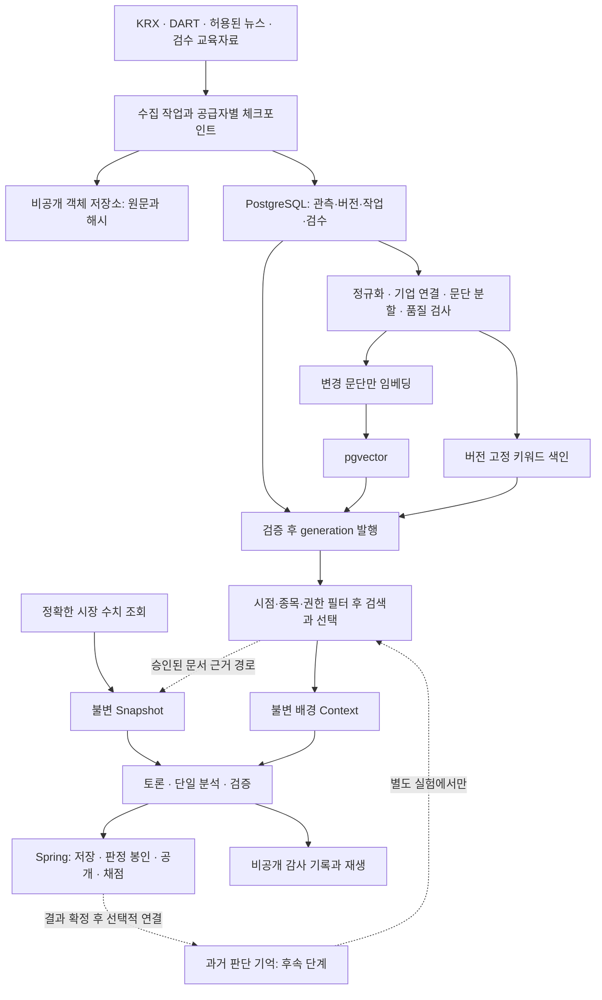

# 다종목 RAG 1주 구현 계획과 장기 아키텍처

작성일: 2026-11-01. 상태: 1주 시험 운영 범위 승인, 4일차 pgvector exact·임베딩 원장·BM25 비교 구현, 실모델 소규모 평가/HTTP shadow 구현, 답 없음/선택 정책·72질문 재평가 구현, 운영 품질 채택은 보류, S3 후순위. 담당: jangwonii(워커·검색), ricky00-dev(API·인프라), 공동(계약·평가 기준).

2026-11-02 후속: Spring/웹 명시적 문서·Fact 조회와 snapshot별 generation 고정/과거 라우팅을 구현했다.
legacy observed context 기반 이관, 원본 receipt 검사, 교체/복구 절차와 선택적 배포 설정은
[운영 안내](RAG-PUBLICATION-RUNBOOK.md)를 따른다. 로컬 연결 검증을 운영 배포나 사람 검수 품질 승인으로 간주하지 않는다.

장기 목표는 **관리형 PostgreSQL + pgvector + 객체 저장소**를 중심으로 다종목 자료를 축적하고, 키워드·벡터 검색을 비교해 검증된 경로를 서비스하는 것이다. 수치 데이터, 문서 근거, 공통 지식, 과거 판단 기억을 분리한다. 클라우드는 공유·복구·운영 문제를 해결하고, 벡터 검색은 표현 차이에 따른 검색 누락을 줄이는 후보 수단이다. 두 효과를 혼동하지 않는다.

이번 구현 목표는 **30종목을 대상으로 한 클라우드 배포 가능한 RAG 시험 운영 경로**다. 아래 1주 범위가 이번 작업의 기준이며 이후 절의 장기 구조는 확장 방향이다. 클라우드 계정/예산이 준비되지 않으면 동일 구성의 로컬 통합까지 완료하고 실제 클라우드 검증을 미완료로 표시한다. 비용·운영 활성화를 문서 승인만으로 수행하지 않는다.

## 이번 주 완료 범위

| 날짜 | 구현 | 완료 증거 |
|---|---|---|
| 1일차 | 저장 인터페이스, PostgreSQL 컨텍스트·감사 저장과 Alembic, 기존 SQLite 이관 진입점 | 실제 로컬 PostgreSQL 저장/재생/멱등/충돌/원자성 테스트. 원문 아카이브는 아직 SQLite임을 명시 |
| 2일차 | 원문·버전·검수 PostgreSQL 이관, 객체 저장소 어댑터, generation 파일 배포 | ID·해시·시점·거절 상태·기존 replay 보존, 이관 재실행과 손상 거부 |
| 3일차 | 기존 공급자의 캡처 기반 증분 적재, 중복·작업 lease·재시도·watermark | fixture 다종목 적재, 권한/한도 준비 시 실제 30종목 수집; 자동 스케줄은 별도 활성화 |
| 4일차 | pgvector exact 검색, 임베딩 버전/비용, BM25·dense·RRF 비교 | 한국어 개념/종목/시점 평가, 같은 허용 문단 집합, 검색 정책별 기록 |
| 5일차 | HTTP shadow 비교, snapshot-context 고정, 배경 주입 | 토론·single 동일 context, 공개 응답 경계·저장 실패 시 호출 중단 |
| 6일차 | 비용 상한·장애·복원·Spring 연동 | 실제 DB fixture 통합, 장애 시 중복 호출 없음, 복원 보고서 |
| 7일차 | 소수 종목 canary, 결함 수정, 30종목 확대 가능 여부 판정 | 준비된 클라우드에서 검증하거나 미검증 사유 기록. 수용 기준 미달이면 비활성 유지 |

첫 주에는 범용 PDF/복잡한 표 파싱, 전체 시장 backfill, 새로운 공개 문서 근거 계약/화면, 다중 토론 replica, 과거 판단 기억, 예측 성과 입증을 제외한다. 뉴스·공시는 기존 Snapshot 근거 경로를 유지하고 새 문서 검색은 shadow로만 평가한다. 검수된 배경만 운영 후보로 사용하며 AI 검수를 사람 승인으로 바꾸지 않는다.

일정은 계정·키·예산과 사람 검수 담당이 준비된 경우의 목표다. 첫 주 최소 평가는 기존 회귀 + 사람 검수 40~60사례, 다종목 fixture, 사전 예산 내 실모델 소수 짝 비교로 한다. 장기 100사례·30개 독립 snapshot 기준을 첫 주에 완료했다고 표시하지 않는다. 운영 수용은 시점/무결성 경계 위반 0건, 테스트 실패 없음, 비용 상한·복구·실제 완료 경로 확인을 필수로 하고 품질/지연 기준은 실행 전에 고정한다. 실제 7거래일 성과는 첫 주 완료 조건이 아니다.

컨텍스트와 원문·검수 PostgreSQL 저장, 객체 저장 어댑터와 generation 배포까지 구현했다. 실제 클라우드 이전·운영 활성화는 아직 하지 않았다. 캡처 기반 증분 적재의 작업 관리·lease·재시도까지 추가했다. pgvector exact와 BM25/dense/RRF 비교까지 추가했다. 실모델 2종의 6문서·24질문 평가와 선택적 HTTP shadow도 구현했다. 벡터 검색의 답 없음 오류 6/6으로 BM25 기본을 유지한다. 이후 72질문(development 24/holdout 48)과 focused 선택 정책을 추가했다. 불필요 문단은 줄었지만 holdout 음성 오류가 8~10/18 남아 운영 전환은 보류한다. 이전 BM25 음성 0/6은 단일 경로 집계였으며 전체 문단 기준 6/6으로 정정했다. 이후 수치/개념 의도와 snapshot Fact 종목·날짜·단위·입력 계보 검증, 모델 없는 POST /rag/query(v0.7 구현 초안)도 추가했다. 기존72개 재사용 검사에서 수치 부재6개는 거절했으나 전체 음성4/18과 recall83.3%로 규칙 한계가 남는다. 후속 수정으로 자연어 규칙 의도 관문은 제거하고 /rag/search와 /rag/facts(v0.8 초안)를 분리했다. 문서는 일반 검색, 수치는 명시 metric/date/unit과 기존 Fact 검증으로 처리하며 모델 호출은 없다. 다음은 사람 검수·확장 corpus·새 holdout 검증과 공동 API 검토/연동이다. 완료 증거는 실행 안내와 evaluations/rag-real-embedding-pilot.md에 기록한다. 실제 공급자 자동 수집과 S3 연결은 미완료다.

## 1. 기준 상태와 현재 구현 재사용

계획 기준은 `origin/develop=2cca67f`다. 원본 문서 작업 브랜치의 HEAD `83247f2`보다 최신이며, fetch로 확인한 뒤 별도 `feat/rag-week-one` 작업 공간을 만들었다. 기능 구현 현황은 그 기준의 `docs/RAG-DATA.md`, `docs/evaluations/rag-corpus-pilot.md`, 계약 v0.6 초안을 따른다. 현재 구현 범위와 명령은 [진행·실행 안내](RAG-WEEK-ONE.md)에 기록한다.

- 현재 SQLite FTS5/BM25, 원문 버전·관측·검수 이력, 고정 generation/context, 재생, HTTP 장애 정책은 재사용한다.
- 배경 색인은 knowledge/research 전용이다. 뉴스·공시 아카이브 기능이 있다는 사실과 뉴스·공시 검색이 운영 토론에 연결됐다는 것은 다르다.
- 최신 seed는 자체 한국어 설명 6개다. 직접 개념 6/6, 표현 변형 4/6 검색 기록이 있으며 사람 미검수 experimental 상태다. 현재 importer의 사람 승인 패키지 지원도 보완해야 한다.
- 기존 실모델 파일럿 최종 4조건 중 1조건 완료는 검색·토론 품질의 운영 승인 근거가 아니다.
- 최신 일정은 11/10 엔진 고정, 11/11 정식 운용, 11/16 코드 프리즈다. 장기 검색 변경은 별도 평가 실행으로 분리하고 정식 실험의 기존 결과에 합산하지 않는다.

## 2. 참고 사례와 채택 범위

| 사례 | 확인한 구현 | 적용할 설계 | 그대로 가져오지 않을 부분 |
|---|---|---|---|
| TradingAgents | 매수·매도 토론, 현재 Markdown 판단 기억, 종목·결과 확정 시점으로 과거 기록 선택 | 토론 자료와 결과 확정 후 회고를 분리, 미래 결과 유입 차단 | 로컬 파일을 다중 워커의 공유 상태 저장소로 사용 |
| FinMem | 종목별 FAISS, 유사도·최신성·중요도 점수, 기억 계층 | 종목 범위와 자료별 시간 유효성, 회고의 제한적 사용 | 검색 점수가 낮다는 이유로 감사 원문 삭제, 검증 전 자동 교훈 승격 |
| FinRobot | V0 Chroma와 공시 유형·분기 필터, V2 SEC 검색 모듈은 BM25 | 문서 유형별 파싱·메타데이터, 수치 계산과 문서 해석 분리 | 예제 영어 임베딩을 한국어 금융 자료에 무평가 적용 |
| FinanceRAG | dense 검색과 재순위화, 질의 확장·문서 정제 실험 | 검색 평가셋과 실패 분석, 필요할 때만 재순위화 | 대회 성적을 토론 정확도나 투자 성과로 해석 |

출처는 문서 끝에 있다. 이 사례들은 관리형 벡터 DB가 필수라는 근거가 아니며, 아래 인프라 선택은 불앤베어의 공유 저장·운영 요구에 따른 제안이다.

## 3. 목표 구조

### 배포와 소유권

- 초기 운영 후보: 기존 AWS 방향에 맞춘 관리형 PostgreSQL과 S3 계열 객체 저장소. 배포 리전의 PostgreSQL/pgvector 지원 버전·백업·요금을 실제 선택 시 확인한다. 공급자 종속 API는 저장 어댑터 뒤에 둔다.
- 초기에는 동일 관리형 PostgreSQL 인스턴스 안에 별도 `rag` 데이터베이스와 계정을 둔다. Spring 서비스 테이블에 워커가 직접 쓰지 않는다. DB 이름/역할 이름은 배포 단계에서 확정한다.
- RAG DB 마이그레이션은 워커의 Alembic이 단독 소유한다. Spring Flyway가 같은 테이블을 관리하지 않는다. 수집 writer, 검색 reader, migration 계정 권한을 분리한다.
- 객체 저장소는 원문·허용된 첨부·고정 색인 산출물·컨텍스트 사본을 저장한다. 브라우저 공개 버킷으로 만들지 않는다.
- 초기 검색은 워커 내부 모듈로 제공한다. 독립 검색 HTTP 서비스, Kafka, Redis, Kubernetes는 필요성이 측정되기 전 도입하지 않는다.
- **RAG 공유 저장 전환만으로 토론 워커의 다중 replica가 가능해지는 것은 아니다.** 현재 HTTP 요청/SSE 저장과 프로세스 잠금도 별도로 공유 저장·실행 lease·멱등 처리로 바꿔야 한다. 그 전에는 토론 워커 1개와 독립 수집 프로세스로 운영한다.

## 4. 데이터 종류와 근거 경계

| 종류 | 저장·조회 | 모델 입력과 검증 |
|---|---|---|
| 시세·거래량·재무 수치 | 정형 저장/공급자 캐시, 종목·시점으로 정확 조회 | 기존 Snapshot Fact. 단위·회계 기간·수정 이력 보존 |
| 뉴스·공시·보고서 | 원문 객체 + 버전/문단 메타데이터 + 검색 인덱스 | 문서 근거 후보. 승인된 projection을 거쳐 Snapshot에 동결 |
| 금융 개념·연구 | 검수된 문단, 적용 시장·기간·한계 | 비공개 KnowledgeContext. 현재 종목 사실로 사용 금지 |
| 과거 토론·결과·회고 | 실행과 채점 버전별 별도 테이블 | 결과 확정 후 별도 기억 경로. 원문 사실이나 정답으로 취급 금지 |
| 판정 기준·금지 규칙 | 버전 고정 코드/프롬프트 | 검색 성공 여부와 무관하게 항상 적용 |

뉴스/공시의 공개 근거 확대는 두 단계로 한다. 먼저 shadow 검색에서만 품질을 측정한다. 이후 문서 위치·정확한 발췌·내용 수준을 검증하는 내부 EvidenceCandidate → Snapshot Fact 변환을 만든다. 토론 시작 전에 snapshot을 고정하고 이후 검색으로 Fact를 추가하지 않는다. 기존 공개 스키마로 출처를 정확히 전달할 수 없으면 양측 승인으로 `worker-api.md` 버전과 브라우저 표시를 먼저 변경한다. 배경 지식 ID를 공개 E번호로 바꾸지 않는다.

단일 분석과 토론은 같은 snapshot뿐 아니라 같은 context/generation을 사용해야 한다. 나중에 시작된 single이 최신 지식을 추가로 받으면 짝 비교가 아니다. 서버 내부에서 snapshot에 실험 context를 연결하고 필요할 경우에만 계약 확장을 검토한다.

## 5. 논리 데이터 모델

다음은 신규 PostgreSQL 모델의 최소 범위다. 기존 ID·해시·시간·재생 의미를 보존하며 실제 DDL은 2단계에서 확정한다.

| 테이블/집합 | 주요 항목 |
|---|---|
| documents | 안정 문서 ID, 공급자 ID, 자료형, 정규 URL, 이용 범위 |
| revisions / observations | 내용 해시, 원문 객체 키, 공개 시각·정밀도, 최초 관측, 수집 시각, 철회/정정 사건 |
| document_entities | 문서와 복수 기업/산업/시장 연결, 연결 방법·확신도·검수 상태 |
| chunks | revision, 원문 위치, 표의 제목·단위·기간, parser/chunker 버전, 내용 해시 |
| reviews | 대상 revision/chunk, reviewer와 종류, 승인/거절, 검수 시각, 적용 범위 |
| embeddings | chunk 해시, 모델·revision·차원·전처리 버전, 생성 시각, vector |
| generations / members | 발행 시각, 대상 문단 목록, 임베딩·키워드 색인 버전, 상태·manifest 해시 |
| ingestion_runs / jobs | 공급자 cursor, 완료 범위, 상태, 재시도 수, lease와 소유 token, 오류 분류 |
| retrieval_runs / contexts | snapshot, cutoff, generation, 질의, 후보·제외 이유, 선택 문단·원문 해시, fallback, 지연 |
| decision_memories | execution, 실제 채점 버전, 결과 관측/확정 시각, 회고 모델·검수 상태 |

기업 연결은 다대다로 저장한다. 동일 산업 기사 하나를 종목마다 복제·임베딩하지 않는다. 종목 코드는 거래소·유효 기간과 연결하고 종목명 변경/동명이인을 처리한다. 뉴스 재전송은 클러스터로 묶되 각 출처·발행·관측 이력은 남긴다.

### 시간과 불변성

- UTC 시각과 원본 시간대·정밀도를 저장하고 거래일 판정은 KST와 시장 달력 정책을 따른다. 가격 기준일, 정보 cutoff, 실제 실행 시각은 별도다.
- observed 운영 검색에서는 공개 및 최초 관측이 cutoff 이하인 버전만 허용한다. 배경 지식은 승인과 generation 발행도 cutoff 이하여야 한다. 정정/철회는 cutoff 당시 알고 있던 상태로 판정한다.
- 날짜만 있는 공시를 임의로 00:00 공개로 만들지 않는다. 보수적 공개 상한/최초 관측 정책을 정하고 장중 판단에서 시각 불명 자료는 제외한다.
- 사후 구축 자료를 사용하는 reconstructed 검색은 별도 실험 표식으로 유지한다. 과거 실운영 재현과 합산하지 않는다.
- document 시점과 별개로 표의 회계 기간·공시 대상 기간·연구 예측 기간을 저장한다. 오래된 기간의 수치를 최신 실적으로 설명하지 않는다.
- 새 revision이 생겨도 과거 실행이 참조한 원문·문단·context를 덮어쓰지 않는다. 보존 제한이 생기면 tombstone과 재생 불가 상태를 기록한다.

## 6. 수집과 색인 발행

1. 공급자별 조회 한도와 허용 이용 범위를 등록한다. 뉴스 제목·요약만 허용되면 본문 확보로 표시하지 않는다.
2. 신규 자료 확인과 과거 backfill 작업을 분리한다. 신규 자료 우선 처리, 과거 적재는 잔여 용량과 일 예산 안에서 수행한다.
3. 원문을 내용 해시 객체로 기록한 후 DB에 관측·revision과 후속 작업을 같은 트랜잭션으로 기록한다. 객체 업로드만 성공한 경우 재시도로 연결하고, 미참조 객체는 유예 기간 후 정리한다.
4. 파싱·표 구조 검사·기업 연결·중복 검사를 수행한다. 파싱 실패 자료와 검수 대기 자료는 격리한다.
5. knowledge/research는 사람이 적용 조건·한계를 승인한다. 시장 문서는 공급자·시점·파싱 검증 정책을 적용하고 모호한 기업 연결·자료는 사람이 검토한다. 모든 기사를 사람이 읽는 구조로 확장하지 않는다.
6. `chunk_hash + embedding_model_revision + preprocessing_version` 키로 새 문단만 임베딩한다. API 실패 재시도 비용도 원장에 기록한다.
7. generation을 staging으로 만들고 문단 수·해시·벡터 차원·검수·시점·색인 일치를 확인한 후 ready를 원자적으로 발행한다. 요청 시작 시 ready generation을 고정한다.

PostgreSQL 작업 테이블은 `FOR UPDATE SKIP LOCKED`로 짧게 작업을 점유한 뒤 트랜잭션을 닫고 외부 호출을 수행한다. 실행 중 lease 갱신과 소유 token 검증, 만료 재시도, dead-letter 상태를 둔다. at-least-once 실행을 전제로 저장을 멱등하게 만든다. 유료 외부 요청은 정확히 한 번 실행된다고 가정하지 않고 예약·실제 비용·미확정 비용을 구분한다.

자료 유형별 신선도는 파일럿에서 설정한다. 초기 제안은 뉴스/공시 15~60분 주기, 재무는 새 공시 감지 시, 공통 지식은 변경 검수와 월별 출처 확인이다. API 한도와 예산을 확인하기 전 자동 스케줄을 켜지 않는다. 장 마감 토론은 유형별 수집 watermark와 누락을 확인해 지연/제외/진행 정책을 결정한다.

## 7. 검색 설계와 기술 선택

### 실행 경로

1. snapshot의 개념과 종목·산업·판단 기간에서 질의를 만든다. 고정 정책 배경과 질의별 관련 지식을 따로 평가한다.
2. 시간·활성 버전·검수·시장·기업/산업/공통 범위로 허용 집합을 만든다. 기업 직접 자료와 공통 시장 자료의 후보 경로를 분리한다.
3. 동일한 허용 집합을 대상으로 키워드와 벡터 검색을 수행한다. 초기 실험 후보 수는 경로별 30개이며 설정과 비용을 기록한다.
4. 순위 기반 RRF로 합치는 후보 구현을 제공한다. BM25 점수와 cosine 점수를 그대로 더하지 않는다. 벡터 단독·키워드 단독도 같은 평가에서 비교한다.
5. 중복 사건·동일 문서 과점 방지 후 필요할 때만 상위 후보를 재순위화한다. 처음에는 재순위화 없이 측정한다.
6. 사실 근거 후보와 비공개 배경을 분리하고 모델 토큰 예산 내에서 선택한다. 배경은 기존 common 2/short 3 상한을 기준선으로 유지한다.
7. context와 감사 기록의 저장 성공 후 모델에 전달한다. 선정/제외 문단, 실제 질의, 모델·색인 버전, 적용 정책을 남긴다.

### 키워드 검색을 클라우드에서 유지하는 방법

초기에는 기존 SQLite FTS5/BM25를 **ready generation의 읽기 전용 파생 색인**으로 재사용한다. PostgreSQL이 원본 메타데이터를 소유하고 빌드 작업이 색인 파일·manifest를 객체 저장소에 발행한다. 각 검색 프로세스는 해시 확인 후 로컬 캐시에 다운로드하고 원자적으로 교체한다. 네트워크 공유 파일에 여러 프로세스가 SQLite 쓰기를 수행하지 않는다.

이 방식은 기존 순위 기준과 오프라인 비교를 보존하지만 generation 빌드·배포 지연이 있다. 문서량 증가로 전체 빌드가 목표 시간을 넘으면 불변 시간 shard + 공통 지식 shard로 개선하고, shard 간 점수 차이는 순위 결합으로 다룬다. 그래도 운영 목표를 못 맞추면 OpenSearch 등 별도 검색 서비스를 평가한다. PostgreSQL 기본 전문 검색의 순위 함수를 BM25와 같다고 부르지 않는다.

### 임베딩과 pgvector

한국어·영문 금융 표현, 약어, 표 주변 설명을 포함한 평가로 다국어 오픈 모델 1개와 API 모델 1개 이하를 비교한다. 구체 모델·차원은 측정 후 고정한다. 모델을 바꿀 때 같은 벡터 컬럼에 섞지 않고 새 버전으로 구축 후 전환한다.

작은 허용 집합에서는 exact vector 검색을 기준선으로 시작한다. HNSW 등 근사 검색은 규모·지연 측정 후 추가한다. 근사 검색은 필터로 후보가 줄어 결과가 모자랄 수 있으므로 후보 확대·iterative scan·작은 집합 exact fallback을 검증한다. 필터를 느슨하게 하여 다른 종목/미래 자료로 빈 결과를 채우지 않는다. 과거 generation 재생은 재검색보다 저장된 context를 우선한다.

### 장애 정책

- 배경 지식 없음/허용된 일시적 검색 timeout: 기존 정책처럼 none으로 진행한 사실을 기록한다.
- 문서 검색 실패: shadow 단계에는 생성에 영향 없음. 공개 근거 경로 적용 후에는 해당 자료형의 필수성 정책에 따라 제외 또는 중단하며 실패를 정상 empty로 바꾸지 않는다.
- 무결성·시점 위반·감사 저장 실패: 모델 호출 전 중단한다.
- 벡터 경로 장애 시 키워드만 쓰는 정책은 별도 버전과 회귀 검증 후 허용한다. hybrid 성공으로 집계하지 않는다.
- 검색 배포/자료 추가 때문에 같은 날의 완료 토론을 자동 재생성하지 않는다. 서비스 재사용 키와 실험 run fingerprint는 분리한다.

## 8. 용량과 비용 산정

다음 숫자는 부하 시험용 가정이며 실제 공급자 수집량이 아니다.

| 시나리오 | 유니크 신규 문서/일 | 평균 문단/문서 | 연간 신규 문단 |
|---|---:|---:|---:|
| 초기 30종목 | 100 | 5 | 182,500 |
| 확장 수백 종목 | 1,000 | 8 | 2,920,000 |
| 광범위 시장 | 5,000 | 10 | 18,250,000 |

문서 수는 종목 연결 중복을 제거한 값이다. 1,024차원 float32 벡터의 payload만 계산하면 100만 문단은 약 4.096GB다. 원문·행·인덱스·WAL·복제·백업은 별도이고, 재임베딩 때 두 버전의 공간이 동시에 필요하다. 첫 운영 sizing은 실제 2주 수집량과 문단 길이 분포로 다시 계산한다.

월 비용 원장에는 DB/스토리지/백업/전송, 수집 API, 신규·재임베딩, 검색 질의 임베딩, 재순위화, 토론 생성·검토를 분리한다. 기존 월 $200 모델 예산에 클라우드 비용이 포함된다고 가정하지 않는다. 상한 미정인 경우 실제 인프라·유료 모델 확장은 실행하지 않고 오프라인 비교까지만 진행한다.

배포 후보별 현재 견적과 실측을 비교해 예산을 확정한다. 처음부터 수천 종목의 매일 전체 토론을 만들지 않고 활성 종목을 우선 수집하며, 토론은 요청/선정 종목에 생성하고 공유 재사용한다. 수집 대상 수와 유료 토론 실행 수를 별도 설정한다.

## 9. 운영 목표와 평가 통과 기준

아래 수치는 초기 제안으로, 1단계에서 데이터셋·부하·환경과 함께 고정한다. 실측 보장이 아니다.

| 구분 | 제안 기준 |
|---|---|
| 절대 경계 | 미래/타 종목 오연결/철회·미승인 자료 노출 0건, 원문 해시·재생 불일치 0건. 유한 테스트 통과가 무오류 보증은 아님 |
| 검색 품질 | 사람 검수 평가 최소 100사례, 10종목·여러 산업·날짜 포함. 상위 10개 recall 0.90 목표, 무관 문단 비율 0.10 이하 목표; 주제별 결과 별도 |
| 비교 설계 | 튜닝/최종 평가 분리, 동일 사건·유사 문단의 분할 누출 차단, BM25/벡터/결합/선택적 재순위화 비교 |
| 지연 | 검색+context 저장 p95 1초 이내 목표(동시 검색 5개), cold 시작·쿼리 임베딩·재순위화 포함 분리 측정 |
| 생성 | 최소 30개의 독립 snapshot과 사전 예산 내 짝 비교, 완료율 95% 목표. 검증기 오탐·실제 오류를 사람 라벨로 구분하고 실패도 분모에 포함 |
| 복구 | 초기 RPO 24시간/RTO 4시간 목표. 사용자 기록과 별도로 RAG 복구 실습; 강화 필요 시 PITR 설정과 비용을 조정 |
| 예측 | 7거래일 확정 결과와 3거래일 보조를 별도 평가. 소표본 적중률로 우월성 선언하지 않음 |

백업은 DB와 객체 manifest를 함께 복원해 참조 일치를 검증한다. 문서 보관 기간과 인용 허용 범위는 공급자별로 정하고, 실행 참조가 있는 자료는 단순 age 기반 정리 대상에서 제외한다. 삭제가 필요한 자료는 재생 제한을 표시한다.

운영 관측 항목: 공급자별 성공률·누락·watermark 지연, 파싱/검수 대기, 임베딩 미처리·미확정 비용, generation 발행 시간, 검색 empty/timeout/fallback, 불필요 문단, p95, 토론 완료율, 모델별 비용. 문서 속 지시문은 비신뢰 데이터로 처리하고 도구 실행·정책 변경 권한을 주지 않는다.

## 10. 첫 주 이후 확장 단계와 PR 단위

기간은 담당자 1명의 집중 작업일 기준 추정이며 병렬 합산이나 확정 마감이 아니다. 사람 검수·예산 결정·공급자 권한 대기와 성과 관측 기간은 별도다.

| 단계 | 작업과 PR 제안 | 담당 | 산출물·완료 조건 | 추정 |
|---|---|---|---|---|
| 0. 기준 고정 | `docs/rag-operating-contract` | 공동 | 최신 develop 기준, 데이터 권리·cutoff·보존·비용 범위·계약 필요 여부 고정 | 1~2일 |
| 1. 평가·검수 | `feat/rag-reviewed-corpus` | 워커 + 사람 검수자 | 사람 승인 이력, 한국 금융 지식 50~100문단, 독립 평가 100사례, 기존 BM25 기준선 | 3~5일 |
| 2. 저장 추상화·이전 | `feat/rag-postgres-store` | 워커/인프라 | Repository/ObjectStore 어댑터, Alembic, SQLite 이관 도구, ID/해시/시점/재생 동등성 | 4~6일 |
| 3. 증분 수집 | `feat/rag-ingestion-jobs` | 워커 | jobs/lease/재시도, 원문·기업 연결·중복·watermark, 30종목 shadow 수집 | 4~6일 |
| 4. 벡터 후보 검색 | `feat/rag-vector-retrieval` | 워커 | 모델 비교, 임베딩 원장, exact 검색, ready generation, BM25/dense/결합 평가 | 4~6일 |
| 5. HTTP shadow·전환 | `feat/rag-shadow-rollout` | 워커/API | 공유 context, 현재 공개 경계 유지, 장애·예산·Spring 통합·복구 검증 | 3~5일 |
| 6. 문서 근거 확장 | `feat/rag-document-evidence` | 공동 | 문서→검증된 Fact, 발췌·표 수치·출처 표시, 필요 시 계약 승인 | 4~7일 |
| 7. 운영 확대 | `chore/rag-production-rollout` | 공동 | 30→100→추가 종목, 실제 부하/비용/누락 측정, 복원/롤백, 승인 기준 통과 | 3~5일 + 관측 |
| 8. 과거 판단 기억 | 별도 후속 실험 | 공동 | 확정 결과만 포함, 회고 검수, 기억 유무 독립 비교 | 후속 산정 |

아래 장기 단계는 범위 누락을 막기 위한 후속 backlog이며 첫 주 일정과 합산하지 않는다. 앞서 제시한 19~30일/26~42일은 이 전체 범위의 추정이다. 이번에는 상단 7일 표의 제한된 시험 운영 범위로 진행하고, 문서 근거 확장·대량 수집·장기 성과 검증은 별도 후속으로 남긴다. 11/10 이후 정식 실험 엔진은 변경하지 않는다.

### 코드 변경 위치

- 유지: `rag/schemas.py`, `context.py`, `replay.py`의 식별·시점·불변성 계약, `agents.py`/`semantic.py` 배경 주입 경계, 기존 회귀 테스트.
- 추가 제안: `rag/repository.py`, `rag/postgres.py`, `rag/object_store.py`, `rag/jobs.py`, `rag/embeddings.py`, `rag/hybrid.py`, `rag/evidence.py`, `rag/migrations/`.
- 확장: `rag/ingest.py` 공급자 생산자/파싱 연결, `corpus.py` 사람 승인 모델, `index.py` generation 빌드/배포, `retrieval.py` 검색 전략, `evaluation.py` 독립 평가, `server/service.py` context 고정/감사 연결.
- 설정 제안: storage backend, 검색 strategy, embedding model revision, 활성 generation, shadow 여부, 유형별 cutoff/timeout, 일/월 예산. 환경변수 이름은 구현 PR에서 확정한다.
- API/Spring 수정은 계약·화면 표시·복제 확장에 필요한 부분만 별도 PR로 분리한다. 현재 worker-api는 이 문서에서 수정하지 않는다.

### 이관과 롤백 순서

1. SQLite 백업을 고정하고 모든 revision·review·generation·context와 객체 해시 목록을 추출한다.
2. PostgreSQL/객체 저장소에 같은 ID로 import한다. 과거 generation의 최초 발행 시각을 바꾸지 않는다. 기존 FTS 산출물과 context도 보존한다.
3. 문서 수뿐 아니라 활성 버전·거절 유지·시간 경계·샘플/전체 해시·과거 replay를 대조한다.
4. 신규 수집 writer 하나를 지정한다. 최종 cutover 때 쓰기를 잠시 멈추고 차분을 반영한 뒤 원본 SQLite를 읽기 전용으로 보관한다. 독립 dual write를 하지 않는다.
5. shadow 검색은 사용자 결과에 주입하지 않고 동일 cutoff 입력으로 비교한다. 실험 모델을 추가 호출하지 않는 검색 shadow부터 시작한다.
6. 내부 canary에서 기존 검색으로 즉시 돌아갈 수 있는 **동일 데이터 기준의 ready 색인**을 보존한다. 신규 PostgreSQL 기록을 과거 SQLite로 역복원하는 것을 간단한 롤백이라고 부르지 않는다.
7. 장애 시 활성 검색 policy/generation만 이전 ready 버전으로 돌리고 진행 중 실행은 시작 때 고정한 context로 마친다. DB 복구와 유료 실행 재개는 별도 절차로 다룬다.

## 11. 확장 판단과 보류할 선택

초기에는 PostgreSQL의 업무 트랜잭션과 검색 부하를 별도 connection pool/role/쿼리 제한으로 보호한다. 공유 인스턴스의 CPU·메모리·IO가 Spring 지연을 악화시키거나 목표 검색 부하를 충족하지 못하면 RAG DB 인스턴스를 먼저 분리한다.

전용 벡터 DB는 필터 포함 recall·동시성·인덱스 갱신·복구·총비용에서 pgvector보다 낫다는 실측이 있을 때 도입한다. 문서 수 한 숫자만으로 전환하지 않는다. 재순위화·과거 기억·자동 질의 확장도 각각 제거 실험으로 효과를 확인한다.

단계 0에서 확정할 사항은 운영 월 총예산, 최초 대상 종목/문서 범위, 공급자 보관·재배포 범위, 사람 검수 담당, DB 운영 계정·백업 담당, 문서 근거 공개 범위다. 기본 계획은 배경 지식부터 이전하고 문서 검색은 shadow로 검증하는 것이다.

## 출처

- [TradingAgents 저장소](https://github.com/TauricResearch/TradingAgents), [판단 기억의 종목·시점 필터](https://github.com/TauricResearch/TradingAgents/blob/main/tradingagents/memory/log.py).
- [FinMem 논문](https://arxiv.org/abs/2311.13743), [종목별 FAISS·기억 점수 코드](https://github.com/pipiku915/FinMem-LLM-StockTrading/blob/main/puppy/memorydb.py).
- [FinRobot V0 문서 검색](https://github.com/AI4Finance-Foundation/FinRobot/blob/master/finrobot_autogen/finrobot/functional/ragquery.py), [V2 BM25 모듈](https://github.com/AI4Finance-Foundation/FinRobot/blob/master/finrobot_desktop/finrobot/engine/primitives/rag.py).
- [FinanceRAG dense·재순위화 예제](https://github.com/linq-rag/FinanceRAG), [Multi-Reranker 논문](https://arxiv.org/abs/2411.16732), [구현 범위](https://github.com/cv-lee/FinanceRAG).
- [pgvector exact/approximate 검색과 필터](https://github.com/pgvector/pgvector), [PostgreSQL SELECT와 SKIP LOCKED](https://www.postgresql.org/docs/current/sql-select.html), [RDS PostgreSQL 백업·복구·배포 옵션](https://docs.aws.amazon.com/AmazonRDS/latest/UserGuide/CHAP_PostgreSQL.html).

웹 출처 확인일: 2026-11-01. 공개 예제·연구의 구현과 성능 주장은 한국어/한국 시장 운영 검증을 대신하지 않는다.
