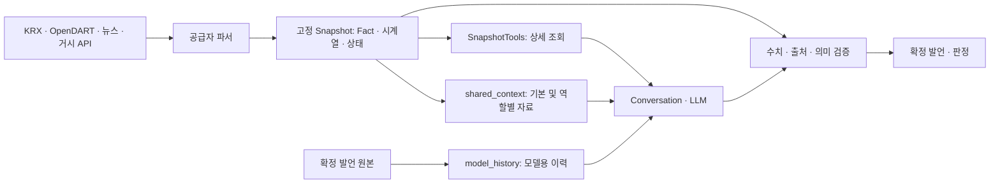
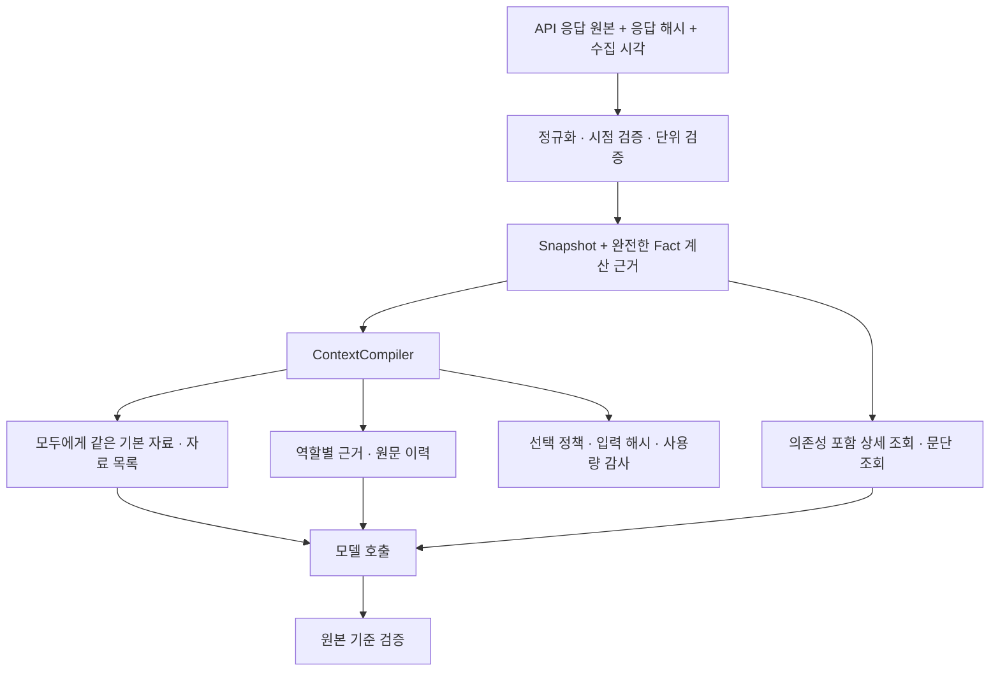

# 스냅샷 품질과 API → AI 입력 전달 설계

작성: 2026-11-11 · 상태: 조사·설계, 런타임 변경 없음.

**권고: 원본 API 응답과 고정 Snapshot은 충분히 보존하고, 모델에 보내는 자료만 공통 핵심 정보 + 역할별 근거 + 필요한 상세 조회로 구성한다.** 분석 시작 시점의 v27에는 이 방향의 상당 부분이 이미 구현되어 있다. 다음 우선순위는 JSON을 다른 형식으로 바꾸는 일이 아니라 데이터의 의미·계산 근거를 보강하고, 단일/토론의 정보 접근을 맞추며, 전체 실행 비용을 측정하는 것이다.

## 1. 분석 기준과 확인 범위

- 브랜치: `feat/worker-remove-basic-knowledge`, HEAD `23a3e27a6e2915a5c10f10c7b2c080291d1a0c48`. **분석 시작 시점 작업 트리와 이후 별도로 고정한 최종 분석 사본**을 구분한다. HEAD만으로 재현되지 않으므로 [측정 JSON](worker-snapshot-context-design-20261111.json)에 두 시점의 워커 Python 소스 SHA-256을 기록했다.
- 기준선 입력 정책: `langgraph-compact-context-v27`. 과거 v26 캡처·WORKLOG와 구분했다.
- 삼성전자 스냅샷 `005930-20261110-98b2a987dc`와 과거 저장 응답으로 시작 시점의 요청 14개를 네트워크 차단 상태에서 재구성했다. 기존 v27 캡처 14개와 요청 객체가 모두 일치했다.
- **동시 변경 경계:** 검토 도중 코드와 공용 v27 캡처가 갱신되었다. 정책 문자열은 계속 v27이어서 문자열만으로 구분할 수 없다. 최초 측정은 `initial_observation`에 보존하고, 마지막에는 소스 전체를 별도 폴더에 복사해 그 사본으로 14개 요청을 재생했다. 아래 초기 구조·행 번호와 최종 사본의 차이는 §2의 별도 표로 구분한다. 이후 작업 트리가 더 바뀌어도 이 문서의 측정 대상은 바뀌지 않는다.
- 최종 고정 원자료: `ai-worker/data/snapshot-context-research-frozen-20261111/`의 `source_snapshot/`, Snapshot, 재생 코드, 14개 요청. 감사 명령은 `ai-worker/data/snapshot-context-research-20261111/freeze_replay.py`다. 이 `data/` 영역은 Git 제외 대상이며 새 clone에는 없다. 아래 명령은 이미 있는 고정 소스 사본을 재사용한다. 저장된 v24 응답과 v26 ZIP도 필요하다.
- **실모델 생성·제공자 토큰 계수·실제 금융 API 호출은 0회**다. 웹 조사는 공식 문서에 한정했다. 아래 문자 수는 토큰 수나 비용이 아니다. 전체 워커 테스트는 이번 문서 작업에서 재실행하지 않았다.

재현 명령(저장 원자료가 있는 Windows 작업공간):

```powershell
& ai-worker/.venv/Scripts/python.exe ai-worker/data/snapshot-context-research-20261111/freeze_replay.py
```

## 2. 기준선 구조와 이미 개선된 부분



기준선 코드에 연결된 기능은 다음과 같다. 이를 새로 구현해야 할 기능으로 중복 제안하지 않는다.

| 기능 | 현재 상태·근거 |
|---|---|
| 고정 기준 데이터 | `snapshot.py`가 Fact·시계열·정보 마감 시점·상태를 저장하고 입력 내용으로 ID를 만든다 |
| 핵심 지표와 계산 입력 선택 | `shared_context.py:23,39,156`의 `core_fact_ids` 및 `expand_fact_ids`; `graph_runtime.py:80`에서 사용 |
| 중재자 입력 선택 | `shared_context.py:178`은 공통 핵심 + 발언에 인용된 Fact + 계산 입력 + 뉴스 미리보기를 제공 |
| 이력 중복 제거 | `model_context.py:69`는 관측 사본과 값의 반복을 제거하고 발언 원문·가정·한계·반박 연결을 보존 |
| 검수 자료 선택·부분 수정 | `statement_review.py:192`는 후보 발언과 관련 이력의 근거를 모아 검수하고 `issues/edits`로 수정 |
| 라운드별 출력 스키마 | `graph_runtime.py:183`에서 입론·반박·최종변론에 필요한 구조를 선택 |
| 중재 코멘트 부분 수정 | `graph_runtime.py:301`은 코멘트 문장 수만 틀린 경우 제한된 수정 경로 사용 |
| 시점 보호 | 당일 공시 공개 시각이 불명확하면 전일까지 사용; 종목/지수 수익률 날짜 정렬; 거시 자료 vintage·가용 시점 검사 |

### 기준선 입력 크기

동일 삼성전자 사례, JSON은 동일한 compact 직렬화로 비교했다.

| 항목 | 과거 v26 | 분석 시작 시점 v27 | 단위·해석 |
|---|---:|---:|---|
| 토론자 공통 데이터 | 13,542 | 6,963 | 문자, 약 48.6% 감소 |
| 중재자 데이터 | 21,569 | 6,817 | 문자, 약 68.4% 감소 |
| 중재자 제공 Fact | 131 | 35 | 행 |
| 중재자 이력 | 12,854 | 10,842 | 문자; 원문과 조건을 보존하므로 상대적으로 덜 감소 |
| 14개 요청의 텍스트·도구·출력 스키마 합계 | 332,442 | 180,551 | 문자, 약 45.7% 감소 |
| 위 합계의 UTF-8 크기 | 497,226 | 275,618 | 바이트 |
| 중재 두 번째 요청을 제외한 13개 합계 | 284,719 | 178,444 | 문자, 약 37.3% 감소 |

14개 합계에는 v26의 중재 전체 재시도가 v27의 짧은 코멘트 수정으로 바뀐 효과도 포함된다. 따라서 45.7%를 순수한 스냅샷 압축 효과라고 하면 틀린다. 이미지, 실제 도구 결과, 제공자 내부 프롬프트·HTTP 외곽 형식은 이 측정에 포함하지 않았다.

전체 Fact 131개는 시세 35, 재무 28, 가치평가 10, 공시 30, 뉴스 25, 거시 3개다. 기준선의 공통 핵심 25개를 계산 입력까지 확장하면 32개다. 발언 6개의 서로 다른 인용 Fact는 4개지만, 중재자에게 이 4개만 보내면 양측이 놓친 근거까지 가려진다. 독립적인 핵심 자료를 유지하는 선택이 타당하다.

저장 응답을 재생했으므로 공개 발언 일치와 판정 주요 필드 보존은 **변환 경로의 호환성 증거**다. 줄어든 입력으로 새 모델이 같은 품질의 판단을 한다는 증거는 아니다.

### 최종 분석 사본에서 추가로 확인한 변화

최초 분석 이후 작업에서 아래 기능이 추가되었다. 별도로 복사한 소스 사본으로 재생해 수치를 확인했으며, 이 조사의 런타임 수정은 아니다.

| 항목 | 분석 시작 시점 | 최종 고정 사본 |
|---|---:|---:|
| 토론자 공통 데이터 문자 | 6,963 | 3,924 |
| 중재자 데이터 문자 | 6,817 | 3,774 |
| 중재자 Fact 행 | 35 | 14 |
| 중재자 이력 문자 | 10,842 | 5,382 |
| 14요청 텍스트·도구·스키마 문자 합계 | 180,551 | 134,383 |
| 14요청 UTF-8 바이트 합계 | 275,618 | 194,791 |

최종 사본은 `build_compact_fact_context`로 반복 메타데이터를 묶고, 토론 기본 Fact를 16개로 줄였다. 계산 입력을 포함하면 27개지만 **기본 전송에는 그 27개를 모두 넣지 않는다**. 뉴스 미리보기에서 요약문도 빠졌다. `model_history`는 공개 발언과 근거 ID를 먼저 보내고 해석·가정·한계는 `get_statement_details`로 조회하게 한다. 검수의 후보/관련 Fact 의존성 확장은 유지된다.

따라서 아래 §4의 “미리보기에 note 전체”는 최초 상태에만 해당하고, 동종 메타데이터 묶음 제안은 최종 사본에서 이미 구현 대상으로 넘어갔다. 남은 핵심은 **조회로 옮긴 조건·계산 근거를 모델이 실제로 찾아 읽는지**다. 상세 조회 도구가 존재하는 것과 필요한 순간에 사용되는 것은 다르다. 이번 재생에는 실제 도구 호출이 없으므로 위 134,383자로 상세 조회가 발생하는 실행의 총량이나 품질을 예측해서는 안 된다.

권고는 반박 검수·중재에서 직접 비교하는 주장에 붙은 가정/한계와 핵심 계산 근거를 우선 제공하고, 그 밖의 상세 분석을 조회 대상으로 두는 것이다. 전부 조회로 옮기는 정책도 비교할 수 있지만 조건 누락·반박 왜곡과 추가 왕복을 통과 기준에 넣어야 한다. 정책 변경에는 새 버전 또는 내용 해시를 부여해야 한다.

## 3. 남은 문제: 데이터 자체

| 우선순위 | 확인된 사실 | 영향·권고 |
|---|---|---|
| P0 | `snapshot.py:562`의 순손실 PER 분기가 정의되지 않은 `report_basis`를 참조 | 순이익 -1의 합성 보고서에서 `NameError` 재현. 적자 기업의 Snapshot 생성 실패 가능. 압축보다 먼저 고쳐야 한다 |
| P0 | `snapshot.py:505-522`의 TTM `inputs`에 전년 동기 누적값이 빠짐. YOY도 비교값이 note에만 존재 | `70 + 40 - 30 = 80`에서 입력 Fact는 70과 40만 남는다. 의존성 확장이 성공해도 계산 근거는 불완전하다. 모든 피연산자를 Fact로 보존하고 계산식·버전을 연결해야 한다 |
| P0 | `data/pykrx_dart.py:151-168`이 주요계정 `currency`를 버리고 `snapshot.py:481,487`은 KRW로 표시 | 가짜 USD 매출 100이 100 KRW로 변환됨을 재현. 실제 종목에서 발생한 사례는 미확인. 우선 비원화·불명확 통화를 검출해 사용 제외하고 이유를 남긴다 |
| P1 | `Fact.as_of`가 시세 거래일·재무 공시일·뉴스 발행일을 함께 표현; 초과수익의 구조화 단위는 `%`, 의미는 `%p` | 날짜·단위를 라벨/note에서 추론해야 한다. 관측 기간, 공개 가능 시점, 분기/YTD/TTM, 연결/별도, `%`/`%p`를 모델용 구조에 명시해야 한다 |
| P1 | `snapshot.py:250,259-262`의 카테고리 `OK`는 일부 Fact 또는 주식수 존재만으로 성립 | `OK`가 PER·재무 전체의 완전성을 의미하지 않는다. 지표별 결측 이유와 자료 나이를 함께 제공한다 |
| P1 | OpenDART 캐시는 요청 인자별 성공 JSON이며 Snapshot과 응답 판본·수집 시각·파서 버전의 연결이 없음 | 원본이 전혀 없는 것은 아니다. 다만 정정 전 판본 재현과 원인 추적이 어렵다. 응답 해시와 수집 이력을 연결해야 한다 |

OpenDART 공식 응답은 통화뿐 아니라 당기·전기 기간, 당기·전기 누적금액도 제공한다. 현재 변환 과정에서 잃는 의미를 상위 모델이 다시 추측하게 만드는 것은 비효율적이다. [OpenDART 단일회사 주요계정](https://opendart.fss.or.kr/guide/detail.do?apiGrpCd=DS003&apiId=2019016)

과거 날짜 재구성은 별도 주의가 필요하다. [ROADMAP](../ROADMAP.md)은 뉴스 제외를 결정했지만, 기준선 `server/market.py:231`의 Snapshot 경로에는 과거 모드 분기 없이 뉴스 공급자를 전달한다. HTTP의 과거 날짜 지정 지원 자체도 아직 구현되지 않았다. 이는 **계획의 미구현 부분**이며 실제 백테스트 오염을 입증한 것은 아니다. 과거 모드를 구현할 때 뉴스 목록·본문 도구를 모두 끄고 `disabled_by_policy`로 표시해야 한다. 기사 발행일이 마감 전이어도 오늘 가져온 본문이 당시와 같은 판본이라는 보장은 없다.

## 4. 남은 문제: 모델에 전달하는 방식

1. **토론과 단일 분석의 정보 접근이 다르다.** `single.py:54-63`은 기존 `TOOL_DEFINITIONS`를 사용하며 거시·전체 뉴스·일봉 조회 도구가 없다. 토론자는 거시를 기본으로 받고 전체 Fact 조회도 가능하다. 같은 Snapshot ID만으로 동일 정보 조건이 되지 않는다. 실험에서는 공통 기본 자료·조회 능력·뉴스 정책·차트 정책을 맞춰야 한다.
2. **생략한 근거를 발견하기 어렵다.** 핵심 목록에는 공시가 없고 뉴스는 회사 2건·시장 1건이다. 최신순 선택은 재현 가능하지만 중요도를 보장하지 않는다. 범주별 자료 수·기간·누락·상세 조회 경로를 기본 입력에 넣고 주요 공시를 놓치는지 검증해야 한다. 제목만 제공된 공시는 본문을 읽은 것으로 취급하지 않는다.
3. **도구 왕복이 다시 입력량을 키울 수 있다.** 기본 입력은 의존성을 확장하지만 `get_facts`는 요청한 ID만 반환한다. 목록 → Fact → 계산 입력의 연속 호출을 줄이도록 의존성까지 묶어서 제공해야 한다.
4. **길이 제한과 조회 가능성이 일치하지 않는다.** `tools.py:167`은 8,000자를 넘는 단일 Fact를 `oversized_source_ids`로만 돌려주어 반복 호출해도 읽지 못한다. 반면 뉴스 미리보기는 note 전체를 넣는다. 짧은 메타데이터와 문단 단위 본문 조회를 분리해야 한다.
5. **8,000자는 요청 전체 토큰 예산이 아니다.** 이력·프롬프트·스키마·이미지·최대 8회 도구 왕복·재시도가 누적된다. 단일 요청 크기와 토론 전체 사용량을 모두 측정해야 한다. `anthropic_budget.py:91-122`의 최대 context window 기반 예약도 별도이므로 입력 축소만으로 예약 부족이 해결되지는 않는다.
6. **선택 정책의 검증 범위가 좁다.** 삼성전자 한 사례와 저장 응답 재생만으로 반증 발견·조건 보존·조회 성공률을 입증할 수 없다. 중재·최종변론의 원문 이력을 추가로 지우기 전에 여러 종목과 오류 사례로 확인해야 한다.

## 5. 외부 조사에서 적용할 원칙

| 공식 자료 | 확인 내용 | 이 프로젝트의 설계 판단 |
|---|---|---|
| [Anthropic: Context engineering](https://www.anthropic.com/research/effective-context-engineering-for-ai-agents) | 유용한 최소 문맥과 필요 시 자료 조회를 권고 | 원본 보존과 모델 입력 선택을 분리한다. 요약문만으로 수치·조건을 대체하지 않는다 |
| [Anthropic: Writing effective tools](https://www.anthropic.com/research/writing-tools-for-agents) | 의미 있는 반환값, 작업을 묶는 도구, 필터·페이지네이션과 자체 평가를 권고 | Fact ID 묶음 + 계산 입력 조회를 확장한다. CSV가 항상 JSON보다 우수하다고 가정하지 않는다 |
| [Claude: Prompt caching](https://platform.claude.com/docs/en/build-with-claude/prompt-caching) | 동일 prefix의 처리 비용·지연을 줄임; 설정·도구·이미지 등의 변화가 캐시에 영향 | 입력량 감소와 캐시 절감을 별도 지표로 보고한다. 동시 입론의 최초 캐시 공유는 보장하지 않는다 |
| [Claude: Structured outputs](https://platform.claude.com/docs/en/build-with-claude/structured-outputs) | 출력 구조를 제약하지만 일부 스키마 제약은 제한됨. `output_config.format` 변경은 prompt cache를 무효화 | 라운드별 작은 스키마와 공통 작은 스키마를 비교한다. 출력 문법 성공을 수치·출처 정확성으로 해석하지 않는다 |
| [Claude: Token counting](https://platform.claude.com/docs/en/build-with-claude/token-counting) | 메시지·도구 등을 사전 계수하나 캐시는 사용하지 않음. web_fetch·web_search·MCP connector는 계수 미지원 | 로컬 도구 요청은 계수 API로, web_fetch 포함 경로는 실제 응답 usage로 검증한다 |

현재 공식 문서는 Sonnet/Haiku 5.5의 메시지 안 system 역할을 지원한다. 따라서 `llm.py:102`의 고정 자료 뒤 역할 메시지 배치 자체를 오류로 보지 않는다. 모델 지원 제약을 유지하며 실제 요청의 캐시 사용량을 확인한다. [Claude: Prompt caching](https://platform.claude.com/docs/en/build-with-claude/prompt-caching)

## 6. 제안 구조

새 서버나 벡터 DB를 도입할 필요는 없다. 기존 Fact·Snapshot·도구를 확장하고, 흩어진 입력 선택을 워커 내부의 `ContextCompiler` 역할로 묶는 안을 권장한다. 아래 타입과 필드는 **제안**이며 현재 구현과 구분한다.



### 6.1 원본과 의미를 보존하는 저장층

| 층 | 보존할 정보 | 모델 전달 |
|---|---|---|
| 원본 응답 | 공급자·endpoint·비밀정보를 뺀 인자, 수집 시각, 응답 해시, 접수번호/판본, 원본 JSON, 파서 버전 | 기본 입력에는 보내지 않음 |
| 정규화된 관측 | 정확한 값·통화·단위, 관측 시작/끝, 기간 종류, 연결/별도, 공개 가능 시점과 그 정밀도, 원본 응답 연결 | 선택한 관측에 필요한 의미만 전달 |
| 파생 지표 | 계산식 ID/버전, **모든** 입력 Fact ID, 계산·표시 반올림 정책 | 결과와 계산 입력을 함께 조회 가능하게 함 |
| 가용성 | missing/unsupported/stale/failed 등 사유, 기준 보고서, 자료 나이 | 필요한 지표의 상태를 반드시 전달 |

원화 환산은 환율 기준일·출처까지 새 근거가 필요한 별도 기능이다. 이번 범위에서는 지원하지 않는 통화의 값을 KRW로 이름만 바꾸지 않고 사용 제외하는 편이 적절하다. 큰 금액은 원본 정확도를 저장층에서 보존하고, 모델 표시를 조원으로 바꾸더라도 scale과 검증 기준 원값을 연결한다.

`observed_period`, `available_at`, `retrieved_at`은 다르다. 공개 시각이 날짜로만 확인되면 정밀도를 `date`로 보존하고 현재의 보수적 마감 정책을 적용한다. API를 오늘 조회했다는 사실만으로 과거 시점 가용성을 증명할 수 없다.

단기에는 기존 `Fact`와 검증을 유지하며 워커 내부 메타데이터를 보완한다. 의미를 바꾸는 메타데이터·입력값은 해시/버전에도 반영해야 한다. 공개 Fact 필드·단위 enum·Snapshot 계약을 변경하는 단계는 `docs/worker-api.md` 계약 PR과 양쪽 검토가 필요하다. 이 문서는 계약을 변경하지 않는다.

### 6.2 공통 기본 자료와 역할별 자료

```python
# 제안 인터페이스. 기존 build_shared_push/model_history 등을 점진적으로 통합.
compile_context(snapshot, *, role, stage, transcript, candidate=None,
                policy, budget) -> ModelContext
```

`ModelContext`는 `stable_prefix`, `task_context`, `tool_profile`, 서버 감사용 `selection_manifest`로 나눈다. 감사용 상세 제외 목록까지 모델에 반복 전송하지 않는다.

| 역할 | 기본 제공 | 추가 제공 |
|---|---|---|
| 황소·곰 입론 | 동일 핵심 수치, 단위/기간, 상태·경고, 자료 목록 | 동일한 조회 능력; 배정 입장만 다름 |
| 황소·곰 반박 | 같은 기본 자료 | 양측 입론 원문, 반박 대상 ID/직접 인용, 기본 자료에 없는 인용 Fact와 계산 입력 |
| 황소·곰 최종변론 | 같은 기본 자료 | 입론·반박 원문과 조건·한계. 기준선의 보존 정책을 우선하며 상세 조회로 옮기면 누락을 검증 |
| 공개 전 검수 | 후보 + 후보가 인용한 근거 | 반박 대상과 인용된 이전 발언, 관련 계산 입력. 대상을 확정할 수 없으면 전체 이력으로 복귀 |
| 중재자 | 독립적인 공통 핵심과 자료 목록 | 6발언 원문 + 인용 Fact/계산 입력. 양측이 쓰지 않은 자료도 조회 가능 |
| 단일 분석 | 토론과 동일 기본 자료·조회 능력·뉴스/차트 정책 | 토론 이력 없이 독립 판정 |

모든 역할에 모든 이력을 넣을 필요는 없지만, 주장·원문 인용·불확실성·입장 변화는 LLM 요약으로 덮어쓰지 않는다. 공개 전 검수의 임무는 전달된 주장과 근거의 대조이며, 광범위한 반증 탐색은 토론자·중재자의 임무로 구분한다.

기본 자료 목록에는 범주별 수량, 관측 기간, 자료 상태와 상세 조회 가능 여부를 넣는다. 공시·뉴스를 생략했다는 사실이 보여야 한다. 감성에 따라 양측에 다른 자료를 고르지 않는다. 공시 미리보기의 개수·선정 규칙은 적자·정정·자본변동 사례에서 누락률을 보고 정한다.

### 6.3 전달 형식: JSON 구조 + 같은 종류의 CSV 표

다음 예시는 실제 투자 데이터가 아닌 **모델용 형식 예시**다. `%p`의 표현도 모델 투영에 대한 제안이며 현행 공개 `Fact.unit`을 바꾸는 뜻이 아니다.

```json
{
  "context_version": "proposal-v1",
  "snapshot_id": "example-snapshot",
  "information_cutoff": "2026-11-10T15:30:00+09:00",
  "tables": [{
    "kind": "relative_return",
    "meta": {"as_of": "2026-11-10", "unit": "pp", "benchmark": "KOSPI", "source": "derived"},
    "rows_csv": "source_id,label,value,window_sessions,inputs\r\nPX.EXCESS_KOSPI_7D,7거래일 초과수익률,1.2,7,PX.RET_7D|MKT.KOSPI_RET_7D\r\n"
  }],
  "availability": [{"metric": "VAL.PER_TTM", "status": "not_applicable", "reason": "nonpositive_ttm_income"}],
  "inventory": [{"category": "disclosure", "available_count": 30, "lookup": "get_fact_catalog"}]
}
```

같은 단위·기간·출처·보고서 기준을 공유하는 행에만 메타데이터를 묶는다. 묶음 키가 달라지면 표를 분리하고 다른 날짜의 근거가 상속되지 않게 검증한다. CSV 파서를 사용해 쉼표·따옴표·개행을 보존한다. `inputs` 구분자는 정해진 ID 문법에서 충돌하지 않는 경우에만 사용하며 그렇지 않으면 JSON 배열을 쓴다.

| 후보 | 장점 | 한계·판단 |
|---|---|---|
| 현재의 작은 JSON + CSV | 기존 코드·검증과 가깝고 수치 표가 간결 | 우선 유지. 동종 표와 공통 메타데이터 묶음을 실험 |
| JSON 객체 배열 | 중첩과 null 의미가 명확 | 반복 키 비용이 있지만 작은·불규칙 데이터에는 적절 |
| columns + rows 배열 | 키 반복이 적음 | 열 순서 오류·긴 배열 가독성을 검증해야 함. 비교 후보 |
| LLM 자연어 요약 | 읽기 편함 | 숫자·기간·예외·반증 손실, 추가 호출 비용. 기준 근거의 대체물로는 부적절 |
| 임베딩 검색/RAG | 긴 비정형 자료에서 관련 문단 탐색에 유용 | 현재의 정확한 Fact ID 조회에는 과도함. 향후 공시 본문 규모가 커질 때 검토 |

빈 셀은 미제공, 수치 0은 관측값 0으로 구분한다. 산출 불가·조회 실패·정책상 제외는 별도 상태로 남긴다. 기본 금융 교과 설명을 다시 주입하지 않고, **이 데이터의 기간·단위·산식에 필요한 설명**을 남긴다. 전송용 gzip이나 base64는 모델이 읽어야 하는 정보량을 줄이는 설계의 대안이 아니다.

### 6.4 상세 조회

- 기존 `get_facts`에 의존성 포함 조회를 추가한다. 요청 ID 1~8개 제한은 시작점으로 유지하되 계산 입력까지 포함된 실제 반환량을 따로 제한한다. 모델이 다른 Snapshot ID를 선택하게 하지 않는다.
- 목록 → 값 → 계산 입력의 왕복 대신 관련 Fact 묶음을 한 번에 반환한다. 결과에 `returned_source_ids`, `missing_source_ids`, `remaining_source_ids`, 의존성 완전성 상태를 넣는다.
- 예산이 모자라면 Fact/계산 묶음의 경계에서 나눈다. `incomplete_dependencies`를 명시하고 완전한 근거를 받은 것으로 검증하지 않는다. 같은 요청이 무한히 동일 실패를 반환하는 경로를 없앤다.
- 긴 뉴스·문서 텍스트는 문단 경계로 분할한다. `source_id`, `content_hash`, 문단 ID, 원문 위치, 다음 cursor를 함께 반환한다. 정확한 인용과 조건이 문단 경계를 넘으면 인접 문단도 받는다. 잘린 요약을 완전한 본문처럼 표시하지 않는다.
- 최신 모드의 본문 조회는 같은 실행에서 내용 해시를 고정·재사용한다. 토론/단일 비교에는 같은 본문 판본과 접근 정책을 적용한다. 과거 재구성 모드는 뉴스 조회 자체를 끈다.
- 로컬 도구 결과의 결정적 계산·필터링은 Python에서 수행한다. 모델에 큰 표를 보내 다시 계산시키지 않는다.

### 6.5 입력 예산·캐시·수정

예산 범위는 `지시 + 자료 + 이력 + 도구 정의 + 출력 스키마 + 이미지 + 이전 도구 결과` 전체다. 제공자가 지원하는 요청은 호출 전에 계수하고, web_fetch 등 계수 미지원 경로는 보수적인 사전 크기 제한과 실제 응답 usage를 함께 쓴다. 지원하지 않는 요청에서 정확한 사전 계수가 가능한 것처럼 표시하지 않는다. 필수 Fact의 의미·직접 인용·상태는 보존한다. 예산을 넘으면 선택 자료를 줄이거나 상세 조회로 이동하며, 필수 자료만으로 한도를 넘을 때는 명시적인 초과 상태를 남긴다. 정해진 숫자에 맞추려고 근거를 조용히 삭제하지 않는다.

캐시는 고정된 공통 prefix에 적용하되 모델, 도구 정의/순서, 출력 스키마, effort, 이미지 유무를 함께 기록한다. **라운드별 스키마 축소와 캐시 적중이 양립한다고 가정하지 않는다.** 다음 두 안을 비교한다.

- A: 기준선 v27의 라운드별 작은 스키마.
- B: 공통으로 작게 만든 스키마 + 라운드별 서버 검증.

기준은 스키마 문자 수가 아니라 실제 비용·총 입력량·재시도·지연이다. 문장 수 같은 형식 오류는 기존 부분 수정을 유지하고, 근거나 논리가 틀린 경우에는 관련 원문과 Fact를 다시 검증한다. 수정 성공 후에도 원본 검증기를 통과해야 한다.

## 7. 검증 계획과 적용 순서

새 설계의 비교 기준은 과거 v26이 아니라 **소스 해시로 식별하는 v27 입력 정책**이다. 최종 고정 사본은 실제 재실행 가능한 후속 기준선이며, 초기 측정은 변화의 경위를 보여주는 기록이다. 후속 작업본은 별도 입력 정책 버전과 소스 해시로 기록한다. 직렬화만 바꾸는 실험에서는 Fact ID·값·단위·기간·조건을 동일하게 유지하고, 선택 정책 변경은 별도 실험으로 분리한다.

| 순서 | 범위 | 완료 판단 |
|---|---|---|
| P0-1 | 적자 PER 예외, 재무 통화 검사, TTM/YOY 전 입력 Fact 보존 | 적자·비원화·전년동기 결측을 합성 입력으로 검증; 파생값을 입력 Fact만으로 재계산 가능 |
| P0-2 | 단일/토론의 공통 자료와 도구 능력 통일 | 같은 Snapshot에서 접근 가능한 범주·시점·뉴스/차트 정책이 같음; 이력·역할만 다름 |
| P0-3 | 기준선과 후속 버전의 입력·도구·스키마·선택 manifest와 실제 usage 기록 | 추가 조회·검수·수정·재시도까지 누락 없이 합산; 기록에 API 키 없음 |
| P1-1 | 자료 목록, 결측 사유, 묶음 상세 조회 | 제외된 공시·반대 근거의 발견 여부와 조회 왕복 감소를 확인 |
| P1-2 | 최종 사본의 메타데이터 묶음·이력 상세 조회 검증, 긴 문서 분할 | 원문·숫자·기간 왕복 보존, 가정/한계 발견, 긴 Fact 조회 가능, 실제 입력 계수 개선 |
| P1-3 | 공통/라운드 스키마 및 캐시 비교 | 총 비용·지연과 검증 실패율을 함께 비교해 선택 |
| 이후 | 원본 판본 저장 확대, 긴 공시 본문 검색 | 실제 수집 규모와 장애 근거가 생겼을 때 확장 |

초기 평가 묶음은 삼성전자 외에 적자 기업, 분기/누적 혼재, 연결/별도 차이, 정정공시, 결측·오래된 재무, 기업행사 가격 단절, 뉴스 과다·본문 실패, 중요한 공시가 기본 자료에 없는 사례를 포함한다. 과거 재구성과 최신 조회는 별도 묶음으로 평가한다.

수치·단위·기간·Fact 참조·원문 인용·계산 입력 보존은 결정적 검사에서 전부 통과해야 한다. 실모델 평가는 맹검으로 반증 누락, 조건/한계 손실, 상대 주장 왜곡을 검토한다. 판정이 기준선과 같다는 이유만으로 성공 처리하지 않는다. 소수 표본의 차이를 일반적인 품질 향상으로 주장하지 않는다.

사용량은 제공자 응답 기준으로 아래를 따로 기록한다. `input_tokens`가 비캐시 입력인 현재 Anthropic usage를 기준으로 한 식이며, 다른 집계의 total 필드와 중복 합산하지 않는다. [Claude: Prompt caching](https://platform.claude.com/docs/en/build-with-claude/prompt-caching)

```text
요청 총 입력 = input_tokens + cache_creation_input_tokens + cache_read_input_tokens
실행 총 입력 = 모든 생성·검수·도구 후속·수정·재시도 요청의 총 입력 합계
비용 = 비캐시 입력 + 캐시 쓰기 + 캐시 읽기 + 출력 + 도구별 비용의 해당 단가 적용 합계
```

함께 볼 지표는 요청 수, 도구 왕복 수, 검수 수정률, 재시도 수, 완료율, p50/p95 지연, 예산 예약 실패율이다. 캐시가 많이 적중해도 실제 문맥은 길 수 있고, 기본 입력을 줄여도 상세 조회가 늘면 실행 총량은 커질 수 있다.

이번 조사에서는 위 평가 중 **초기 입력과 최종 고정 사본의 오프라인 재현, 데이터 결함 최소 재현**까지 수행했다. 새로운 설계 및 검토 중 추가된 구현의 실모델 품질·실제 토큰·캐시·비용 절감은 미측정이다. 구현 시에는 P0부터 진행하고, 공개 계약 변경과 대규모 검색 인프라 확장은 별도 작업으로 분리한다.
