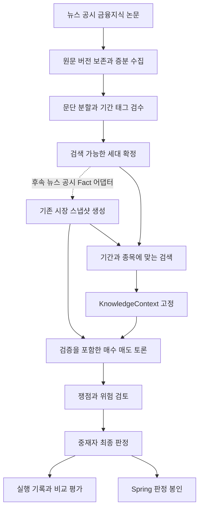
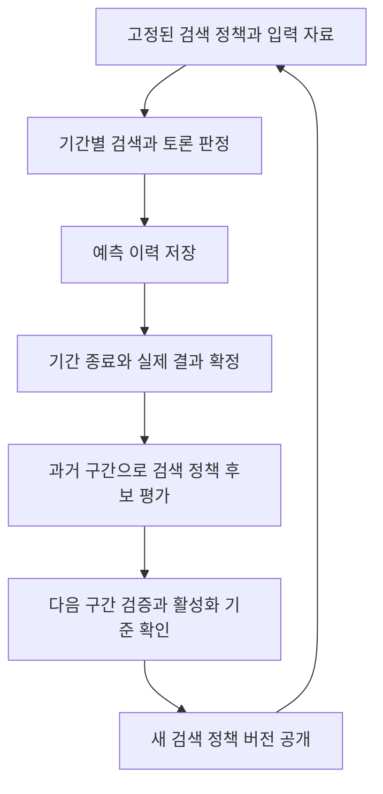

# 워커 RAG 저장 구조와 기간별 검색 설계

2026-10-30 · 구현 전 설계 · 담당 영역 ai-worker

현재 워커의 고정 스냅샷과 근거 검증을 유지하면서 뉴스·공시를 증분 저장하고, 금융지식·논문을 공통·단기·중기·장기 태그로 검색한다. 시장 사실은 `Snapshot.facts`, 설명과 해석을 돕는 지식은 별도 `KnowledgeContext`로 관리한다. 토론 시작 전에 두 입력을 고정하고, 진행 중에는 검색 저장소의 최신 내용으로 바꾸지 않는다.

현재 서비스의 본판정은 **7거래일 뒤 코스피 대비 초과수익**이며 3거래일은 보조 채점이다. 기간 태그는 자료의 적용 범위를 나타낸다. 중기·장기 태그를 추가해도 서비스의 판정 기간이나 BUY/HOLD/SELL 의미가 바뀌지 않는다. 계약은 [worker-api.md](worker-api.md), 일정은 [ROADMAP.md](ROADMAP.md), 실험 기준은 [experiment.md](experiment.md)를 따른다.

## 현재 구현 우선순위

2026-10-30 기준 우선순위다. 11/16 코드 프리즈와 전시용 7거래일 결과 축적을 고려해 기존 전향 운용을 먼저 시작한다. RAG·위험 검토·LangGraph 완성을 운영 시작의 의존성으로 두지 않는다. 아래 순서는 현재 작업 선택 기준이며, 뒤의 구현 단계 표는 각 모듈의 의존성을 설명한다.

| 순위 | 우선순위 | 작업 | 완료 기준 |
|---|---|---|---|
| 1 | P0 | 실제 Spring 연동·기준선 측정·전향 운용 | 토론→사용자 판정→공개→채점 경로 확인, 실제 모델·비용·완료율·지연과 실패 기록, 첫날부터 입력/정책 버전 보존 |
| 2 | P0 병행 | 뉴스·공시의 최소 원문 수집·버전/관측 이력 | 현재 제공되는 제목·요약부터 멱등 저장, 정정/활성화·수집 실패·자료 공백 기록. 검색·본문 확보를 기다리지 않고 축적 시작 |
| 3 | P0 | 동일 스냅샷 단일 대비 토론 실행기 | 같은 목표·시장 Fact·최종 판정 모델로 조건 비교, 성공/실패·시간·비용·원문 보존. 운영 HTTP 캐시를 우회하는 별도 내부 실험 |
| 4 | P1 | 공통·단기 RAG 최소 저장·검색·고정 입력 | 검수한 소규모 지식, 문단/복수 태그, FTS5, KnowledgeContext 고정, 토론자·중재자·검토자 연결, 시점·공개 인용 경계 통과 |
| 5 | P1 | RAG 추가 효과 평가와 운영 고정 | 기본 대비 common+short만 변경해 비교하고 완료율·개념 오류·지연·비용 확인. 예측 결과가 성숙하기 전 성과 개선을 단정하지 않음 |
| 6 | P2 | 위험 검토 노드 하나 | 같은 자료·모델에서 검토 유무만 비교, 추가 비용과 오류 탐지 효과가 허용 범위인지 확인 |
| 7 | P2 | LangGraph 실행 이관 | 기존 발언 순서·검증·이벤트 동등성 확인. 기능 변화와 구조 이관의 효과를 분리 |
| 보류 | 후속 | 실행 재개·벡터 검색·중장기 예측·자동 검색 정책 개선 | 실제 필요·자료·평가 표본과 시간 예산을 확보한 뒤 독립 기능으로 진행 |

1번의 최소 실행 기록은 나중으로 미루지 않는다. 2번은 1번과 병행하고, 3번 비교 실행기를 만드는 동안 4번의 저장 스키마를 병행할 수 있다. 현재 `experiment.py`는 선공 순서 비교이며 단일 에이전트 기준선이 구현된 것은 아니다.

워커 자체의 첫 구현 묶음은 `rag/schemas.py`, `rag/store.py`, 현재 공급자 응답을 보존하는 `rag/ingest.py`와 최소 감사 기록이다. 원문·공개/관측 시각·버전 활성화가 먼저이며 검색 엔진과 새 에이전트 추가는 뒤에 연결한다. 기사 본문·논문 대량 수집·새 기술 지표를 이 묶음의 필수 조건으로 늘리지 않는다.

프리즈 전 목표는 **기존 전향 운용과 공통·단기 RAG의 검증된 최소 경로**다. RAG가 늦어지면 기존 기본 조건으로 결과 축적을 계속하고, 투입 시점·프로필·지식 묶음을 별도 조건으로 기록한다. 5번의 비교 결과나 기간이 부족하면 6·7번을 진행하기보다 운영 구성을 고정한다. PM 관리 문서인 ROADMAP의 일정 자체는 이 제안으로 변경하지 않는다.

## 설계 결정

| 항목 | 초기 구현 결정 | 이유 |
|---|---|---|
| HTTP 서버 | 기존 FastAPI·인증·202 응답·SSE·멱등 키 유지 | Spring 연동과 판정 봉인 경계를 재사용한다 |
| 원문 저장 | 별도 `data/rag/rag.sqlite3`와 원문 파일 | 토론 이벤트 DB의 쓰기 잠금을 수집 작업과 분리한다 |
| 지식 분류 | 문단별 복수 태그 `common/short/medium/long` | 공통 자료의 중복 저장과 수정 불일치를 줄인다 |
| 첫 검색 엔진 | SQLite FTS5 BM25와 검수된 용어·별칭 사전 | 별도 서버 없이 작은 자료 집합부터 평가한다 |
| 의미 검색 | 검색 평가 후 추가하는 교체 가능한 인덱스 | 한국어 검색 누락을 측정하고 임베딩 비용·효과를 비교한다 |
| 토론 입력 | 시장 스냅샷과 불변 지식 묶음을 각각 고정 | 수치 근거와 일반 이론의 역할을 구분한다 |
| 첫 공개 인용 | 기존 `[E#]`와 Fact ID만 사용 | 현재 웹은 모든 근거 칩을 `facts[source_id]`에서 찾는다 |
| 그래프 | 기존 함수들을 감싸는 LangGraph 실행 계층 | RAG의 저장·검색은 그래프와 독립적으로 먼저 구현할 수 있다 |
| 초기 실행 복구 | 현재의 중단 시 실패 처리 유지 | 영속 체크포인트·호출 기록·이벤트 중복 방지까지 갖춘 뒤 재개한다 |

여기서 RAG는 검색한 자료를 생성·검토 입력에 제공하는 구조다. 벡터 DB는 필수 조건이 아니다. SQLite FTS5의 BM25와 토큰화는 [공식 문서](https://sqlite.org/fts5.html)를 기준으로 구현한다. 기본 토큰화만으로 한국어 복합명사·띄어쓰기 차이를 충분히 처리한다고 가정하지 않는다.

## 현재 코드와 연결 위치

| 현재 파일 | 현재 역할 | 추가할 연결 |
|---|---|---|
| `snapshot.py` | Fact 구성·내용 해시·시세 기준일 | 초기에는 그대로 유지. 후속 단계에서 저장된 뉴스·공시를 같은 공급자 자료형으로 투영 |
| `tools.py` | 고정 스냅샷의 범주별 Fact 조회 | 진행 중인 토론에서 최신 검색 DB를 조회하지 않음 |
| `agents.py` | 발언·중재·검증·재작성 | 선택적 `background_context` 주입 |
| `semantic.py` | 개념·논리·기간·인용 해석 검토 | 같은 지식 묶음과 연구 적용 범위를 보조 입력 |
| `verifier.py`, `presentation.py` | 수치·근거 ID·새 근거·길이 검사 | 배경지식 ID를 시장 근거로 인정하지 않도록 경계 유지 |
| `server/service.py` | 스냅샷 생성·Runner 실행·이벤트 선별 | `snapshot` 이후 지식 묶음 고정, 내부 실행 기록과 연결 |
| `server/store.py` | SQLite 요청·스냅샷·SSE 저장 | 기존 DB 유지. 지식 묶음 연결과 실험 기록은 별도 저장 |
| `experiment.py` | 같은 스냅샷의 선공 비교·실패/비용 기록 | 지식·위험 검토 조건을 구분한 내부 비교 실행기 확장 |

현재 뉴스 공급자는 제목·요약·링크·발행 시각을 받고, 스냅샷에는 최근 7일 최대 30건을 담는다. 공시는 현재 제목 중심이다. RAG 도입이 기사·공시 본문 확보를 자동으로 해결하지는 않는다. 첫 수집기는 현재 제공되는 텍스트를 보존하고, 본문을 제공하는 공급자는 별도 어댑터로 확장한다.

## 자료 유형과 기간 태그

자료 유형과 기간은 서로 다른 축이다.

| `document_kind` | 내용 | 생성·검토에서의 역할 |
|---|---|---|
| `news` | 종목·업종 기사 | 시점별 시장 사실 후보 |
| `disclosure` | DART 공시·보고서 | 시점별 시장 사실 후보 |
| `knowledge` | 금융·회계 개념, 공식 교육 자료 | 정의·해석·예외 설명 |
| `research` | 논문·연구 보고서 | 조건부 가설·반례·적용 범위 검토 |

| `horizon_tag` | 내부 분류 기준 | 예시 |
|---|---|---|
| `common` | 기간을 가리지 않는 정의·계산·논리 | PER 정의, 상대수익과 %p, 변동성과 방향성의 구분 |
| `short` | 일별·이벤트 단위의 적용. 현재 서비스의 7거래일 질문과 관련 | 실적 발표의 기대 대비 차이, 뉴스 반응, 유동성 |
| `medium` | 월·분기 단위의 적용 | 이익 전망 변화, 재고·업황 주기 |
| `long` | 연 단위의 적용 | 경쟁우위, 자본 배분, 장기 가치 평가 |

이 구분은 검색 정책의 분류다. 논문이 실제로 검증한 기간은 별도로 저장한다. 예를 들어 `sample_start=2010`, `sample_end=2020`은 표본 범위이고, `forecast_horizon={value: 1, unit: trading_day}`는 예측 대상 기간이다. 표본 범위가 길다는 이유로 `long`을 붙이지 않는다. 기간을 알 수 없는 연구는 임의로 `short`로 채우지 않고 `unverified`로 둔다.

태그는 원문 전체보다 문단에 붙인다. 같은 자료의 PER 정의 문단은 `common`, 분기 이익 흐름 문단은 `medium`, 장기 가치 평가 문단은 `long`일 수 있다. 여러 태그를 허용하되 이유와 검수 상태를 남긴다. 모델이 제안한 태그는 검수 전 운영 검색에서 제외한다.

### 기간별 분석 프로필

참고 그림의 기간과 지표는 다음 검색 프로필의 대표 범위로 반영한다. 실제 요청은 태그와 별도로 정확한 기간·단위·벤치마크를 가진다. 범위 사이의 기간이나 3년을 넘는 요청을 임의로 가까운 태그에 배정하지 않으며, 해당 요청을 지원하는 프로필을 별도로 정의한다.

| 프로필 | 대표 기간 | 우선 검토할 내용 | 자료·지표 예시 |
|---|---|---|---|
| `common` | 모든 기간 | 개념·계산·회계·위험 해석 | PER·ROE 정의, 수익률과 %p, 변동성과 방향성 |
| `short` | 1~10거래일 | 가격·거래량·수급·이벤트의 단기 연결 | 뉴스·공시, 실적 기대 대비 차이, 모멘텀·RSI·MACD·변동성 |
| `medium` | 1~6개월 | 실적·업황·밸류에이션 변화 | EPS·PER·ROE, 실적 전망, 60/120일 이동평균, 벤치마크 상대강도 |
| `long` | 1~3년 | 기업가치·성장·자본 배분 | 사업보고서·산업 구조, ROIC·FCF·부채·경쟁우위·장기 성장률 |

표는 자료 선택의 출발점이며 지표가 한 기간에만 유효하거나 해당 기간의 수익을 예측한다고 보장하지 않는다. 공통 개념은 모든 프로필이 공유하고 같은 문단이 여러 프로필에 속할 수 있다. 현재 운영 프로필은 `common+short`, 목표는 7거래일로 유지한다.

현재 Fact에는 20/60/120일 이동평균, 거래량 비율, 20일 변동성, PER·ROE·영업이익률 등이 있다. RSI·MACD·EPS·ROIC·FCF·투자자별 수급·컨센서스 대비 어닝 서프라이즈·코스피 대비 상대강도 Fact는 현재 구현되어 있지 않다. 각 지표를 도입하려면 입력 자료와 공개 시각·계산식·검증을 먼저 추가해야 한다. 지식 문단에 설명이 있다는 이유로 해당 종목의 현재 수치를 모델이 만들어 넣지 않는다.

그림의 단기 시계열 모델·중기 수익률 모델·장기 가치 모델은 후속 예측 모듈 후보로 구분한다. 초기에는 동일한 LLM 토론 엔진에 기간별 자료 선택 정책을 적용한다. 학습 모델을 추가하면 학습 종료 시각·모델 버전·출력 사건을 별도로 고정하고 기존 LLM 판정과 조건을 구분한다. 실제 중기·장기 판정 기능은 채점 규칙·거래일/달력일·기업행사·배당 처리까지 정한 뒤 확장한다.

## 저장 구조

### 파일 배치

```text
data/
  http/worker.sqlite3          기존 요청·스냅샷·SSE
  snapshots/                  기존 시장 스냅샷
  debates/                    기존 감사 JSONL
  rag/
    rag.sqlite3               원문 버전·문단·주석·검색·지식 묶음
    objects/<content_hash>    받은 원문 파일 또는 원문 응답
  experiments/<run_id>/       조건·스냅샷·지식 묶음·결과·실패·사용량
  checkpoints/                후속 LangGraph 실행 재개 단계에서 추가
```

모든 경로는 `Settings.data_dir` 아래에서 계산한다. 운영 비밀값·원문 데이터는 기존 git 제외 정책을 따른다. 아래 표는 논리 스키마이며 실제 마이그레이션 DDL은 구현 단계에서 작성한다.

| 테이블 | 주요 필드 | 불변 조건 |
|---|---|---|
| `documents` | `document_id`, `source`, `source_item_id`, `kind`, `canonical_url`, `publisher` | `UNIQUE(source, source_item_id)`. 원문 식별과 내용 버전을 분리 |
| `document_revisions` | `revision_id`, `document_id`, `content_hash`, `object_path`, `text`, `title`, `published_at`, `published_on`, `source_updated_at`, `first_observed_at`, `fetched_at`, `timestamp_precision`, `content_level` | 내용은 덮어쓰지 않음. `UNIQUE(document_id, content_hash)` |
| `document_events` | `event_id`, `document_id`, `revision_id`, `collection_id`, `kind`, `observed_at`, `source_ref` | `revision_activated/withdrawn/deleted` 등 현재 버전·정정·철회 확인을 추가 기록 |
| `chunks` | `chunk_id`, `revision_id`, `ordinal`, `text`, `text_hash`, `source_locator`, `chunker_version` | 문단과 원문 페이지·절·문자 위치 연결. 분할 정책 변경도 버전 구분 |
| `chunk_annotations` | `annotation_id`, `chunk_id`, `topics`, `tickers`, `markets`, `event_at`, `valid_from`, `valid_until`, `study_scope`, `applicability`, `limitations`, `duplicate_group_id`, `review_status`, `reviewed_at`, `tagging_policy_version` | 주석 변경은 새 행. 종목·시장·태그 판정의 이력 보존 |
| `chunk_horizons` | `annotation_id`, `horizon_tag` | 복합 기본 키. 한 문단에 복수 기간 허용 |
| `index_generations` | `generation_id`, `status`, `index_type`, `normalizer_version`, `embedding_spec`, `committed_at` | `building/ready/failed`. ready 세대만 검색 가능 |
| `index_members` | `generation_id`, `chunk_id`, `annotation_id` | 해당 세대에서 검색 가능한 문단과 주석을 정확히 고정 |
| `collection_runs` | `collection_id`, `source`, `query_key`, `requested_window`, `status`, `pages`, `counts`, `coverage`, `safe_error`, `started_at`, `finished_at` | `completed/partial/failed` 구분. 빈 결과와 장애 구분 |
| `source_watermarks` | `source`, `query_key`, `cursor`, `completed_through`, `updated_at` | 필요한 페이지 수집·원문 저장 성공 뒤에만 전진 |
| `retrieval_runs` | `retrieval_id`, `decision_at`, `generation_id`, `profile_version`, `queries`, `filters`, `candidates`, `selected`, `exclusion_counts`, `status`, `latency_ms` | 재검색 없이 선택 과정을 확인할 수 있는 내부 감사 기록 |
| `context_bundles` | `context_id`, `snapshot_id`, `schema_version`, `canonical_payload`, `created_at` | 선택된 본문·출처·버전·적용 범위를 통째로 보관 |
| `debate_contexts` | `debate_id`, `context_id`, `retrieval_id`, `run_fingerprint`, `attached_at` | 같은 운영 토론의 연결은 한 번 확정하고 변경 금지 |

`study_scope`는 `market`, `sample_start/end`, `forecast_horizon`, `holding_period`, `decision_frequency`, `outcome_window`를 구분하는 JSON이다. 기간은 값과 단위(`trading_day/calendar_day/month/year`)를 함께 저장한다. 논문이 사용한 측정값도 절대수익·벤치마크 초과수익·방향 분류 등으로 구분한다.

`content_level`은 `title_only/title_summary/full_text`다. 제목만 받은 공시를 본문으로 표시하지 않는다. 원문·주석·출처에 접근할 수 없는 레코드는 새 묶음의 검색 후보에서 제외한다.

안정적인 원문 키는 DART 접수번호, 공급자 기사 ID, 보수적으로 정규화한 원문 URL, DOI/공식 보고서 식별자를 우선 사용한다. 제목 유사도는 중복 그룹을 묶는 보조 값이다. URL이 다르다는 이유만으로 같은 사건을 새 근거로 세지 않는다. 정확히 같은 입력 재처리는 멱등이어야 한다.

`content_hash`는 제목·본문과 공개 시각 등 의미 있는 원천 메타데이터를 정규화한 값으로 계산한다. 재조회 시각·수집 작업 ID는 제외한다. 같은 내용의 재조회는 수집 기록에 남기고 불변 revision의 최초 관측 시각을 덮어쓰지 않는다. 원천 메타데이터의 정정도 새 revision으로 구분한다.

현재 버전은 revision의 최초 관측 시각이 아니라 `revision_activated` 사건 순서로 정한다. 내용이 A→B→A로 돌아오면 마지막 A는 원문 행을 재사용하되 새 활성화 사건을 기록한다. 활성화는 원천에서 현재 버전으로 확인한 관측에만 부여하고, 과거 검색·백필 응답이 현재 버전을 덮어쓰지 못하게 한다. 같은 수집 작업의 항목 재처리는 사건도 중복 기록하지 않는다. 철회·삭제는 그 시점까지 관측한 사건만 적용하며 검색 결과에서 사라진 것만으로 삭제를 추정하지 않는다.

수집 쓰기는 단일 writer와 짧은 트랜잭션으로 제한하고, 토론 검색은 별도 읽기 연결을 쓴다. 원문 파일 저장·문단 생성·색인 구축 중간에는 ready 포인터를 바꾸지 않는다. 준비된 세대 manifest와 ready 상태는 하나의 커밋으로 공개한다.

## 시점 정책

`Snapshot.as_of`는 마지막 확정 종가의 **날짜**다. 자료 검색의 컷오프에는 별도 내부 시각 `decision_at`을 사용한다. 초기에는 새 토론 준비를 시작할 때 잡은 `snapshot.created_at`과 같은 값을 전달하며, 모든 시각을 시간대가 있는 값으로 저장한다. DB 비교는 UTC로 정규화하고 로그·화면에는 KST를 쓴다.

운영 기본 정책 `observed-v1`은 다음을 모두 요구한다.

1. 해당 버전의 공개 시각이 `decision_at` 이하다. 날짜만 제공되면 아래의 관측 정책으로 확인한다.
2. 해당 내용 버전의 `first_observed_at`이 `decision_at` 이하다.
3. 선택된 태그·주석은 그 시점까지 검수되어 있다.
4. 철회·유효 기간·시장·자료 유형 필터를 통과한다.

기사 최초 발행 시각과 정정 버전 관측 시각을 구분한다. 오늘 수집한 정정본을 어제 발행 시각으로 소급해 어제 토론에 넣지 않는다. 공개 시각이 날짜뿐이면 `published_on`과 `timestamp_precision=day`를 저장하고 `published_at`은 비워 둔다. 공개 공급자에서 그 정확한 버전을 확인한 `first_observed_at`을 공개가 확인된 시각의 상한으로 사용한다. 따라서 당일 16시에 확인한 공시는 16:40 토론에서 사용할 수 있지만, 날짜만 보고 당일 0시에 이미 공개됐다고 추정하지 않는다. 발행일이 관측 시각보다 미래이거나 원문 공개를 확인하지 못한 자료는 격리한다.

사건 발생일·보고 대상 분기 말·논문 표본 기간은 자료가 공개된 시각과 다르다. 정정·철회가 새로 확인되면 이후 검색에서 반영하되 기존 묶음은 당시 내용으로 재생한다.

나중에 확보한 과거 원문은 운영의 `first_observed_at` 조건으로 과거 입력에 들어갈 수 없다. 당시 공개된 정확한 버전임을 입증하는 아카이브가 있으면 별도 실험 정책 `archived-v1`을 정의해 사용하고, 보고서에 정책과 증거를 남긴다. 이를 운영 조건에 조용히 섞지 않는다. 과거 문서 시점을 통제해도 모델의 학습 지식에 들어간 후속 사건까지 제거할 수는 없으므로 전향 운용을 주평가로 유지한다.

## 증분 수집과 색인 갱신

수집은 토론과 분리한다. 일별 전향 운용 직전에 수집 완료를 시도하고, 각 공급자의 완료 시각·누락 구간을 기록한다. 요청 처리 중 전체 아카이브 재수집·문서 전체 재색인을 기다리지 않는다. 초기 뉴스 재조회는 지난 성공 구간과 48시간이 겹치게 하는 설정값으로 시작하고, 지연 기사·정정 누락을 보고 조정한다.

신규 기사 발견과 기존 문서의 정정 확인은 별도 작업이다. 48시간 발행일 재조회로 오래된 기사의 정정을 모두 찾았다고 판단하지 않는다. 수정 시각 조회가 가능한 공급자는 그 커서를 사용하고, 그 외에는 최근에 사용한 원문 URL을 재확인하며 확인 범위·마지막 확인 시각을 남긴다. `coverage=complete`는 요청한 신규 발견 범위에만 적용하고 정정 탐지의 완전성을 뜻하지 않는다.

1. 공급자·종목·기간별 수집 작업을 연다. 응답과 각 버전의 공개·관측 시각을 기록한다.
2. 안정적인 원문 키와 내용 해시를 비교한다. 같은 내용은 새 버전·새 임베딩을 만들지 않는다.
3. 변경 내용은 새 revision으로 저장한다. 정정·재전송·철회 관계를 별도로 남긴다.
4. 제목·절·문단 경계로 분할하고 원문 위치를 보존한다. 초기 문단 길이는 대략 500~1,000자로 하되 표·수치·부정문·적용 조건을 임의로 잘라 의미를 바꾸지 않는다.
5. 검수된 주석·기간 태그를 붙이고 새 세대의 검색 가능 목록을 만든다. 검수 안 된 새 지식·논문은 보류한다.
6. 원문·문단·색인 정합성을 확인한 뒤 `ready` 세대로 원자적으로 전환한다. 토론은 준비 단계에서 선택한 세대를 계속 사용한다.
7. 수집 범위가 완성된 작업만 watermark를 전진시킨다. 실패는 기존 ready 세대를 유지하고 재시도한다.

원문과 문단은 공통 테이블에 한 번 보관한다. 초기 FTS5 검색 색인은 작은 자료 집합을 대상으로 세대별 불변 테이블로 구축하며 원문 저장과 색인 저장의 복제 범위를 구분한다. 같은 FTS 테이블에 새 문서를 계속 넣고 필터만 적용하면 BM25의 문서 빈도 통계가 변하므로, 고정 세대의 점수를 재현할 수 없다. 초기에는 FTS 색인 재구축을 허용하고, 원문·문단 분석과 임베딩은 변경분만 갱신한다. 운영 검색은 `committed_at <= decision_at`인 ready 세대를 선택한다. 과거 실험도 해당 시점의 허용 원문만 담은 전용 세대를 만들어 미래 문서가 순위 통계에 영향을 주지 않게 한다.

임베딩 캐시를 추가하면 `text_hash + embedding_model/version + preprocessing_version + embedding_context_hash`를 키로 사용한다. 모델·분할·전처리 변경은 새 세대에서 구축한다. 묶음이 참조하는 원문·문단·주석·세대 manifest는 보존하며, 검색 색인 보관·재구축 정책은 원문 보존과 구분한다. 임베딩 변경분 갱신의 원리는 [Qdrant 공식 예시](https://qdrant.tech/documentation/tutorials-operations/incremental-embedding-updates/)를 참고한다.

현재 NAVER 수집은 최대 3페이지이고 토론 스냅샷은 최대 30건이다. 수집 페이지 상한에 도달했는데 요청 기간을 끝까지 확인하지 못했다면 `partial`로 기록한다. 토론에 보여줄 30건 제한을 아카이브 수집 완료의 근거로 쓰지 않는다. 선택적 뉴스의 일부 누락은 경고로 남길 수 있지만 `coverage=complete`로 표시하지 않는다.

## 검색 흐름



### 기본 요청

검색 요청은 서버가 만들며 모델이 판정 기간·컷오프·검색 세대를 바꿀 수 없다. 초기 질의는 종목·업종, 현재 Fact의 개념 목록, 고정 판정 질문에서 결정론적으로 만든다. 상승·하락 결론을 미리 담은 질의는 사용하지 않는다.

```json
{
  "ticker": "005930",
  "market": "KR",
  "snapshot_id": "005930-20261030-example",
  "decision_at": "2026-10-30T16:40:00+09:00",
  "target": {"value": 7, "unit": "trading_day", "benchmark": "KOSPI"},
  "horizon_tags": ["common", "short"],
  "allowed_document_kinds": ["knowledge", "research"],
  "topics": ["valuation", "volatility", "earnings", "event_relevance"],
  "profile_version": "knowledge-short-v1",
  "time_policy": "observed-v1"
}
```

`example`은 형식 설명용 ID다. 실제 요청에는 저장된 스냅샷 ID를 사용한다.

초기 `retrieve`의 허용 자료형은 `knowledge/research`뿐이다. 뉴스·공시는 아카이브에 저장하더라도 지식 묶음의 숨은 시장 사실로 전달하지 않는다. 후속 Fact 어댑터에서 선택·확정된 자료만 `Snapshot.facts`를 통해 토론에 제공한다. 기존 토론 재생은 저장된 `KnowledgeContext`를 읽으며 검색을 다시 실행하지 않는다.

### 선택과 정렬

1. 준비된 세대 하나와 조회 시점을 고정한다. 문서마다 그 시점까지의 활성화·철회 사건으로 현재 revision을 정하고 그 버전의 검수 주석 하나를 선택한다. 시점·검수·자료 유형·시장·유효 기간을 먼저 제한한다. 현재 revision이 아직 색인·검수 준비 중이면 기본 정책은 `pending_revision`으로 제외하며 이전 버전을 정상 최신 자료로 사용하지 않는다.
2. `common`과 `short`를 별도 경로로 검색한다. `PER/주가수익비율`, `ROE/자기자본이익률`처럼 검수된 별칭을 같은 검색어로 확장한다.
3. 각 경로에서 최대 20개씩 후보를 구한다. 기간·시장·주제 적합성을 확인하고 같은 사건·동일 문서의 과도한 중복을 줄인다.
4. 초기에는 `common` 최대 2문단, `short` 최대 3문단을 선택한다. 관련 자료가 없으면 해당 칸은 비워 두고 무관한 문단으로 채우지 않는다.
5. 명시적으로 활성화한 `knowledge-short-background-v1`에서만 `medium/long` 배경을 합계 2문단까지 추가한다. 기본 5문단은 비교 조건 사이에서 바이트 단위로 같게 고정하고, 남은 길이·토큰 예산에 온전한 배경 문단만 추가한다. 기본 문단을 교체·절단해 배경을 넣지 않는다. 전체 최대 7문단·본문 합계 6,000자를 상한으로 둔다. 숫자는 초기 설정값이며 품질·지연·비용 측정 후 조정한다.
6. 결정론적 정렬은 적합성 등급 → 같은 경로의 BM25 순위 → 출처 우선순위 → `chunk_id`로 한다. FTS5 BM25는 낮은 값이 앞선다는 규칙을 어댑터에 숨기고 원점수와 최종 순위를 기록한다.
7. 선택한 내용·버전·검색 정책·제외 사유를 묶음과 검색 기록에 저장한다. 양측 토론자·중재자·검토자가 동일한 묶음을 사용한다.

로컬 검색의 초기 전체 시간 한도는 1초로 두고, 상한에 도달하면 결과 일부를 조용히 완료 처리하지 않고 상태·경고를 고정한다. 첫 구현은 결정론적 선행 검색 한 번이며 토론 중 재검색 도구를 추가하지 않는다. 후속 에이전트 검색을 도입해도 동일한 고정 후보 집합 안에서만 조회하게 하고 컷오프·자료 세대를 바꾸지 못하게 한다. 검색 문단은 검사 대상 데이터로 전달하며 시스템 지시로 취급하지 않는다.

추가로 렌더링한 전체 지식 입력은 `context_max_tokens=2000`의 초기 상한을 둔다. 본문 6,000자와 토큰 상한 중 먼저 도달하는 제한을 적용하고 메타데이터도 토큰 수에 포함한다. 선택 모델에 맞는 검증된 계산기 또는 보수적 상한 계산을 사용하며 글자 수를 실제 토큰 수로 표시하지 않는다. 모델 입력 한도에서는 기존 시스템 지시·Fact·대화·출력 여유를 먼저 확보한다. 문단은 끝에서 온전하게 제외하고 잘린 인용을 만들지 않는다.

지식·논문에는 최신성만으로 높은 점수를 주지 않는다. 뉴스 신선도, 원문 신뢰도, 질문의 기간·시장 적합성은 각 자료 유형에 맞게 판단한다. 해외 연구는 일반 설명에 참고할 수 있지만, 국내 7거래일 효과의 실증 근거로 자동 승격하지 않는다. 실제 연구 기간이 월·연 단위인 문단은 `short` 태그가 있어도 배경 역할로 제한한다.

임베딩 검색을 추가하는 단계에서는 같은 필터를 통과한 후보만 검색하고, 키워드·벡터 순위를 RRF 등 버전 고정된 방식으로 합친다. 벡터 결과의 원문·세대·시점을 다시 검증한다. 처음부터 LLM 질의 재작성·재정렬을 넣지 않으며, 추가 호출을 켜는 실험은 비용과 조건을 별도로 기록한다.

### 관련도 최신성 출처의 반영

기간·시장·공개 시점 필터는 순위 점수보다 먼저 적용한다. 이후 같은 자료 유형 안에서 관련도·최신성·출처 품질을 기록하고 재정렬한다. 필터에서 제외된 미래 문서가 높은 관련도 점수로 복귀할 수는 없다.

| 신호 | 시장 사실 후보인 뉴스·공시 | 금융지식·논문 |
|---|---|---|
| 관련도 | 종목·업종·사건·현재 질문과의 연결 | 개념·기간·시장·연구 조건과의 연결 |
| 최신성 | 기사 발행·정정·사건의 시각과 예상 영향 기간을 구분 | 발행 연도만으로 감점하지 않고 정의 변경·철회·적용 조건 확인 |
| 출처 품질 | 원문 추적·공식 발표·재전송·실제 사실 오류 기록 | 저자·기관·연구 방법·검수 상태·한계·원문 추적 |

초기에는 기존의 결정론적 순위와 자료 유형별 규칙을 사용한다. 가중합을 실험할 때는 신호의 정의·정규화·가중치를 `profile_version`에 고정한다. 주가 예측이 틀렸다는 이유만으로 기사에 적힌 사실이 틀렸다고 평가하거나 출처 신뢰도를 낮추지 않는다. 자료의 사실성, 논리의 적합성, 예측 성과는 각각 측정한다. 뉴스·공시 경로는 후속 Fact 어댑터에서 사용하며 초기 `KnowledgeContext`의 자료형 허용 목록은 유지한다.

## 불변 지식 묶음과 인용 경계

`KnowledgeContext`는 다음 내용을 담는다.

```json
{
  "schema_version": "knowledge-context-v1",
  "snapshot_id": "005930-20261030-example",
  "decision_at": "2026-10-30T16:40:00+09:00",
  "generation_id": "generation-example",
  "profile_version": "knowledge-short-v1",
  "time_policy": "observed-v1",
  "target": {"value": 7, "unit": "trading_day", "benchmark": "KOSPI"},
  "items": [
    {
      "knowledge_id": "K.example",
      "chunk_id": "chunk-example",
      "revision_id": "revision-example",
      "role": "definition",
      "horizons": ["common"],
      "text": "선택한 원문 문단을 그대로 보관한다.",
      "source_ref": "검수된 원문 식별자",
      "source_locator": "쪽 또는 절과 원문 위치",
      "applicability": "개념 설명",
      "limitations": []
    }
  ],
  "warnings": []
}
```

실제 묶음은 발행·관측 시각, 시장·연구 범위, 원문 해시, 정규화한 질의와 순위도 포함한다. `context_id`는 이 결정론적 payload의 canonical JSON SHA-256으로 계산해 바깥 저장 행에 둔다. 생성 소요 시간·실행별 UUID는 검색 감사 기록에 두고 해시에서 제외한다. `run_fingerprint`는 `snapshot_id + context_id + 실제 모델 설정 + 정책/프롬프트/스키마 버전 + 실험 조건`으로 별도 계산한다.

현재 `snapshot_id`는 Fact 내용만 해시한다. 지식 문단을 섞어 이 ID의 기존 의미를 바꾸지 않는다. 같은 시장 스냅샷을 사용하면서 지식 조건만 다른 실험은 별도 `context_id`와 `run_fingerprint`로 식별한다.

| 입력 | 허용 역할 | 공개 근거 처리 |
|---|---|---|
| `Snapshot.facts`의 시세·재무·뉴스·공시 | 해당 종목의 수치·사건 근거 | 기존 `Evidence.source_id`, `[E#]`, `decisive_evidence` 사용 |
| `knowledge` 문단 | 정의·계산 해석·예외 | 내부 배경 입력. Fact 근거 수와 새 근거 조건에 포함하지 않음 |
| `research` 문단 | 가설·반례·연구 범위·위험 검토 | 내부 배경 입력. 연구 수치를 종목의 검증된 확률로 표시하지 않음 |

첫 공개 형식에서는 `K.*`를 `Statement.evidence`나 중재자의 `decisive_evidence`에 넣지 않는다. 구체적인 논문 제목·통계 수치를 최종 발언의 새 근거처럼 인용하는 것도 허용하지 않는다. 정의를 쉽게 설명할 수는 있지만, 개별 종목의 새로운 사실 주장은 반드시 고정 Fact를 인용해야 한다. 금융지식으로 반박·마무리의 미사용 근거 조건을 채울 수 없다.

기사·공시 아카이브를 실제 토론 근거로 연결하는 후속 단계에서는 선택된 버전을 내부 Fact 어댑터에서 `category=news/disclosure`, `value=None`, `unit=text`, `source`, `url`, `note`, `published_at`을 가진 Fact로 만든다. 제목·요약 뉴스는 현재 `NewsArticle` 경로를 재사용할 수 있다. 현재 `Disclosure`에는 본문·정확한 공개 시각이 없고 빌더의 `note`도 제출인 정보이므로, 공시 본문은 어댑터가 선택 문단·공개 시각·출처를 직접 보존하도록 구현해야 한다. 이 선택은 `snapshot_created` 이전에 끝낸다. 선택 revision과 Fact ID의 대응은 내부 manifest에 남긴다. 배경지식을 뉴스 Fact로 변환하지 않는다. 본문 문단 단위의 새 근거 표현이 필요하면 웹의 근거 칩과 현재 계약의 해석을 먼저 검토한다.

여러 기사·문단·정정본이 같은 사건을 반복하면 하나의 `duplicate_group_id`로 묶어 Fact 후보를 줄인다. 후속 공급자 연결 단계에서는 이 그룹을 새 근거 검사에도 전달해 ID만 다른 재전송 기사나 같은 내용의 다른 문단으로 미사용 근거 조건을 채우지 못하게 한다. 별도 사건·실질적인 새 사실이 확인된 정정만 새 근거 후보가 된다.

현재 HTTP와 Spring은 `(ticker, data_date)`로 토론을 재사용한다. 같은 날 지식 세대를 바꿔도 운영 API로 새 토론을 만들지 않는다. 이미 접수된 토론은 기존 묶음으로 재생한다. 지식 조건 비교는 별도 내부 실험 실행기로 수행한다. 중기·장기 판정 요청이나 지식 조건별 운영 캐시를 추가하는 일은 향후 공동 계약 변경 대상이다.

## 토론과 LangGraph 연결

첫 구현은 기존 `LiveRunner.run(snapshot, debate_id, max_extra_rounds, emit)` 진입점을 유지하고, 내부에서 준비한 `KnowledgeContext`를 `Debater`, `Moderator`, `SemanticReviewer`의 선택적 입력으로 전달한다. 짧고 필수적인 정의와 결정론적 수치 검사는 기존 프롬프트·검증기에 남긴다.

LangGraph로 옮길 때의 논리 흐름은 `prepare_context → 기존 3라운드 speak_and_verify → risk_review → moderator → 추가 질문 또는 완료`다. 추가 질문이 있으면 한도 안에서 발언을 더 하고 위험 검토·중재를 다시 거친다. 원본 토론의 순서·반박 이력과 최대 재시도는 유지한다. 병렬 발언이나 분석가 추가는 별도 실험 조건이다.

`speak_and_verify`는 현재 `Debater.speak`의 결정론적 검증·표현·기간·의미 검토를 포함한다. 그래프에서 같은 발언을 다시 생성하거나 검토 루프를 이중으로 돌리지 않는다. 확정 발언만 현재 `statement_accepted`로 내보낸다.

`risk_review`는 선택적으로 켜는 노드 하나로 시작한다. 검토 결과는 `bull_invalidation`, `bear_invalidation`, `shared_uncertainties`, `horizon_mismatches`, `market_mismatches`로 구조화하고 각 항목에 Fact ID 또는 내부 지식 ID를 연결한다. 이 노드는 투자 비중·손절가·매매 수량을 만들지 않는다. 잘못된 확신·장기 연구의 단기 오용 등 이미 생성된 발언의 오류는 각 발언의 의미 검토에서 차단하며, 마지막 위험 검토가 과거의 잘못된 공개 발언을 소급 취소하는 구조를 만들지 않는다. 중재자도 최종 의미 검토를 통과해야 한다.

그래프 상태에는 `debate_id`, `snapshot_id`, `context_id`, `run_fingerprint`, 현재 차례, 확정 발언, 검증 시도, 남은 예산, 위험 보고서, 비공개 중재 결과를 직렬화 가능한 값으로 넣는다. DB 연결·LLM 클라이언트는 상태 밖에서 주입한다. 그래프의 원시 상태·검색 원문·위험 보고서는 내부 로그로만 기록하고 현재 HTTP 이벤트 allowlist를 거쳐 공개한다. 판정 봉인은 계속 Spring 책임이다.

기본 구조는 [multi-agent의 그래프](https://github.com/alielbaha/multi-agent/blob/986ac78098abff31efd92d857fbadd21379c8bd1/app/graph/pipeline.py), 역할 분리는 [TradingAgents의 그래프 구성](https://github.com/TauricResearch/TradingAgents/blob/c4544913a14ed3df5f1ed7b9e8483270ce20682a/tradingagents/graph/setup.py)을 참고한다. 거래 실행·Portfolio Manager 전체와 원본 HOLD 정의는 도입 범위에서 제외한다.

## 실패 처리와 실행 기록

| 상황 | 운영 동작 | 실험 기록 |
|---|---|---|
| 관련 지식 없음 | 빈 지식 묶음으로 기존 Fact 토론 진행 | `empty`와 검색 조건 기록 |
| 선택적 검색·색인 장애 | 경고가 포함된 빈 묶음을 시작 전에 고정 | `unavailable` 기록. 자료 없음과 구분 |
| 지식 필수 조건의 비교 실험에서 검색 장애 | 해당 실험 조건을 실패로 기록 | 성공한 기본 조건으로 대체해 집계하지 않음 |
| 필수 시세·스냅샷·Fact 참조 손상 | 기존 데이터 오류·토론 실패 경로 | 실패 단계와 원인을 안전한 형식으로 보존 |
| 새 세대 구축 실패 | 마지막 ready 세대 사용 | 실제 세대·신선도·누락 경고 기록 |
| 토론 중 새 기사·정정·지식 변경 | 새 토론에만 반영 | 진행 중인 묶음은 유지 |
| 검증 재시도 소진 | 기존처럼 실패 처리 | 반려 시도·사용량도 포함 |
| 프로세스 재시작 | 초기에는 기존 running→failed 정책 | 기존 이벤트 재생. 자동 유료 실행 재개 없음 |

지식이 비었거나 검색에 실패한 토론도 입력 상태를 고정한다. 중간에 검색이 회복됐다는 이유로 다른 문단을 주입하지 않는다. 검색 실패 시 현재 최신 문서나 미래 문서로 시점 필터를 완화하지 않는다.

내부 실행 manifest에는 코드 commit, 실제 응답 모델, 정책·프롬프트·스키마 버전, 선공 조건, 스냅샷과 지식 묶음, 원문 인용 위치, 검색 결과·제외 사유, 재시도·반려·실패, 단계별 시간·LLM 사용량을 연결한다. 수집·임베딩 비용은 일별 색인 작업으로, 토론별 검색·추가 검토 비용은 해당 실행으로 구분한다. 추가 LLM 호출은 성공·실패와 관계없이 기존 모델별 `usage` 집계에 포함한다.

처음에는 유료 검색·질의 재작성·재정렬을 호출하지 않는다. `extra_call_budget_usd=0`이 기본이며, 위험 검토·외부 임베딩 등 새 유료 호출을 켜는 설정에는 실행별·일별 상한과 버전 고정된 모델 단가표가 필요하다. 위험 검토의 초기 `max_attempts=1`이며 숨은 재시도를 추가하지 않는다. 호출 직전에 남은 예산과 입력·출력 상한을 확인하고, 상한을 확보할 수 없으면 호출하지 않고 해당 실험 조건의 실패 또는 시작 전 기능 비활성 상태를 기록한다. 기존 LLM 호출에 추가된 배경 입력 비용도 전체 실행 사용량에 포함하며, 추가 호출 예산 0을 전체 RAG 비용 0으로 표시하지 않는다. 기본 토론과 기능 추가의 전체 비용 허용 범위는 아래 활성화 기준에서 정한다.

SQLite 체크포인트는 실행 상태 보존 수단이다. [LangGraph 공식 문서](https://docs.langchain.com/oss/python/langgraph/persistence)와 [TradingAgents 구현](https://github.com/TauricResearch/TradingAgents/blob/c4544913a14ed3df5f1ed7b9e8483270ce20682a/tradingagents/graph/checkpointer.py)을 참고하되, 도입 전에 현재 Store의 재시작 실패 처리와 함께 설계한다. 완료 단계 결과를 `run_fingerprint + node + turn + attempt`로 저장하고 이벤트·사용량 반영의 중복을 막아야 한다. 외부 API 응답을 받은 직후 로컬 저장 전에 죽는 구간은 체크포인트만으로 정확히 한 번 호출을 보장할 수 없으므로 자동 재호출 대신 미확정 상태로 남기는 정책이 필요하다.

## 구현 파일과 순서

다음 경로·설정은 새로 만들 대상이며 현재 제공되는 기능이 아니다. 코드 경로는 `ai-worker/` 기준이다.

```text
src/bullbear/rag/
  schemas.py             문서·revision·기간·검색 요청·KnowledgeContext
  store.py               SQLite 마이그레이션과 불변 버전·묶음 저장
  ingest.py              공급자 수집·watermark·중복·정정 처리
  chunking.py             문단 분할과 원문 위치
  tagging.py              기간·시장·주제 검수 규칙
  index.py                FTS5와 후속 벡터 검색 어댑터
  retrieval.py            시점 필터·후보·정렬·묶음 고정
  snapshot_adapter.py     후속 뉴스·공시 아카이브의 기존 공급자 자료형 연결
  audit.py                검색·사용 자료·비용 manifest
src/bullbear/graph.py     후속 실행 그래프
```

내부 경계는 `ingest(source, window) → CollectionResult`, `publish_generation() → generation_id`, `retrieve(snapshot, policy) → KnowledgeContext`, `load_context(context_id) → KnowledgeContext`로 둔다. `retrieve`는 외부 크롤링·전체 색인을 실행하지 않는다. 기본 설정은 `BULLBEAR_RAG_ENABLED=false`, `BULLBEAR_RAG_PROFILE=knowledge-short-v1`, `BULLBEAR_RISK_REVIEW_ENABLED=false`를 제안한다. 기능을 켜는 배포에서는 세대·프로필·모델 설정을 명시한다.

수집·가져오기·세대 공개는 내부 CLI 작업으로 제공하고 배포 스케줄러가 전향 운용 전에 실행한다. 계획하는 하위 명령은 `bullbear rag sync`, `bullbear rag import`, `bullbear rag publish`, `bullbear rag inspect`이며 현재 CLI에는 없다. 정적 지식·논문은 검수 후 가져오고 변경 시에만 새 세대를 공개한다. 초기 HTTP에는 수집·검색·세대 변경 엔드포인트를 추가하지 않는다.

| 단계 | 구현 범위 | 완료 조건 |
|---|---|---|
| 0 | 기존 동작과 자료/모델 설정의 기준선 기록 | 완료율·p95 지연·실패 포함 비용의 허용 범위를 비교 실험 전에 고정 |
| 1 | 별도 저장소·불변 버전·태그·수집 감사 | 같은 입력 재수집 멱등, 정정 이력·시각·원문 위치 보존 |
| 2 | 검수한 공통/단기 지식의 FTS5 검색·지식 묶음 | 고정 스냅샷에서 같은 묶음 재현, 미래 버전 제외 |
| 3 | 기존 토론자·중재자·검토자에 배경 입력 연결 | 공개 형식·새 근거·수치 검증·판정 봉인 회귀 없음 |
| 4 | 같은 자료 비교·비용/실패 기록 | 기본/지식 추가 조건 비교 보고서와 완료율 |
| 5 | 뉴스·공시 아카이브의 Fact 투영 | 공개 근거가 실제 선택 원문 버전으로 역추적됨 |
| 6 | 기존 실행의 LangGraph 이관·위험 검토 실험 | 기능 이관의 동등성 확인 후 위험 검토 유무만 비교 |
| 7 | 중장기 배경·의미 검색·실행 재개 | 각 변경의 검색 품질·비용·복구 수용 기준 통과 |

RAG와 그래프 실행은 인터페이스를 분리해 병행 개발할 수 있다. 운영에 모든 단계를 한꺼번에 켜지 않는다. 중기·장기 판정을 실제 상품 기능으로 추가하거나 공개 `knowledge_refs`를 도입하는 일은 별도 범위다. 그때 원문 조회·번호 체계·웹 표시·캐시 키·채점·봉인 필드를 함께 설계하고 양쪽 담당자의 계약 검토를 거친다. 이 설계에서는 `docs/worker-api.md`를 변경하지 않는다.

활성화 기준은 미래 자료 유입 0건, 선택 문단의 원문 역추적 100%, 공개 Fact·새 근거·봉인 필수 시나리오 회귀 0건과 사전 고정한 완료율·p95 지연·비용 허용 범위다. 허용 범위를 정하지 않았거나 통과하지 못한 기능은 실험 설정에 남긴다. 예측 성과가 개선되지 않으면 개념 오류 감소 같은 별도 효용과 운영 비용을 함께 기록해 유지·축소·비활성화 중 선택하며, 단순히 비교 보고서가 생성됐다는 이유로 운영 기능을 켜지 않는다.

## 평가와 수용 시나리오

검색 평가는 검수한 질문·문단 정답 집합으로 기간/시장 적합성, 원문 추적, 필요한 문단의 누락을 확인한다. 예측 평가는 동일 스냅샷·모델·정책에서 `기본`, `common+short`, `common+short+중장기 배경`을 비교하고 위험 검토 유무는 별도 축으로 둔다. 기존 토론 대비 단일 에이전트 비교에도 같은 지식 묶음을 제공한다. 과거 결과 reflection을 자동으로 주입해 비교 조건을 바꾸지 않는다.

중장기 배경 비교에서는 기본 common+short 항목·순서·본문을 그대로 공유하고 배경 추가 여부만 바꾼다. 여유 예산이 없어 배경을 추가하지 못한 실행은 `background_not_added`로 표시해 실제 추가 조건의 효과로 집계하지 않는다.

지표는 7거래일 적중률, 3거래일 보조 적중률, 판정 분포와 항상 보류/매수/무작위 기준선, 확신도 보정, 개념 오류·기간 오용·근거 해석 오류, 완료율·반려율, 전체 지연·비용이다. 실패를 적중률의 성공/실패 판정으로 임의 변환하지 않고, 전체 시도 수·성공한 판정 수·실패 수를 함께 표시한다. 같은 날짜·겹치는 예측 구간의 상관을 반영해 신뢰구간을 설계한다.

RAG의 시점 필터가 기존 시장 공급자의 모든 과거 버전까지 복원하는 것은 아니다. 현재 원시 시세의 기업행사 미보정, 재무 정정본의 과거 시점 재현 등 시장 데이터의 잔여 한계는 별도 추적한다. 모든 비교 조건은 동일한 시장 Fact를 사용하고, 지식 추가의 효과와 시장 데이터 변경의 효과를 섞지 않는다.

실험 manifest와 같은 자료 비교는 [BetterTradingAgents manifest](https://github.com/kingabzpro/BetterTradingAgents/blob/36cdb3e9c208699eb9612338dfe7e022701849d1/app/backtest/manifest.py), [paired experiments](https://github.com/kingabzpro/BetterTradingAgents/blob/36cdb3e9c208699eb9612338dfe7e022701849d1/app/backtest/experiments.py)를 참고한다. 종목·날짜별 재실행과 실패 보존은 [TradingAgents backtest](https://github.com/TauricResearch/TradingAgents/blob/c4544913a14ed3df5f1ed7b9e8483270ce20682a/tradingagents/backtest.py)를 참고한다. 원본의 mock 결과·달력일·SPY·매매 수익 채점을 BAB 판정 성과로 사용하지 않는다.

| 수용 시나리오 | 기대 결과 |
|---|---|
| 같은 기사를 반복 수집 | 동일 revision과 문단 재사용, 같은 색인 작업 중복 없음 |
| 원문 내용이 A→B→A로 정정 | 원문 A는 재사용하고 활성화 이력으로 각 시점의 현재 버전 선택 |
| 16:40 토론 뒤 17:00 정정 기사 도착 | 기존 토론 재생 내용 불변, 다음 토론만 새 버전 사용 |
| 과거 발행 기사 정정본을 오늘 처음 관측 | 과거 토론 입력에 소급 포함되지 않음 |
| 페이지 제한·일부 공급자 실패·정상 빈 결과 | `partial/failed/empty`와 누락 범위를 구분 |
| long 연구만 있는 7거래일 질문 | 단기 효과 근거로 사용하지 않음, 선택적 배경 역할과 한계 기록 |
| 논문의 10년 표본과 1일 예측 기간 | 표본과 예측 기간이 별도 저장·검색됨 |
| K ID를 공개 evidence에 사용 | 검증 반려, 신규 Fact 조건을 충족하지 못함 |
| 같은 Fact의 지식 조건만 바꾼 비교 | 시장 스냅샷 동일, context와 실행 식별자만 다름 |
| 운영 토론이 존재한 뒤 지식 갱신 | 기존 `(ticker, data_date)` 토론과 묶음 재사용 |
| 검색 상한·시간 한도 도달 | 고정된 경고·상태 기록, 무제한 재검색 없음 |
| 그래프 이관 전후 동일 fixture | 확정 발언 순서·검증·공개 이벤트·usage 의미 동일 |
| 실행 재개 단계의 장애 주입 | 완료 발언·이벤트·비용 중복 없음, 미확정 API 호출 명시 |

## 예측 이력과 검색 정책 개선

참고 그림의 피드백 흐름은 `기간별 검색 → 토론·판정 → 예측 이력 저장 → 기간 종료 후 결과 확정 → 검색 정책 후보 평가 → 다음 실행에 새 버전 적용`으로 구체화한다. 첫 구현은 이력과 평가 보고서를 남기며, 운영 검색 가중치를 실시간으로 자동 변경하지 않는다.



후속 평가 단계에 다음 논리 테이블을 추가한다. 기존 Spring의 공식 판정·채점 원장을 대체하지 않는다. 초기 공식 3/7거래일 결과는 Spring 채점을 기준으로 가져오며, 자동 연동에 새 조회 계약이 필요하면 별도로 협의한다. 내부 실험에서 직접 계산하는 결과는 동일 규칙의 fixture로 대조하고 `evaluation_only`로 구분한다.

| 기록 | 필드 | 의미 |
|---|---|---|
| `prediction_records` | `prediction_id`, `run_fingerprint`, `debate_id`, `ticker`, `decision_at`, `target`, `benchmark`, `grade_policy_version`, `decision`, `raw_confidence`, `snapshot_id`, `context_id`, `profile_version` | 무엇을 언제 어떤 자료로 예측했는지 고정 |
| `outcome_records` | `outcome_id`, `prediction_id`, `status`, `target_trade_date`, `realized_return`, `benchmark_return`, `excess_return`, `actual_class`, `resolved_at`, `first_observed_at`, `source_version`, `supersedes` | `pending/resolved/unavailable`을 구분하고 결과 정정도 새 기록으로 보존 |
| `retrieval_policy_versions` | `profile_version`, `parent_version`, `config`, `data_cutoff`, `training_window`, `validation_window`, `outcome_ids`, `metrics`, `change_reason`, `published_at` | 어떤 확정 결과로 왜 검색 정책을 변경했는지 기록 |

현재 `confidence`는 모델의 원시 확신도다. 그림의 '예측 확률'로 표시하려면 예컨대 '7거래일 뒤 코스피 대비 +2%p 초과'라는 사건을 정의하고 확정 결과와 보정 평가를 연결해야 한다. BUY/HOLD/SELL 전체 확률이 필요하면 합계 1인 세 사건의 분포와 검증 형식을 별도로 설계한다. 원시 확신도를 보정된 확률로 이름만 바꾸지 않는다. 보정의 의미는 [확률 보정 공식 문서](https://scikit-learn.org/stable/modules/calibration.html)를 참고한다.

검색 정책 개선은 다음 순서로 진행한다.

1. 정책 평가 시각까지 기간이 끝나고 확정·관측된 결과만 선택한다. 아직 끝나지 않은 7거래일 결과나 3거래일 보조 결과를 7거래일 정답으로 사용하지 않는다.
2. 기간·자료 유형·시장 국면별로 표본과 실패를 집계한다. 시장 국면을 검색 입력으로 쓸 때는 판단 당시 Fact로 계산한 값을 고정한다. 나중에 알게 된 상승장·하락장 구분은 과거 검색에 소급 주입하지 않는다.
3. 문단 수·출처 선택·재정렬 가중치 중 한 축씩 바꾼 후보를 만든다. 모델·프롬프트·기본 Fact·다른 검색 조건은 비교 조건 사이에서 고정한다. 같은 시점의 반사실 입력을 재생하는 연구와 실제 다음 구간의 전향 검증을 구분한다.
4. 과거 구간에서 조정한 후보를 다음 구간에서 검증한다. 동일 표본으로 정책을 고른 뒤 그 점수를 최종 성과로 발표하지 않는다. 학습·검증 경계에서 예측 결과 기간이 겹치는 표본은 제외하거나 간격을 두고, 시계열 분할은 [공식 설명](https://scikit-learn.org/stable/modules/generated/sklearn.model_selection.TimeSeriesSplit.html)을 참고해 설계한다.
5. 고유 판단일·종목 수·기간별 확정/미확정/실패 수와 비용을 함께 보고한다. 단순 기사 수나 토론 수를 독립 표본 수로 취급하지 않는다. 자료 조합과 성과의 상관만으로 특정 문서가 수익을 만들었다고 결론내리지 않는다.
6. 활성화 기준을 통과한 후보는 새 `profile_version`으로 공개하고 다음 새 실행부터 적용한다. 과거 토론의 검색 기록·묶음·결과를 수정하지 않으며, 같은 종목·종가 날짜의 기존 운영 토론은 계속 재사용한다.

중기·장기 결과가 아직 축적되지 않은 기간에는 그 태그의 검색 품질과 개념 설명을 평가할 수 있지만 예측 적중률 개선은 확인할 수 없다. 단기 결과로 중기·장기 검색 정책의 효과를 입증하지 않는다.
